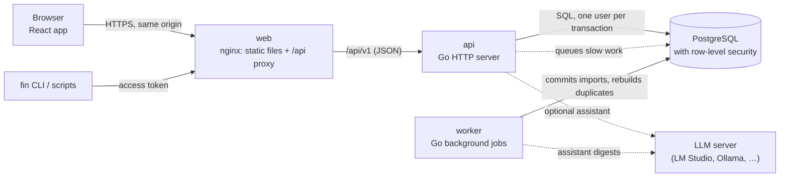
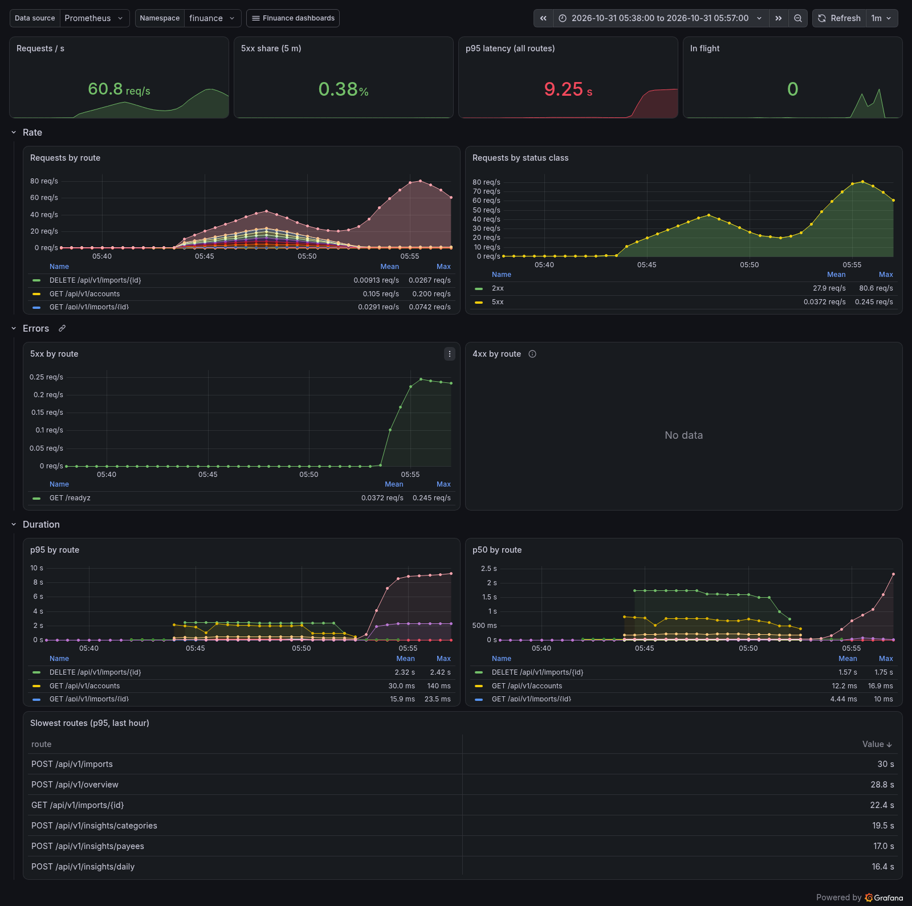

# Finuance

**Self-hosted personal finance for bank CSV exports.** Drop in the statements your bank lets you download and get one clean, searchable history across all your accounts, on your own server.

[](https://github.com/x2db736ac85h/Finuance/actions/workflows/ci.yml)
[](https://github.com/x2db736ac85h/Finuance/releases)
[](LICENSE)

<picture>
  <source media="(prefers-color-scheme: dark)" srcset="docs/screenshots/overview-dark.png">
  
</picture>

Finuance is a Go API and worker, PostgreSQL and a React app. I built it to replace a single-file prototype I had been using for my own statements, and to learn what it takes to run a small product properly: several users, real deployments, backups that have been restored, alerts, security scans.

## Why it might interest you

- **Tenant isolation is enforced by the database.** Every user-owned table has forced row-level security, and each request runs in a transaction bound to the signed-in user. A test fails the build if code outside the store layer talks to the database.
- **It is operated, not only written.** Helm charts, CloudNativePG and Argo CD; SLOs with burn-rate alerts; a restore drill (71 s to restore, measured); pod kills under load with no failed request; weekly ZAP scans and a Kubernetes rehearsal in CI.
- **An assistant that runs on your own model.** It answers questions through read-only tools, proposes changes you apply with a click, and every applied change can be undone.

## Features

- **Import any bank's CSV.** Encoding, delimiter, header row, date order and amount columns are detected and shown in a preview you can correct. A layout you mapped once is remembered. Tested with Pekao, PKO BP and mBank layouts.
- **One history across overlapping exports.** The same transaction in two files is kept once; your categories and notes survive deleting and re-importing a file.
- **A fast table.** Accent-insensitive search, per-column conditions (`>100`, `2025-03`, `!uber`), groups, CSV export, keyboard shortcuts; built for 100,000 rows.
- **Charts and a monthly overview.** Categories, cash flow, pace against last month, budgets, recurring payments, goals.
- **Rules and transfers.** Categorise by rule; transfers between your own accounts are found and left out of spending.
- **Share expenses.** Friends by one-time codes, shared groups with splits, balances and settling up. Members see copies of shared expenses, never each other's accounts.
- **Assistant.** Works with LM Studio, Ollama, or any OpenAI- or Anthropic-compatible server. Reads receipts from photos, writes digests, and shows exactly what it looked up.
- **Administration without access to money.** Administrators manage accounts, limits and model servers, and see counts, never financial data.
- **Scriptable.** Personal access tokens and `fin`, a command-line client.

The full list, with the filter language and how duplicates are recognised: [docs/features.md](docs/features.md).

<picture>
  <source media="(prefers-color-scheme: dark)" srcset="docs/screenshots/assistant-dark.png">
  
</picture>

## Tech stack

| | |
|---|---|
| Backend | Go (standard `net/http`), API specified first in [OpenAPI](api/openapi.yaml) with generated server and client code, `pgx` + `sqlc`, `goose` migrations, [River](https://riverqueue.com/) background jobs |
| Data | PostgreSQL 18 with row-level security; money as integer minor units |
| Frontend | React, TypeScript, Vite, a typed client generated from the same OpenAPI file |
| Deployment | Docker Compose; Helm, CloudNativePG, Argo CD and Sealed Secrets on Kubernetes |
| Observability | Prometheus metrics, OpenTelemetry traces, Grafana dashboards and alert rules as code |
| Testing and security | Go tests against a real PostgreSQL, fuzzing, Vitest, Playwright, axe, k6, Trivy, gitleaks, govulncheck, OWASP ZAP, OpenVAS |

## Architecture



One Go binary runs as the API server, the background worker, the migration step and the admin CLI. PostgreSQL holds everything, the job queue included, so there is one thing to back up. More in [docs/ARCHITECTURE.md](docs/ARCHITECTURE.md).

## Quick start

You need Docker with Compose, Node 22 and GNU Make.

```sh
git clone https://github.com/x2db736ac85h/Finuance.git
cd Finuance
make up
```

Open http://localhost:8000, sign up, and press **Load demo data**. `make up` creates `.env` from [`.env.example`](.env.example); those passwords are for local development only, and every port is bound to `127.0.0.1`. `make down` stops the stack and keeps the database.

To run a released version instead of building, or to deploy on Kubernetes, see [docs/deploying.md](docs/deploying.md).

## Design decisions

Each of the main choices has a short record of the context, the decision and what it costs ([36 so far](docs/adr/)). A few that shaped the code:

- **Row-level security, forced, as the second line of defence** behind the application's own filters ([ADR 0007](docs/adr/0007-multi-tenancy-rls.md)).
- **Money is `int64` minor units, never floating point**, and a CI check keeps floats out of the money path ([ADR 0004](docs/adr/0004-money-minor-units.md)).
- **Jobs are enqueued in the same transaction as the change that needs them**, so an import can't be saved without its processing job ([ADR 0006](docs/adr/0006-river-background-jobs.md)).
- **Server-side sessions with a custom-header CSRF check** instead of tokens in the browser ([ADR 0011](docs/adr/0011-sessions-and-csrf.md)).
- **The assistant never writes.** Its tools run in read-only transactions; a change is a proposal the user applies through the normal API, recorded so it can be undone ([ADR 0030](docs/adr/0030-ai-changes-and-undo.md)).
- **The new backend is tested against the prototype.** A harness runs the old app in a headless browser and records its results; the Go code must match them, except for a short list of [deliberate differences](testdata/oracle/ALLOWED_DIFFS.md).

## Operations



Finuance runs on a single-node k3s cluster at home, deployed by Argo CD from this repository. A release opens a pull request that changes the image tag; merging it deploys, reverting it rolls back.

- **SLOs:** 99.5 % of requests without a server error, 95 % of table and chart requests under 300 ms, with multi-window burn-rate alerts ([docs/SLO.md](docs/SLO.md)).
- **Backups:** continuous WAL archiving and daily base backups. The restore drill is scripted and measured: 71 s to a working instance, at most 96 s of data lost.
- **Load:** the latency SLO holds up to about 77 table requests per second on that machine. The first load test failed 29 % of its requests; [docs/perf.md](docs/perf.md) explains the cause (a readiness cascade over an undersized database) and the fix.
- **Security:** a [threat model](docs/THREAT-MODEL.md) tied to tests, images signed with cosign and shipped with SBOMs, scan results and accepted findings in [docs/security-scan.md](docs/security-scan.md).
- **Runbook:** bootstrap, deploy, rollback, restore and playbooks in [docs/RUNBOOK.md](docs/RUNBOOK.md).

## Testing and CI

| Layer | What it covers |
|---|---|
| Go unit and integration | HTTP tests against a real PostgreSQL, cross-user checks on every endpoint, a row-level-security suite, property tests for duplicate handling |
| Fuzzing | The CSV parser, money and date parsing and the filter language, nightly |
| Web | Component tests with Vitest and a mocked API |
| End to end | Playwright against a fresh Compose stack, accessibility checks with axe |
| Parity | The prototype and the new app on the same data, number by number ([report](docs/parity-report.md)) |
| Cluster rehearsal | Weekly on a kind cluster: install the charts, kill pods under load, restore a backup |
| Security | gitleaks, Trivy (images, repository, charts), `npm audit`, govulncheck on every push; ZAP weekly |

```sh
make check              # linters, unit tests, generated-code drift, private-data guard
make test-integration   # Go tests with PostgreSQL (needs Docker)
make test-e2e           # Playwright against a fresh stack
```

All test data is synthetic.

## Roadmap

Released: **0.4.1**. Next: a phone and touch layout (0.5), then more security checks in CI, signature verification in the cluster, a public demo and 1.0. Details in [docs/ROADMAP.md](docs/ROADMAP.md) and the [changelog](CHANGELOG.md).

## How it was built

I wrote the specification and the phase plan, made the decisions, reviewed each phase hands-on before merging it, and run the deployment. Most of the code was written by an AI coding agent ([Claude Code](https://claude.com/claude-code)) working from that plan, one phase per branch, with tests and documentation in the same change and CI green before review.

Nothing about that is hidden: the agent's instructions are in [`CLAUDE.md`](CLAUDE.md), the specification is [docs/PLAN.md](docs/PLAN.md), and the decisions are in the [ADRs](docs/adr/). The repository starts with a single commit because the earlier history contained personal details.

<details>
<summary><b>More screenshots</b> (made-up demo data; they follow your GitHub theme)</summary>

| | |
|---|---|
| <picture><source media="(prefers-color-scheme: dark)" srcset="docs/screenshots/import-dark.png"></picture> **Import window**: the header was found on line 26 of an mBank-style export. | <picture><source media="(prefers-color-scheme: dark)" srcset="docs/screenshots/filters-dark.png"></picture> **Search and filters**: chips for each condition, the column menu with its value checklist. |
| <picture><source media="(prefers-color-scheme: dark)" srcset="docs/screenshots/groups-dark.png"></picture> **Groups**: a drag selection, the quick bar with its total, and the Group column. | <picture><source media="(prefers-color-scheme: dark)" srcset="docs/screenshots/duplicates-dark.png"></picture> **Duplicates**: two exports of the same account, with the bank's re-labelled categories highlighted. |
| <picture><source media="(prefers-color-scheme: dark)" srcset="docs/screenshots/overview-dark.png"></picture> **Monthly overview**: a month in progress with its projection, highlights, budgets and recurring payments. | <picture><source media="(prefers-color-scheme: dark)" srcset="docs/screenshots/assistant-dark.png"></picture> **Assistant**: one lookup, exactly what the model received, and the answer (here from the built-in test model). |
| <picture><source media="(prefers-color-scheme: dark)" srcset="docs/screenshots/welcome-dark.png"></picture> **First start**: drop files or load a demo year. | |

</details>

## Documentation, security, license

- All documents, and who each is for: [docs/README.md](docs/README.md).
- Please report vulnerabilities privately, as described in [SECURITY.md](SECURITY.md).
- Issues and ideas are welcome; see [CONTRIBUTING.md](CONTRIBUTING.md).
- [MIT](LICENSE).
