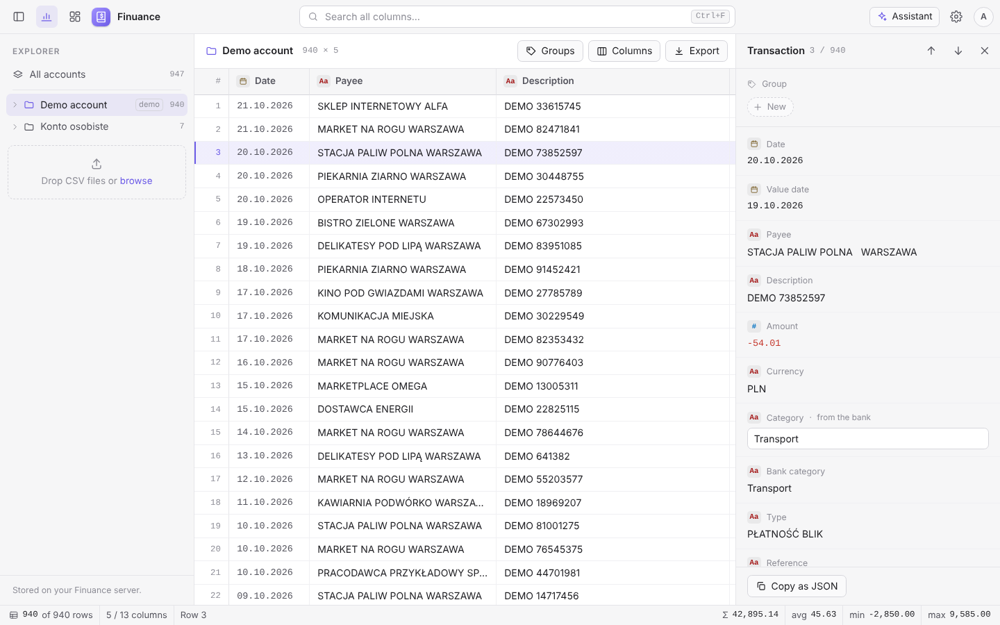
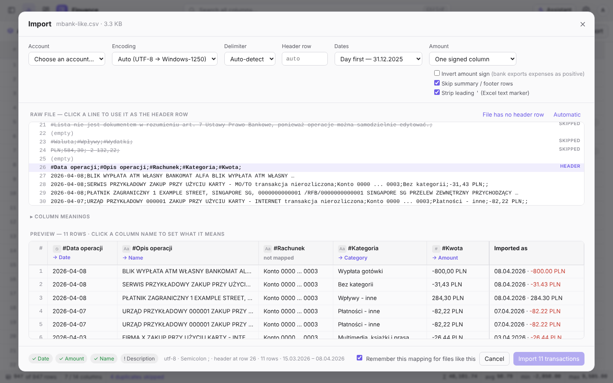
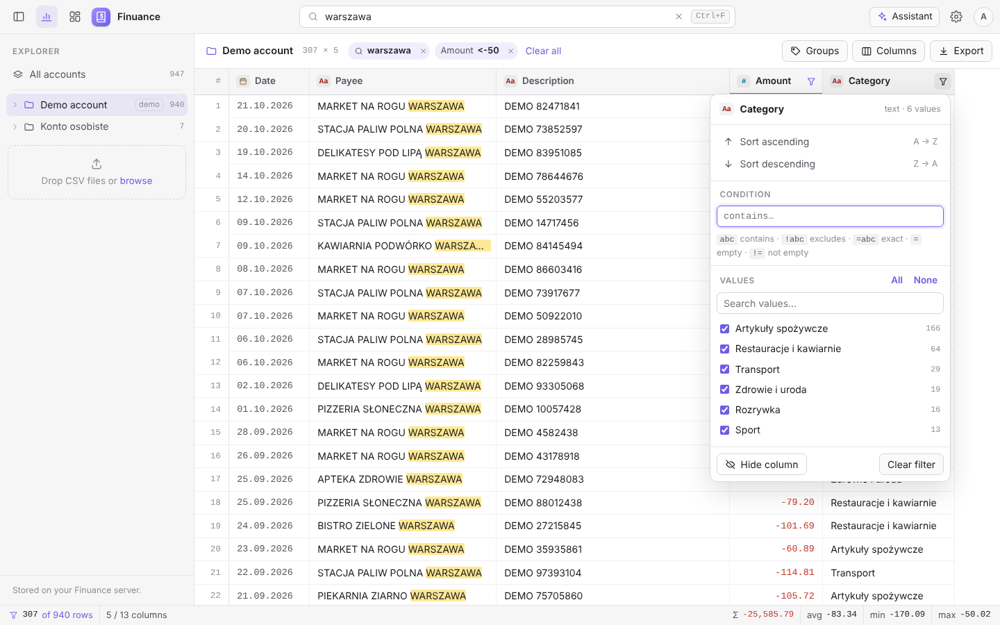
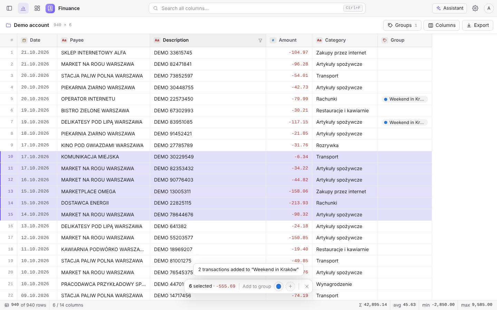
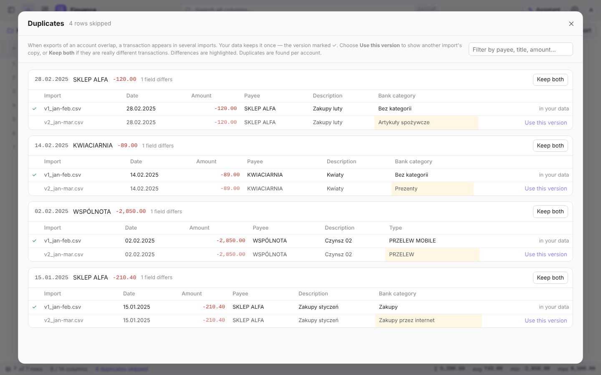
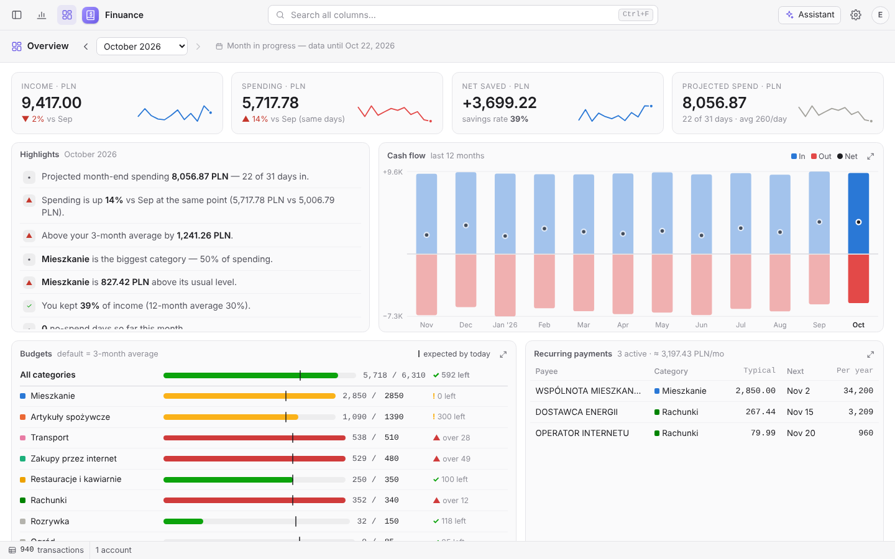
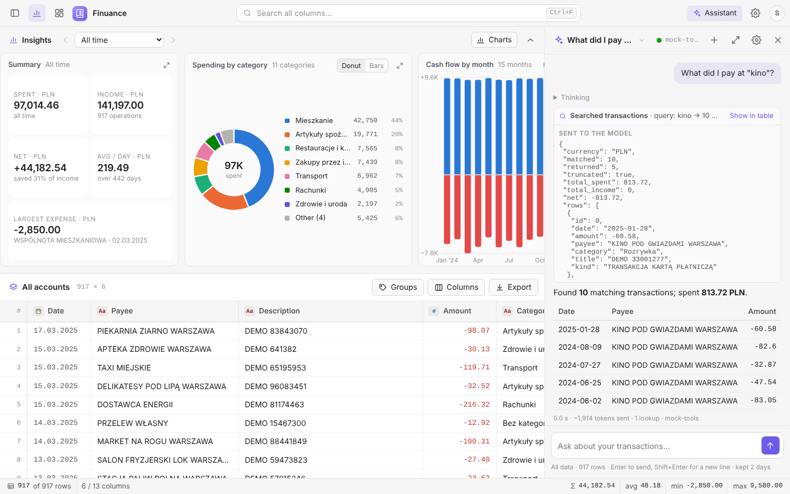
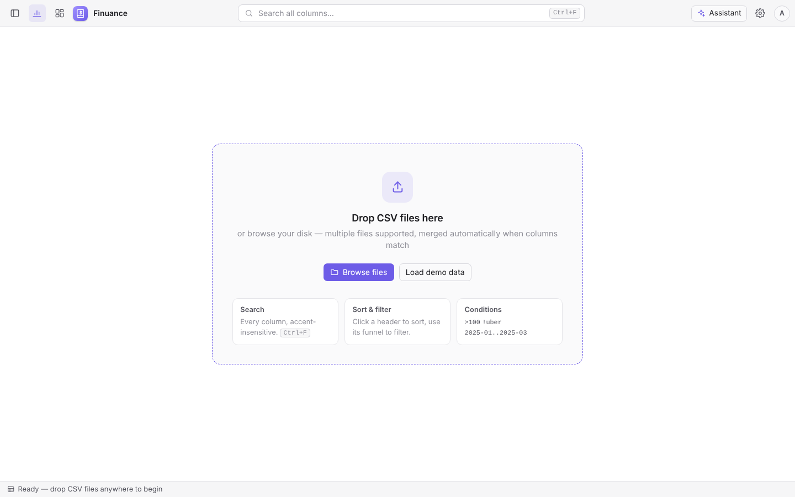
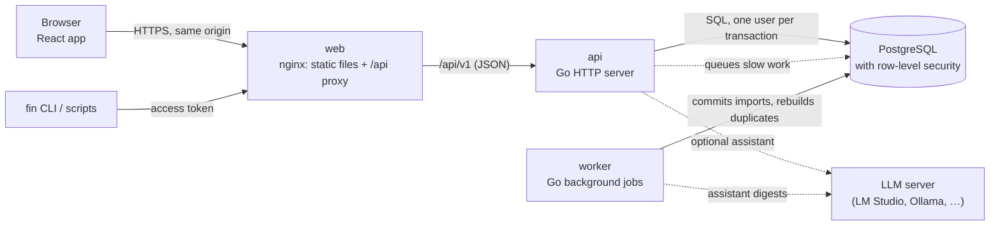

# Finuance

**Self-hosted, privacy-first personal finance for bank CSV exports.**

[](https://github.com/x2db736ac85h/Finuance/actions/workflows/ci.yml)
[](LICENSE)

Download your statements as CSV from your bank (Pekao, PKO BP and mBank are tested; any bank's export can be mapped), drop them into Finuance and get one clean, searchable history across all your accounts. Overlapping exports are de-duplicated, your own labels and notes survive re-imports, and everything runs on your own server: no bank logins, no third-party cloud.

<picture>
  <source media="(prefers-color-scheme: dark)" srcset="docs/screenshots/table-dark.png">
  
</picture>

> [!NOTE]
> 🚧 **Work in progress.** Finuance is being rebuilt from a single-file prototype (in [`legacy/`](legacy/)) into a multi-user web application, in 22 planned phases (0–21). **v0.1.0** (Phases 0–14) has every feature of the prototype: importing, the transaction table, groups, duplicate review, the insight charts, the monthly overview, the AI assistant and migration from the prototype's backups. **v0.2.0** (Phases 15–18) adds category rules and transfer detection, the Kubernetes deployment, monitoring with dashboards and alerts, an activity log and a demo mode, and runs on a homelab cluster. **v0.3.0** (Phase 19) adds an admin panel, colour themes, friends and shared groups. Phase 20, in progress, gives the assistant changes you can undo, receipts by photo, goals, digests and an advice library, and adds access tokens and the `fin` command line; then the public release (Phase 21). See [Status](#status).

## Contents

- [What you can do today](#what-you-can-do-today)
- [Screenshots](#screenshots)
- [Key concepts](#key-concepts)
- [Architecture](#architecture)
- [Quick start](#quick-start)
- [Deploying](#deploying)
- [Testing](#testing)
- [Status](#status)
- [How this project is built](#how-this-project-is-built)
- [Documentation](#documentation)
- [Security, contributing and license](#security-contributing-and-license)

## What you can do today

- **Import bank exports.** Drag and drop CSV files, or press ⌘/Ctrl O. An import window shows the raw file and a preview before anything is saved. The encoding (UTF-8 or Windows-1250), the delimiter, the header row (even after a long preamble, as in mBank exports), date order, amount columns (one signed column or separate debit/credit) and summary rows are detected for you, and every guess can be changed. A layout you have mapped once is remembered, so the next file from the same bank goes in with one click, or straight away with the fast path.
- **Keep one history across overlapping exports.** Import January–March and then February–April: the overlap is recognised and kept once. A duplicates window shows every version side by side, with the differences highlighted, and lets you pick a version or keep both.
- **Explore every transaction.** A fast, keyboard-friendly table built for histories of 100,000 rows and more:
  - accent-insensitive search (`platnosc` finds `PŁATNOŚĆ`);
  - per-column conditions (`>100`, `-50..50`, `2025-03`, `!uber`, `=`) and an Excel-style value checklist;
  - sorting, resizable and hideable columns;
  - CSV export of exactly what you see;
  - an inspector with every field, the bank's original row, the category and a note.
- **See where the money goes.** Six charts above the table follow its search, filters and period: a summary with the change against the previous period, spending by category, cash flow by month, the month's spending pace against earlier months, top payees and a daily spending calendar. Click a category, payee, month or day to filter the table; open any chart larger to see its numbers as a table.
- **Review each month.** An overview page shows the month's income, spending, net saved and projected spending against the previous month, with highlights in plain sentences, budgets per category (a default from your last three months, editable in place), recurring payments, a money-flow diagram from income to categories, the largest expenses, savings rate, spending by weekday and the account balance. Investment, yield-on-cost and FI/RE cards track values you enter by hand.
- **Ask questions in plain language.** An optional assistant panel (⌘/Ctrl J) answers questions such as "how much did I spend on restaurants in March?" in English or Polish. It looks your data up through read-only tools (search, totals, month overview, recurring payments) and shows every lookup, with *Show in table* to see the same rows in the list. It can also propose changes, such as categorising matching rows or creating a rule, which only happen when you press *Apply*. It works with any model your admin connects: LM Studio, Ollama, vLLM or another OpenAI- or Anthropic-compatible server, local or in the cloud, and uses the model's thinking when it has it. Cloud services need your consent first; chats are deleted after 2 days unless you choose otherwise.
- **Organise categories and let rules do the sorting.** Rename, merge or delete categories (re-imports follow). Turn any search and filters into a rule ("payee contains Biedronka → Groceries"), with a live preview of what it matches; rules apply in order to every import, and categories you set by hand always win. After you categorise the same payee by hand a few times, Finuance suggests a rule. Set a category for many rows at once from the selection.
- **Recognise transfers between your own accounts.** Matching amounts going out of one account and into another within three days are marked as transfers: shown in the table with a badge (hide them with one click), and left out of the charts, the overview and the assistant's totals. You can unpair or mark them by hand.
- **Group transactions.** Select rows by dragging, Shift-click or ⌘/Ctrl-click, then add them to a colour-coded group such as "Italy trip". A quick bar shows the count and the total of the selection. Groups filter the table and are kept when you delete and re-import a file. Each group has its own report (totals, span, spending per day, categories, top payees, an optional budget) and a CSV export.
- **Keep cash too.** A cash account holds money that never reaches a bank file: add its expenses by hand (Add or `N`), change or delete them later. Rules categorise them like imported rows, and a cash withdrawal pairs with the cash it put in the wallet.
- **Add friends.** Show a short code (valid for the hour) or enter someone's in Settings → Friends. Friends see each other's display name, never the e-mail address; a bell in the title bar says when someone added or removed you, invited you or settled up.
- **Share a trip with friends.** Share a group from the Groups menu (or start an empty one in the Shared tab, `S`), invite friends, and each of you adds expenses: your own transactions put into the group, cash, or typed straight into the group. Friends see a copy of each shared expense (date, amount, payee, category, note, who paid), never your accounts or the bank's description. Split equally, by shares or as exact amounts; balances say who owes whom in as few payments as possible, and *Settle up* records a payment. The Shared tab lists your trips and groups over the years with per-day costs and "next time" hints. See [docs/sharing.md](docs/sharing.md).
- **Move over from the prototype.** Settings → Data reads a backup of the single-file app (a locked one is decrypted in your browser) and brings its files, groups and labels, duplicate decisions, budgets, investments and chats, with a report of anything that didn't match. See [docs/migration.md](docs/migration.md).
- **Share an instance.** Several people can use one server. Each person's data is isolated in the database itself (row-level security), not just in the application code.
- **Run the instance for others.** Administrators create and manage accounts (one-time passwords, disable, reset), set limits, choose where a new user's view starts, switch parts of the app off and see usage, all without seeing anyone's transactions. See [docs/admin.md](docs/admin.md).
- **Pick a colour theme.** Indigo, Fjord, Grove or Ember, each in a dark and a light variant, all readable to WCAG AA; administrators can make and approve more.
- **Let the assistant do the typing** (🚧 Phase 20). Besides answering, it proposes changes: categories, groups and rules, a budget, a cash expense, sharing or a new split, a savings goal. You apply each with one click, or let chosen kinds apply themselves (never more than 50 rows); everything it changed is marked ✦ and can be undone from the card or Settings → Activity.
- **Snap a receipt** (🚧 Phase 20). With a model that reads images, photograph a receipt in the panel: the assistant finds the payment and proposes the receipt in its note, or proposes the expense. The photo is shrunk and stripped of its location in your browser. A card payment typed in before the bank's file arrives is merged into the bank's row when it does.
- **Set goals** (🚧 Phase 20): save an amount by a date, or spend a percentage less on a category than before; the Overview's *Goals* card shows each against a steady pace.
- **Get a digest** (🚧 Phase 20): a short daily or weekly summary written in the background (budgets and goals that need attention, payments due, changes worth making), behind the bell, with its proposals waiting for you.
- **Read the advice library** (🚧 Phase 20): short articles your admin publishes; the assistant uses them for general money questions and names them in its answer.
- **Script it** (🚧 Phase 20): personal access tokens (read only, or read and write) and `fin`, a command line for accounts, transactions, imports, the overview and the assistant, with table, CSV or JSON output ([docs/cli.md](docs/cli.md)).
- **See what happened in your account.** Settings → Activity lists sign-ins (failed ones too), password changes, revoked sessions, imports, deletions, exports and applied assistant proposals, with the address and browser of each, for a year.

Coming next (🚧): v0.4.0 with Phase 20 above; then a public demo and v1.0.0. See [Status](#status).

## Screenshots

All screenshots use made-up demo data. They follow your GitHub theme (dark or light).

| | |
|---|---|
| <picture><source media="(prefers-color-scheme: dark)" srcset="docs/screenshots/import-dark.png"></picture> **Import window**: the header was found on line 26 of an mBank-style export. | <picture><source media="(prefers-color-scheme: dark)" srcset="docs/screenshots/filters-dark.png"></picture> **Search and filters**: chips for each condition, the column menu with its value checklist. |
| <picture><source media="(prefers-color-scheme: dark)" srcset="docs/screenshots/groups-dark.png"></picture> **Groups**: a drag selection, the quick bar with its total, and the Group column. | <picture><source media="(prefers-color-scheme: dark)" srcset="docs/screenshots/duplicates-dark.png"></picture> **Duplicates**: two exports of the same account, with the bank's re-labelled categories highlighted. |
| <picture><source media="(prefers-color-scheme: dark)" srcset="docs/screenshots/overview-dark.png"></picture> **Monthly overview**: a month in progress with its projection, highlights, budgets and recurring payments. | <picture><source media="(prefers-color-scheme: dark)" srcset="docs/screenshots/assistant-dark.png"></picture> **Assistant**: one lookup, exactly what the model received, and the answer (here from the built-in test model). |
| <picture><source media="(prefers-color-scheme: dark)" srcset="docs/screenshots/welcome-dark.png"></picture> **First start**: drop files or load a demo year. | |

## Key concepts

**Accounts and imports.** An *account* is one bank account. An *import* is one CSV file brought into an account. The original file is stored, so an import can be downloaded again, re-mapped and reprocessed, or deleted (which removes its transactions unless another import also contains them).

**Import profiles.** When you confirm how a file's columns map to Finuance's fields (date, amount, payee, …), that mapping is remembered for that column layout. The next file with the same header uses it automatically, and a short label (`b1`, `b2`, …) tells layouts apart in the import history.

**Duplicates are found per account.** Each transaction gets a fingerprint from the bank's reference number and amount, or, when there is no reference, from its date, amount, payee and title. Within one account, a fingerprint found in two imports is one transaction; identical twins inside one file are counted and kept apart. The same purchase in two *different* accounts is never merged; that is usually a transfer between your own accounts.

**Your edits survive re-imports.** Categories you set, notes and group labels are stored against the transaction's fingerprint, not against a database row. Delete an import, import the file again, and your edits come back.

**Views and the filter language.** *All accounts* and every single account are separate views, each remembering its own columns, widths, sort and period. Filters are written per column:

| Write | Means |
|---|---|
| `kino` · `!kino` | contains · doesn't contain (accent- and case-insensitive) |
| `=Rachunki` · `=` · `!=` | exactly · empty · not empty |
| `>100` · `<=0` · `-50..50` | number comparisons and ranges |
| `2025-03` · `>=01.03.2025` · `01.2025..03.2025` | dates: a month, a day, a range |

**Categories, rules and transfers.** A transaction's category comes from the bank, from a rule, or from you, in rising order of priority: rules are re-applied from scratch whenever they change, and never touch a category you set by hand. Transfers between your own accounts are detected after every import and left out of spending totals.

**Groups** are your own colour-coded labels (one per transaction), independent of the bank's categories. They work like any other column: filter, sort, export.

**Privacy by design.** Data stays on your server. The database enforces that every query only sees the signed-in user's rows (PostgreSQL row-level security), passwords are hashed with Argon2id, sessions are server-side, the web app runs under a strict Content Security Policy, and an append-only activity log records every sign-in and change to your data. The optional AI assistant only reads data through read-only tools, sends a model only what it looks up (and a receipt photo you attach), and talks to a model your admin connects; a cloud model needs each user's consent. Details are in the [threat model](docs/THREAT-MODEL.md).

## Architecture



- **One Go binary** runs as the API server (`finuance serve`), the background worker (`finuance worker`), the migration step and the admin CLI. The API is specified first in [`api/openapi.yaml`](api/openapi.yaml); server code and the web app's typed client are generated from it.
- **PostgreSQL** holds everything: users, accounts, imports with their original files, transactions, and the job queue ([River](https://riverqueue.com/)). Every request runs in a transaction that is tied to the signed-in user, and row-level security makes the database refuse other users' rows.
- **The web app** (React, TypeScript, Vite) recreates the prototype's interface, with its keyboard shortcuts, dark and light themes and adjustable interface size.
- **The import pipeline** decodes, shapes and parses the file entirely in Go ([`backend/internal/ingest`](backend/internal/ingest)), and stages every row with its fingerprint. Committing an import runs as a background job: one set of SQL statements links rows to existing transactions or creates new ones.
- **Money** is stored as integer minor units (grosze for PLN) with its currency, never as floating point.

More detail: [docs/ARCHITECTURE.md](docs/ARCHITECTURE.md) (components, data model, request flow) and the [architecture decision records](docs/adr/).

## Quick start

**Run a release** (Docker with Compose; nothing to build):

```sh
mkdir finuance && cd finuance
curl -fsSLO https://github.com/x2db736ac85h/Finuance/releases/latest/download/compose.prod.yaml
curl -fsSL -o .env https://github.com/x2db736ac85h/Finuance/releases/latest/download/finuance.env.example
$EDITOR .env                  # passwords; FINUANCE_PUBLIC_ORIGIN=http://localhost:8000 to try it locally
docker compose --env-file .env -f compose.prod.yaml up -d
docker compose --env-file .env -f compose.prod.yaml exec -T api /finuance admin create-user --email you@example.com --password-stdin
```

Then open http://localhost:8000 (see [Deploying](#deploying) for TLS).

**Build from source** (development). Requirements: Docker with Compose, Node 22 (to build the web app) and GNU Make. Go 1.27 is only needed for development outside Docker.

```sh
git clone https://github.com/x2db736ac85h/Finuance.git
cd Finuance
make up                       # builds and starts db → migrate → api + worker → web
open http://localhost:8000    # sign up, then press "Load demo data"
```

`make up` creates `.env` from [`.env.example`](.env.example) on the first run. Those passwords are for local development only. `make down` stops everything and keeps the database; `make db-reset` wipes it.

Useful while running locally:

```sh
make logs                                 # follow the logs
curl -s localhost:8080/readyz             # readiness (database reachable, migrations current)
curl -s localhost:9090/metrics | head     # Prometheus metrics (admin port, dev only)
make up-observability                     # the stack plus Grafana (localhost:3000) with the dashboards, Prometheus and traces
make dev-api & make dev-web               # API on :8080 and the Vite dev server on :5173 with hot reload
```

## Deploying

**Docker Compose.** [`deploy/compose/compose.prod.yaml`](deploy/compose/compose.prod.yaml) runs the released images (`ghcr.io/x2db736ac85h/finuance-api` and `finuance-web`, amd64 and arm64, signed with cosign). It needs only itself and a `.env` ([`.env.prod.example`](deploy/compose/.env.prod.example), attached to every [release](https://github.com/x2db736ac85h/Finuance/releases) as `finuance.env.example`). Only the web container is published, on `127.0.0.1:8000` by default; the database, the API and the admin ports stay on the internal Compose network.

- Put a reverse proxy with TLS in front of port 8000 (Caddy, Traefik, nginx) and set `FINUANCE_PUBLIC_ORIGIN` to its URL. Production mode sends secure cookies only, so the app works over HTTPS, or over plain http on `localhost` (e.g. through an ssh tunnel to a server).
- Sign-up is off by default. Create accounts with the admin CLI: `docker compose … exec -T api /finuance admin create-user --email you@example.com --password-stdin` (it reads the password from standard input), or set `FINUANCE_ALLOW_SIGNUP=true`.
- Demo mode (`FINUANCE_DEMO_MODE=true`): visitors start their own throwaway demo user from the sign-in page ("Try the demo"), deleted with its data after 24 hours. Sign-up is off, uploads are limited to 2 MiB, the migration from the single-file app is refused, at most 5 demo users start per hour and address, and the assistant stays off unless `FINUANCE_DEMO_ASSISTANT=true` (then 10 questions per visitor). `make test-e2e-demo` runs it with [`compose.demo.yaml`](deploy/compose/compose.demo.yaml).
- Verify an image: `cosign verify ghcr.io/x2db736ac85h/finuance-api:<version> --certificate-identity-regexp 'https://github.com/x2db736ac85h/Finuance/' --certificate-oidc-issuer https://token.actions.githubusercontent.com`.
- Back up the database volume regularly. It holds your original CSV files too.

**Kubernetes with Helm, CloudNativePG and Argo CD** (rehearsed weekly in CI on a kind cluster, including a backup restore and pod kills; running on a reference environment, single-node k3s with a small NVIDIA GPU, since Phase 18):
- The app chart [`deploy/helm/finuance`](deploy/helm/finuance) runs the api (with an HPA), the worker, the web front end, a migrations Job before every upgrade, and NetworkPolicies.
- The database chart [`deploy/k8s/db`](deploy/k8s/db) runs a CloudNativePG cluster, with WAL archiving and daily backups to S3-compatible storage.
- [`deploy/k8s/argocd`](deploy/k8s/argocd) is an Argo CD app-of-apps with Sealed Secrets.
- A release opens a pull request that bumps the image tag in [`deploy/environments/homelab`](deploy/environments/homelab), and merging it deploys.
- [`deploy/k8s/observability`](deploy/k8s/observability) holds six Grafana dashboards and the alert rules as code: SLO burn rates ([docs/SLO.md](docs/SLO.md)), failing jobs and imports, PostgreSQL, WAL archiving and backup age, failures at the ingress, with an e-mail receiver. The homelab runs it with kube-prometheus-stack and Tempo, all through Argo CD.
- Single-node k3s step by step (Tailscale certificates, an in-cluster backup bucket, the model server on the host, the per-machine values in a private repository, an image admission policy): [RUNBOOK](docs/RUNBOOK.md#bootstrap-on-single-node-k3s). Measured there: restore in 71 s (RPO 96 s), no failed request while pods are killed, the latency SLO held up to about 77 table requests per second, an OpenVAS scan with nothing above "Log" ([docs/perf.md](docs/perf.md), [docs/security-scan.md](docs/security-scan.md)).

Operating it: [docs/RUNBOOK.md](docs/RUNBOOK.md).

## Testing

```sh
make check              # everything that runs on each commit: linters, Go and web unit tests,
                        # generated-code drift, fixture drift, private-data guard
make test-integration   # all Go tests, including PostgreSQL ones (testcontainers; needs Docker)
make test-e2e           # Playwright end-to-end tests against a fresh Compose stack
make test-e2e-demo      # the demo-mode specs against a demo-mode stack
make helm-lint          # render and validate the charts, dashboards and alert rules (promtool unit tests)
make loadtest           # k6 against the running stack (after make loadtest-seed); PROFILE=smoke|load|ramp
make zap                # OWASP ZAP baseline and signed-in API scan against the running stack
tools/homelab-drill.sh   # restore drill, pod kills under load and SSE timing on a cluster (restore|podkill|sse)
tools/openvas-scan.sh    # OpenVAS (Greenbone) against a deployed instance, and a port scan from the LAN
```

What the tests cover:
- **Go:** unit tests, HTTP tests against a real PostgreSQL with cross-user (tenancy) checks, a row-level-security suite, property tests for duplicate handling, and fuzz targets for the CSV parser, money and date parsing and the filter language (nightly in CI).
- **Web:** component tests with Vitest and MSW.
- **End to end:** Playwright specs for every screen and flow against a fresh Compose stack, accessibility checks with axe, and a parity harness that runs the prototype next to the new app on the same data ([report](docs/parity-report.md)).
- **Legacy oracle:** [`tools/legacy-oracle`](tools/legacy-oracle) runs the original prototype in a headless browser and records its results (parsing, de-duplication, filters, …) on [synthetic fixtures](testdata/fixtures). The new backend is tested against those recordings, so it behaves like the prototype. The few deliberate differences are listed in [`testdata/oracle/ALLOWED_DIFFS.md`](testdata/oracle/ALLOWED_DIFFS.md).

All test data is synthetic, or real exports passed through the [anonymiser](backend/cmd/anonymize) and reviewed before commit.

CI ([`.github/workflows/ci.yml`](.github/workflows/ci.yml)) runs all of this on every push, plus a secret scan, Trivy scans of the images and the repository (HIGH and CRITICAL fail the build), `npm audit` and Go vulnerability checks. Every week, and on deployment changes, a [kind cluster rehearsal](.github/workflows/k8s-rehearsal.yml) installs the charts, kills pods under load and restores a backup; the [weekly workflow](.github/workflows/weekly.yml) runs the ZAP scans, a k6 smoke test against the SLOs and the demo-mode tests.

Performance notes and measurements, including the load test: [docs/perf.md](docs/perf.md). Security scan results: [docs/security-scan.md](docs/security-scan.md).

## Status

| Phase | | Status |
|---|---|---|
| 0–2 | Repository, legacy extraction and oracle, backend skeleton | ✅ done |
| 3–4 | Import engine, database schema with row-level security | ✅ done |
| 5–7 | Sign-in and sessions, import pipeline, transaction query API | ✅ done |
| 8–10 | Web app foundation, import window, table with groups and duplicates | ✅ done |
| 11 | Insights: charts, period picker, chart windows | ✅ done |
| 12 | Monthly overview: KPIs, budgets, recurring payments, money flow | ✅ done |
| 13 | AI assistant with read-only tools on your own model | ✅ done |
| 14 | Migration from the prototype's backups, accessibility, v0.1.0 | ✅ done |
| 15 | Category rules, transfer detection, group reports, assistant actions | ✅ done |
| 16 | Kubernetes deployment: Helm, CloudNativePG, Argo CD, rehearsed in CI | ✅ done |
| 17 | Observability, load tests, activity log, security scans, demo mode | ✅ done |
| 18 | Homelab rollout on a reference environment: GitOps, TLS, backups and restore drill, monitoring and alerts, load test, OpenVAS, image admission, v0.2.0 | ✅ done |
| 19 | Admin panel, colour themes, friends, shared groups with balances and a Shared tab, v0.3.0 | ✅ done |
| 20 | Assistant that can act (with undo), receipts by photo, goals, digests, advice library, access tokens and the `fin` CLI | 🚧 in progress |
| 21 | Public release: privacy clean-up, security scanning, signed images, public demo, documentation, v1.0.0 | 🚧 planned |

The detailed task list and every decision taken so far are in [docs/PROGRESS.md](docs/PROGRESS.md); the full specification is [docs/PLAN.md](docs/PLAN.md).

## How this project is built

Finuance is developed by an AI coding agent ([Claude Code](https://claude.com/claude-code)) working from a written plan, phase by phase, with a human in the loop:

1. The agent proposes each phase's tasks and open questions. Our Product Engineer answers them and approves the plan.
2. The agent builds the phase on its own branch: code, tests and documentation together, with `make check` before every commit.
3. CI must be green. Our Product Engineer then reviews the phase's *gate* (hands-on checks, screenshots, measurements) before it is merged into `main`.

The instructions the agent works from are part of the repository: [`CLAUDE.md`](CLAUDE.md) (plus one per area in `backend/` and `web/`) and [`.claude/commands`](.claude/commands). Decisions are recorded in [docs/PROGRESS.md](docs/PROGRESS.md) and [ADRs](docs/adr/).

## Documentation

Start with [docs/README.md](docs/README.md), which lists every document and who it is for. The most useful ones:

- [Architecture](docs/ARCHITECTURE.md): components, data model, row-level security, request flow
- [Threat model](docs/THREAT-MODEL.md): what is protected, against whom, and how; [security scan results](docs/security-scan.md)
- [Runbook](docs/RUNBOOK.md): running it on Kubernetes, backups and restores; [SLOs](docs/SLO.md)
- [Architecture decisions](docs/adr/): why the main choices were made
- [API specification](api/openapi.yaml): OpenAPI 3
- [Shared groups](docs/sharing.md), [administration](docs/admin.md), [the assistant](docs/assistant.md), [the `fin` command line](docs/cli.md)
- [Moving over from the single-file app](docs/migration.md), [accessibility](docs/a11y.md), [parity report](docs/parity-report.md), [changelog](CHANGELOG.md)

## Security, contributing and license

- **Security:** please report vulnerabilities privately, as described in [SECURITY.md](SECURITY.md).
- **Contributing:** see [CONTRIBUTING.md](CONTRIBUTING.md). Issues and ideas are welcome; pull requests are not accepted yet while the rebuild is in progress.
- **License:** [MIT](LICENSE).
