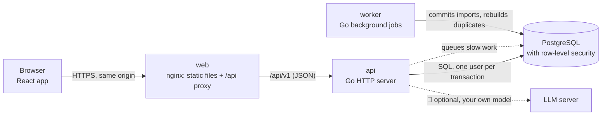

# Finuance

**Self-hosted, privacy-first personal finance for bank CSV exports.**

[](https://github.com/x2db736ac85h/Finuance/actions/workflows/ci.yml)
[](LICENSE)

Download your statements as CSV from your bank (Pekao, PKO BP and mBank are tested; any bank's export can be mapped), drop them into Finuance and get one clean, searchable history across all your accounts. Overlapping exports are de-duplicated, your own labels and notes survive re-imports, and everything runs on your own server: no bank logins, no third-party cloud.

<picture>
  <source media="(prefers-color-scheme: dark)" srcset="docs/screenshots/table-dark.png">
  
</picture>

> [!NOTE]
> 🚧 **Work in progress.** Finuance is being rebuilt from a single-file prototype (in [`legacy/`](legacy/)) into a multi-user web application, in 18 planned phases. **Phases 0–13 are done**: importing, the transaction table, groups, duplicate review, the insight charts, the monthly overview and the AI assistant all work today. Migration from the prototype and the Kubernetes deployment are still under construction. See [Status](#status).

## Contents

- [What you can do today](#what-you-can-do-today)
- [Screenshots](#screenshots)
- [Key concepts](#key-concepts)
- [Architecture](#architecture)
- [Quick start](#quick-start)
- [Deploying](#deploying)
- [Testing](#testing)
- [Status](#status)
- [How this project is built](#how-this-project-is-built)
- [Documentation](#documentation)
- [Security, contributing and license](#security-contributing-and-license)

## What you can do today

- **Import bank exports.** Drag and drop CSV files, or press ⌘/Ctrl O. An import window shows the raw file and a preview before anything is saved. The encoding (UTF-8 or Windows-1250), the delimiter, the header row (even after a long preamble, as in mBank exports), date order, amount columns (one signed column or separate debit/credit) and summary rows are detected for you, and every guess can be changed. A layout you have mapped once is remembered, so the next file from the same bank goes in with one click, or straight away with the fast path.
- **Keep one history across overlapping exports.** Import January–March and then February–April: the overlap is recognised and kept once. A duplicates window shows every version side by side, with the differences highlighted, and lets you pick a version or keep both.
- **Explore every transaction.** A fast, keyboard-friendly table built for histories of 100,000 rows and more:
  - accent-insensitive search (`platnosc` finds `PŁATNOŚĆ`);
  - per-column conditions (`>100`, `-50..50`, `2025-03`, `!uber`, `=`) and an Excel-style value checklist;
  - sorting, resizable and hideable columns;
  - CSV export of exactly what you see;
  - an inspector with every field, the bank's original row, the category and a note.
- **See where the money goes.** Six charts above the table follow its search, filters and period: a summary with the change against the previous period, spending by category, cash flow by month, the month's spending pace against earlier months, top payees and a daily spending calendar. Click a category, payee, month or day to filter the table; open any chart larger to see its numbers as a table.
- **Review each month.** An overview page shows the month's income, spending, net saved and projected spending against the previous month, with highlights in plain sentences, budgets per category (a default from your last three months, editable in place), recurring payments, a money-flow diagram from income to categories, the largest expenses, savings rate, spending by weekday and the account balance. Investment, yield-on-cost and FI/RE cards track values you enter by hand.
- **Ask questions in plain language.** An optional assistant panel (⌘/Ctrl J) answers questions such as "how much did I spend on restaurants in March?" in English or Polish. It looks your data up through read-only tools (search, totals, month overview, recurring payments) and shows every lookup, with *Show in table* to see the same rows in the list. It works with any model your admin connects: LM Studio, Ollama, vLLM or another OpenAI- or Anthropic-compatible server, local or in the cloud, and uses the model's thinking when it has it. Cloud services need your consent first; chats are deleted after 2 days unless you choose otherwise.
- **Group transactions.** Select rows by dragging, Shift-click or ⌘/Ctrl-click, then add them to a colour-coded group such as "Italy trip". A quick bar shows the count and the total of the selection. Groups filter the table and are kept when you delete and re-import a file.
- **Share an instance.** Several people can use one server. Each person's data is isolated in the database itself (row-level security), not just in the application code.

Coming next (🚧): migration from the prototype's backups, category rules and transfer detection, and a Kubernetes deployment. See [Status](#status).

## Screenshots

All screenshots use made-up demo data. They follow your GitHub theme (dark or light).

| | |
|---|---|
| <picture><source media="(prefers-color-scheme: dark)" srcset="docs/screenshots/import-dark.png"></picture> **Import window**: the header was found on line 26 of an mBank-style export. | <picture><source media="(prefers-color-scheme: dark)" srcset="docs/screenshots/filters-dark.png"></picture> **Search and filters**: chips for each condition, the column menu with its value checklist. |
| <picture><source media="(prefers-color-scheme: dark)" srcset="docs/screenshots/groups-dark.png"></picture> **Groups**: a drag selection, the quick bar with its total, and the Group column. | <picture><source media="(prefers-color-scheme: dark)" srcset="docs/screenshots/duplicates-dark.png"></picture> **Duplicates**: two exports of the same account, with the bank's re-labelled categories highlighted. |
| <picture><source media="(prefers-color-scheme: dark)" srcset="docs/screenshots/overview-dark.png"></picture> **Monthly overview**: a month in progress with its projection, highlights, budgets and recurring payments. | <picture><source media="(prefers-color-scheme: dark)" srcset="docs/screenshots/assistant-dark.png"></picture> **Assistant**: one lookup, exactly what the model received, and the answer (here from the built-in test model). |
| <picture><source media="(prefers-color-scheme: dark)" srcset="docs/screenshots/welcome-dark.png"></picture> **First start**: drop files or load a demo year. | |

## Key concepts

**Accounts and imports.** An *account* is one bank account. An *import* is one CSV file brought into an account. The original file is stored, so an import can be downloaded again, re-mapped and reprocessed, or deleted (which removes its transactions unless another import also contains them).

**Import profiles.** When you confirm how a file's columns map to Finuance's fields (date, amount, payee, …), that mapping is remembered for that column layout. The next file with the same header uses it automatically, and a short label (`b1`, `b2`, …) tells layouts apart in the import history.

**Duplicates are found per account.** Each transaction gets a fingerprint from the bank's reference number and amount, or, when there is no reference, from its date, amount, payee and title. Within one account, a fingerprint found in two imports is one transaction; identical twins inside one file are counted and kept apart. The same purchase in two *different* accounts is never merged; that is usually a transfer between your own accounts.

**Your edits survive re-imports.** Categories you set, notes and group labels are stored against the transaction's fingerprint, not against a database row. Delete an import, import the file again, and your edits come back.

**Views and the filter language.** *All accounts* and every single account are separate views, each remembering its own columns, widths, sort and period. Filters are written per column:

| Write | Means |
|---|---|
| `kino` · `!kino` | contains · doesn't contain (accent- and case-insensitive) |
| `=Rachunki` · `=` · `!=` | exactly · empty · not empty |
| `>100` · `<=0` · `-50..50` | number comparisons and ranges |
| `2025-03` · `>=01.03.2025` · `01.2025..03.2025` | dates: a month, a day, a range |

**Groups** are your own colour-coded labels (one per transaction), independent of the bank's categories. They work like any other column: filter, sort, export.

**Privacy by design.** Data stays on your server. The database enforces that every query only sees the signed-in user's rows (PostgreSQL row-level security), passwords are hashed with Argon2id, sessions are server-side, and the web app runs under a strict Content Security Policy. The optional AI assistant only reads data through read-only tools, sends a model only what it looks up, and talks to a model your admin connects; a cloud model needs each user's consent. Details are in the [threat model](docs/THREAT-MODEL.md).

## Architecture



- **One Go binary** runs as the API server (`finuance serve`), the background worker (`finuance worker`), the migration step and the admin CLI. The API is specified first in [`api/openapi.yaml`](api/openapi.yaml); server code and the web app's typed client are generated from it.
- **PostgreSQL** holds everything: users, accounts, imports with their original files, transactions, and the job queue ([River](https://riverqueue.com/)). Every request runs in a transaction that is tied to the signed-in user, and row-level security makes the database refuse other users' rows.
- **The web app** (React, TypeScript, Vite) recreates the prototype's interface, with its keyboard shortcuts, dark and light themes and adjustable interface size.
- **The import pipeline** decodes, shapes and parses the file entirely in Go ([`backend/internal/ingest`](backend/internal/ingest)), and stages every row with its fingerprint. Committing an import runs as a background job: one set of SQL statements links rows to existing transactions or creates new ones.
- **Money** is stored as integer minor units (grosze for PLN) with its currency, never as floating point.

More detail: [docs/ARCHITECTURE.md](docs/ARCHITECTURE.md) (components, data model, request flow) and the [architecture decision records](docs/adr/).

## Quick start

Requirements: Docker with Compose, Node 22 (to build the web app) and GNU Make. Go 1.27 is only needed for development outside Docker.

```sh
git clone https://github.com/x2db736ac85h/Finuance.git
cd Finuance
make up                       # builds and starts db → migrate → api + worker → web
open http://localhost:8000    # sign up, then press "Load demo data"
```

`make up` creates `.env` from [`.env.example`](.env.example) on the first run. Those passwords are for local development only. `make down` stops everything and keeps the database; `make db-reset` wipes it.

Useful while running locally:

```sh
make logs                                 # follow the logs
curl -s localhost:8080/readyz             # readiness (database reachable, migrations current)
curl -s localhost:9090/metrics | head     # Prometheus metrics (admin port, dev only)
make dev-api & make dev-web               # API on :8080 and the Vite dev server on :5173 with hot reload
```

## Deploying

**Docker Compose (available now).** The production overlay publishes only the web container. The database, the API and the admin port stay on the internal Compose network:

```sh
cp .env.example .env    # then set strong, unique passwords and your public URL (FINUANCE_PUBLIC_ORIGIN)
make web-dist           # build the web app
docker compose --env-file .env -f deploy/compose/compose.yaml -f deploy/compose/compose.prod.yaml up -d --build
```

- Put a reverse proxy with TLS in front of port 8000 (Caddy, Traefik, nginx). Production mode sends secure cookies only, so HTTPS is required.
- To keep the instance private, set `FINUANCE_ALLOW_SIGNUP=false` and create accounts with the admin CLI: `docker compose … exec -T api /finuance admin create-user --email you@example.com --password-stdin` (it reads the password from standard input).
- Back up the database volume regularly. It holds your original CSV files too.

**Kubernetes with Helm, CloudNativePG and Argo CD:** 🚧 under construction (Phase 16). The placeholders are in [`deploy/helm`](deploy/helm/finuance), [`deploy/k8s`](deploy/k8s) and [`deploy/environments`](deploy/environments).

## Testing

```sh
make check              # everything that runs on each commit: linters, Go and web unit tests,
                        # generated-code drift, fixture drift, private-data guard
make test-integration   # all Go tests, including PostgreSQL ones (testcontainers; needs Docker)
make test-e2e           # Playwright end-to-end tests against a fresh Compose stack
```

What the tests cover:
- **Go:** unit tests, HTTP tests against a real PostgreSQL with cross-user (tenancy) checks, a row-level-security suite, property tests for duplicate handling, and fuzz targets for the CSV parser, money and date parsing and the filter language (nightly in CI).
- **Web:** component tests with Vitest and MSW.
- **End to end:** Playwright specs for importing, the table, groups and duplicates.
- **Legacy oracle:** [`tools/legacy-oracle`](tools/legacy-oracle) runs the original prototype in a headless browser and records its results (parsing, de-duplication, filters, …) on [synthetic fixtures](testdata/fixtures). The new backend is tested against those recordings, so it behaves like the prototype. The few deliberate differences are listed in [`testdata/oracle/ALLOWED_DIFFS.md`](testdata/oracle/ALLOWED_DIFFS.md).

All test data is synthetic, or real exports passed through the [anonymiser](backend/cmd/anonymize) and reviewed before commit.

CI ([`.github/workflows/ci.yml`](.github/workflows/ci.yml)) runs all of this on every push, plus a secret scan, container image builds with a vulnerability scan, and Go vulnerability checks.

Performance notes and measurements: [docs/perf.md](docs/perf.md).

## Status

| Phase | | Status |
|---|---|---|
| 0–2 | Repository, legacy extraction and oracle, backend skeleton | ✅ done |
| 3–4 | Import engine, database schema with row-level security | ✅ done |
| 5–7 | Sign-in and sessions, import pipeline, transaction query API | ✅ done |
| 8–10 | Web app foundation, import window, table with groups and duplicates | ✅ done |
| 11 | Insights: charts, period picker, chart windows | ✅ done |
| 12 | Monthly overview: KPIs, budgets, recurring payments, money flow | ✅ done |
| 13 | AI assistant with read-only tools on your own model | ✅ done |
| 14 | Migration from the prototype's backups, accessibility, v0.1.0 | 🚧 next |
| 15 | Category rules, transfer detection, group reports | 🚧 planned |
| 16–17 | Kubernetes deployment, observability, load tests, hardening | 🚧 planned |
| 18 | Public demo, documentation, v1.0.0 | 🚧 planned |

The detailed task list and every decision taken so far are in [docs/PROGRESS.md](docs/PROGRESS.md); the full specification is [docs/PLAN.md](docs/PLAN.md).

## How this project is built

Finuance is developed by an AI coding agent ([Claude Code](https://claude.com/claude-code)) working from a written plan, phase by phase, with a human in the loop:

1. The agent proposes each phase's tasks and open questions. Our Product Engineer answers them and approves the plan.
2. The agent builds the phase on its own branch: code, tests and documentation together, with `make check` before every commit.
3. CI must be green. Our Product Engineer then reviews the phase's *gate* (hands-on checks, screenshots, measurements) before it is merged into `main`.

The instructions the agent works from are part of the repository: [`CLAUDE.md`](CLAUDE.md) (plus one per area in `backend/` and `web/`) and [`.claude/commands`](.claude/commands). Decisions are recorded in [docs/PROGRESS.md](docs/PROGRESS.md) and [ADRs](docs/adr/).

## Documentation

Start with [docs/README.md](docs/README.md), which lists every document and who it is for. The most useful ones:

- [Architecture](docs/ARCHITECTURE.md): components, data model, row-level security, request flow
- [Threat model](docs/THREAT-MODEL.md): what is protected, against whom, and how
- [Architecture decisions](docs/adr/): why the main choices were made
- [API specification](api/openapi.yaml): OpenAPI 3

## Security, contributing and license

- **Security:** please report vulnerabilities privately, as described in [SECURITY.md](SECURITY.md).
- **Contributing:** see [CONTRIBUTING.md](CONTRIBUTING.md). Issues and ideas are welcome; pull requests are not accepted yet while the rebuild is in progress.
- **License:** [MIT](LICENSE).
