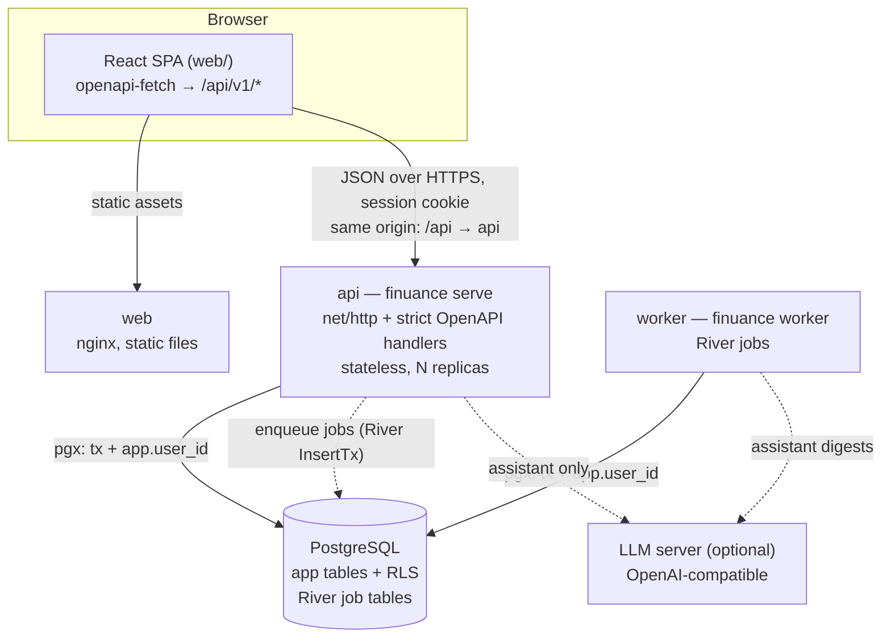
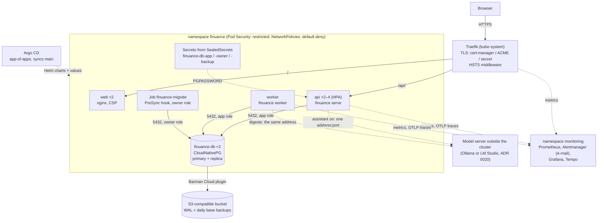
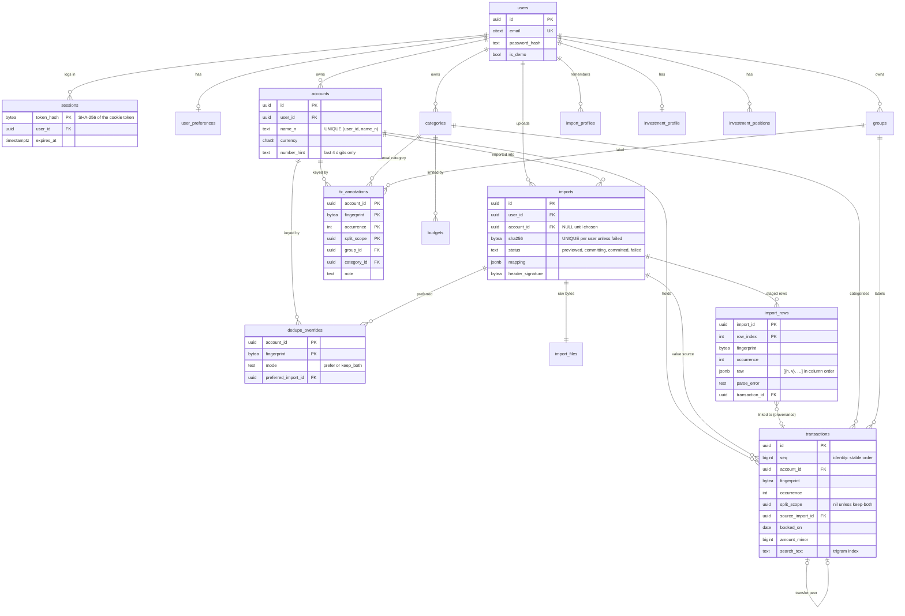
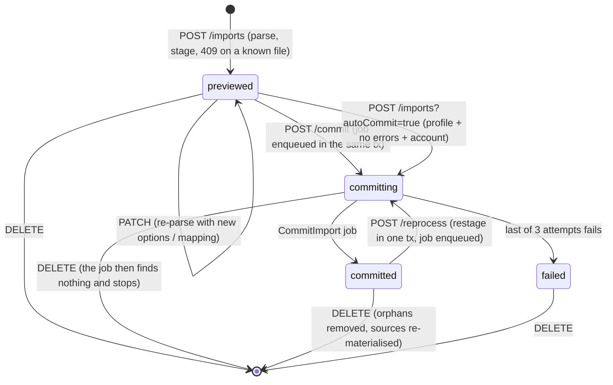
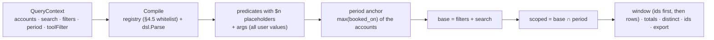
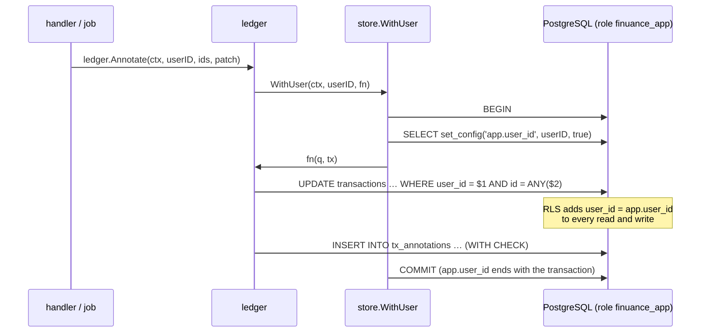

# Architecture

How Finuance is put together, for someone reading the code for the first time. The plan (`docs/PLAN.md`) is the specification. This document explains what is built and why it is shaped that way. It grows phase by phase. Phase 4 adds the data model and tenant isolation; Phase 8 the web app.

> 🚧 This describes the system after Phase 11, plus the Kubernetes deployment of Phase 16 ([Deployment](#deployment)). Parts from Phases 12–20 (the overview, the AI assistant and its model server, the `rules` package of Phase 15, administration and sharing of Phase 19) appear in the diagrams and the package table where they fit and are described in their own documents (`docs/assistant.md`, `docs/admin.md`, `docs/sharing.md`, the ADRs).

## Components



- **One Go binary, one image.** The subcommands are `serve`, `worker`, `migrate`, `seed-demo`, `admin`, `healthcheck` and `version`.
- **api** serves HTTP and never runs jobs. Slow work, such as committing an import, is enqueued in the same database transaction as the state change, so a job exists exactly when its change was committed.
- **worker** runs the River workers on the same domain packages as api.
- **web** serves static files. Everything is same-origin (ingress or nginx path routing), so there is no CORS and cookies stay `SameSite=Lax`.

### Backend packages

```
cmd → app → {httpapi, jobs} → {ledger, query, insights, rules, auth} → {store, ingest, money, platform}
```

`rules` (Phase 15) stores the categorisation rules and reclassifies transactions: rules from scratch in position order, then transfer detection, as the `reclassify` job (ADRs 0017, 0018); a rule's match compiles with `query`'s filter compiler. `insights` holds the chart rules; its aggregation SQL lives in `query` (`insights.go`), the only package besides `store` that runs SQL.

| Package | Role |
|---|---|
| `ingest`, `money` | Pure parsing and normalisation (Phase 3): bytes in, staged rows out. No database, no clock. |
| `store` | The database: the pool, migrations, sqlc queries (`store/queries/*.sql` → `store/db`), and the only entry points to user data (`WithUser`, `WithUserReadOnly`, `WithoutUser`). |
| `ledger` | Accounts, categories, groups, imports, transactions, annotations, budgets and profiles, and the transactions typed into cash accounts (`origin = 'manual'`, ADR 0029). Every method runs through `WithUser` and returns domain types, never sqlc rows. |
| `legacyimport` | Migration of single-file app backups (Phase 14, ADR 0016): rebuilds the legacy tables and keys, runs each file through the import pipeline, moves labels, duplicate decisions, budgets, investments and chats, writes the report. |
| `instance`, `admin` | Instance administration (Phase 19, ADR 0025). `instance` is pure: the settings document (view defaults, feature switches, limits resolved user → instance → environment) and the colour-theme contract with its WCAG check (ADR 0026). `admin` manages accounts, settings and themes through `WithoutUser` (those tables are outside RLS, like `users`); it can't import the financial packages and reads user-owned tables only for counts, under each user's own context. |
| `sharing`, `splits` | Shared groups (Phase 19, ADR 0028). `sharing` runs groups, invitations, expenses, settlements, the report and the timeline under each caller's own context; `splits` is the pure arithmetic (equal, shares, exact, balances, minimal transfers). The copy of a member's transaction is written by `ledger` in the same database transaction as the change that shares it. Row-level security by membership: `shared_member_role()` (SECURITY DEFINER) answers the caller's role in a group. |
| `friends`, `notify` | Between users (Phase 19, ADR 0027). `friends` makes and redeems friend codes (hashed, outside RLS like sessions) and keeps friendships (forced RLS for the two sides); `notify` writes in-app notifications under the recipient's own context and lists them. Friends see display names only. |
| `assistant`, `llm`, `goals`, `aichanges`, `advice`, `secret` | The assistant (Phases 13 and 20). `llm` speaks the OpenAI and Anthropic protocols (images included); `assistant` holds the connections (the file's and those stored in the panel, reloaded every minute; keys sealed by `secret`, ADR 0035), the read-only tools, the run loop, the chats, the digests (run by the worker, ADR 0033) and the daily token budget; `goals` computes progress on read (ADR 0031); `aichanges` lists and undoes the changes applied from proposals, which every write path records in the same transaction (ADR 0030); `advice` is the article library and its full-text search (ADR 0034). |
| `fincli`, `client/gen` | The `fin` command line (Phase 20): a client generated from `api/openapi.yaml`, authenticated with a personal access token (ADR 0036). |
| `httpapi`, `jobs` | Map HTTP requests and River jobs onto the domain packages. They contain no SQL. `httpapi`'s session layer also gates `/admin` (administrators only, else `404`), the one-time-password change and switched-off features. |

A guard test (`store/guard_test.go`) parses every non-test file outside `internal/store`. It fails on direct `Query`/`Exec`/`Begin` calls, and on building a sqlc querier (`db.New`) that would bypass `WithUser`.

### Web app (`web/`)

A Vite + React + TypeScript single-page app that recreates the legacy `finuance.html` UI: the legacy CSS is ported verbatim (`src/styles/`), and components reuse the legacy class names.

| Folder | Role |
|---|---|
| `api/` | `openapi-fetch` client typed from `api/openapi.yaml` (`schema.d.ts` is generated). Errors become `ApiError` with the RFC 9457 problem; a `401` sends the router to `/login?next=…`. TanStack Query hooks per resource in `api/hooks/`. |
| `stores/` | Zustand: `uiStore` (toggles, theme, size, chart and assistant settings), `viewStore` (per-view sort, columns, period; search and filters are session-only). `prefsSync.ts` saves the persisted slices with a 500 ms debounce and the document version; on `409` the server's document wins and local changes are laid back on top, once. |
| `auth/` | Sign-in, sign-up and `RequireAuth`, which loads `/me` and `/preferences` and hydrates the stores before the app renders. |
| `shell/` | Title bar, sidebar (accounts with their import history), status bar, empty state, drop overlay, settings popover, keyboard manager. |
| `import/` | The upload queue (`queue.ts`: one file at a time, fast path, duplicate files) and the import window at `/imports/:id`. The window's working copy is a `PreviewEditor` (`editor.ts`): edits wait 300 ms and go to the server as one `PATCH`, and the screen renders the server's re-staged preview. Committed imports are edited locally and sent with *Reprocess*. |
| `ui/` | Primitives: Popover and Menu (Floating UI), Modal, Toast queue, Tooltip, buttons, inputs. Open modals and popovers register as layers, so the global keyboard manager leaves their keys alone. |

The production image (`deploy/docker/Dockerfile.web`) is unprivileged nginx: static files with a strict CSP (`script-src 'self'; style-src 'self'; connect-src 'self'`), immutable hashed assets, `no-cache` for `index.html`, and `/api/` proxied to the API without buffering (exports stream through). No HTML is ever built from strings (an ESLint rule bans `innerHTML` and `dangerouslySetInnerHTML`), which is what makes that CSP possible.

## Deployment

Two ways to run it, from the same images (`ghcr.io/x2db736ac85h/finuance-api`, `finuance-web`):

- **Docker Compose** (`deploy/compose/compose.prod.yaml`): one machine; nginx in the web container proxies `/api` to the api.
- **Kubernetes** (Phase 16; [docs/RUNBOOK.md](RUNBOOK.md)): the Helm chart `deploy/helm/finuance`, the database chart `deploy/k8s/db` on CloudNativePG, and Argo CD applications in `deploy/k8s/argocd`, with the homelab's values in `deploy/environments/homelab`.



- **Same origin, two routes.** The Ingress sends `/api/` straight to the api (streamed assistant answers need no buffering) and everything else to web. Under Compose, nginx does that split.
- **Migrations before every rollout.** The `finuance-migrate` Job (Helm `pre-install`/`pre-upgrade`, Argo CD `PreSync`) runs as the owner role. The api reports ready only when the schema is at least at its version, so a failed migration leaves the old pods serving.
- **Zero-downtime rollouts.** Rolling updates with `maxUnavailable: 0`; api and web pause in `preStop` until Traefik has dropped them from its endpoints; the api drains in-flight requests on SIGTERM. The CI rehearsal checks this under load.
- **Passwords never sit in a URL.** The ConfigMap holds password-less database URLs; each process gets `PGPASSWORD` from the role's basic-auth secret, the same secret CloudNativePG's managed role reads.
- **Backups** are continuous WAL archiving plus a daily base backup through the Barman Cloud plugin, with a 14-day recovery window. A restore is a new cluster from the bucket, optionally to a point in time.
- **GitOps.** A release opens a pull request that bumps the image tag in the homelab values; merging it deploys, reverting it rolls back. The database application syncs only by hand.
- **The rehearsal** (`tools/rehearsal.sh`, the `k8s-rehearsal` workflow) runs all of this on a kind cluster, with RustFS as the bucket and the mock model server.
- **Readiness under load.** `/readyz` checks the database and the migration version, but a check that only times out within 30 s of its last success counts as busy: every replica shares the database, and failing them all at once would turn slow answers into refused ones at the ingress (Phase 18 load test).
- **Monitoring** (Phase 18): kube-prometheus-stack scrapes the api, the worker, the database and Traefik; Finuance's dashboards, SLO rules and e-mail receiver come from `deploy/k8s/observability`; traces go to Tempo over OTLP/HTTP. Availability is measured at the api and, separately, at the ingress.
- **Image admission** (Phase 18): a built-in `ValidatingAdmissionPolicy` admits pods in Finuance's namespaces only with images from the registries listed per namespace (Finuance's own only from `ghcr.io/x2db736ac85h`); signature checks follow in Phase 21 (ADR 0024).
- **Single-node k3s** (the reference environment, ADR 0022): Traefik on host ports and reachable only from the tailnet (an nftables table on the host), a Tailscale `*.ts.net` certificate, RustFS in the cluster as the backup bucket, the model server on the host; the machine-specific values come from a private repository (ADR 0023).

## Data model

All ids are UUIDv7 generated in Go (`platform.NewID`), so they are time-ordered and index-friendly. Money is `bigint` minor units with an ISO currency code (ADR 0004). Booking dates are `date` (ADR 0005). The `*_n` columns hold `ingest.Collapse(ingest.Norm(x))`, computed in Go, so search and filters use the same normalisation as the importer.

The `pl_natural` ICU collation (`pl-u-kn-true`) sorts names by the Polish alphabet (`ł` after `l`, `ż` after `z`) and numbers by value (`Konto 2` before `Konto 10`). It is applied in queries (`ORDER BY name COLLATE pl_natural`), not on columns. Equality and indexes therefore stay byte-based.



Every table except `users` and `sessions` also has `user_id uuid NOT NULL REFERENCES users ON DELETE CASCADE`. It is omitted from the diagram for readability. `budgets`, `import_profiles`, `investment_profile` and `investment_positions` are left out of the attribute lists. The full DDL is `backend/internal/store/migrations/00002_core.sql` (PLAN §5.2).

### De-duplication in the schema

- **Identity.** A transaction's identity within an account is `(fingerprint, occurrence, split_scope)`, and `UNIQUE (account_id, fingerprint, occurrence, split_scope)` enforces it.
  - The fingerprint is the SHA-256 of the legacy merge key (`ingest.FingerprintKey`).
  - `occurrence` numbers identical rows within one import, so two genuine identical coffees in one export stay two.
- **Committing** inserts staged rows with `ON CONFLICT DO NOTHING`. A row the account already has is a duplicate, linked rather than inserted. A transaction is therefore kept `max(count in any single import)` times.
- **`import_rows`** is both the staging area and the provenance record. Every committed row points at its transaction. Deleting an import deletes its rows, then the import-origin transactions that no row points at any more. A transaction that an overlapping export also contains survives.
- **`tx_annotations`** stores user edits (group, manual category, note) under the same identity, not the transaction id. Deleting and re-importing a file creates new transaction rows, and the commit re-applies the annotations to them (`ledger.CommitImport`, step 1b).
- **Value source and overrides.** Each transaction records the import its field values come from (`source_import_id`): by default the earliest committed import containing the identity. A `dedupe_overrides` row changes that per fingerprint: `prefer` takes the values from one import, `keep_both` gives each import its own copy (`split_scope` = the first 16 bytes of the file's SHA-256). `ledger.Rematerialize` recomputes one fingerprint from scratch and is the reference the incremental commit and delete paths are property-tested against.
- **One writer per account.** Commit, delete, reprocess and override changes lock the account row (`FOR NO KEY UPDATE`) before touching its transactions (ADR 0013).

### Import lifecycle



- **Upload.** The api reads one multipart file (`FINUANCE_MAX_UPLOAD_BYTES`), rejects binary files (NUL in the first 8 KiB) and identical bytes (SHA-256 per user → `409` with `existingImportId`). It parses with the user's saved profile for this header layout if there is one, else with detection, stages every row, and pre-fills the account when the own-account column matches exactly one account's number hint.
- **Commit job** (`jobs.CommitImportWorker`): upsert the bank categories, insert the new identities, re-apply annotations, link every staged row, mark the import committed, re-materialise overridden and re-sourced fingerprints, record the stats, and remember the mapping as the layout's profile.

### Query engine (`internal/query`)

Every transaction read — the table window, distinct values, id ranges, the CSV export, category colours, the insight charts, and later the overview — goes through one compiler, so all views agree.



- **The registry** (`columns.go`) holds each API column's typed value, display text (`-79,99`, `dd.mm.yyyy`), normalised text and sort expression. It is the only source of SQL fragments. User text is always an argument, and LIKE patterns are escaped.
- **`base` and `scoped`.** Totals, stats and the data range are computed over `base` (filters, no period) in one pass. The window and the count use `scoped`. Comparisons use `base` within the previous period (the summary's delta), and the cash flow and pace charts read `base` for their whole history while the period only highlights.
- **Statements join only what they need**, so the common unfiltered and period-only totals are index-only scans on `tx_user_booked_idx`. Windows find their ids first and then fetch the display columns (late row lookup). See `docs/perf.md` for the measurements, and for why the trigram index on `search_text` is unused under forced RLS.
- **Execution** happens in `query/sql.go` inside `store.WithUser` (the store guard allows `internal/query`). The export streams one read-only query (ADR 0014).

## Tenant isolation

Two independent layers keep users apart.

1. **Explicit filters.** Every query on user data has `WHERE user_id = @user_id`. Every `ledger` method takes the user id.
2. **Row-level security** (ADR 0007, migration `00003_rls.sql`). Every user-owned table has RLS **enabled and forced**, with one policy:

   ```sql
   USING      (user_id = nullif(current_setting('app.user_id', true), '')::uuid)
   WITH CHECK (user_id = nullif(current_setting('app.user_id', true), '')::uuid)
   ```

   One table has its own policies: the activity log (`audit_log`, ADR 0021) has one per command,
   so the app can read and add its own events but never update them, can't backdate one, and can
   delete only those older than 365 days; `UPDATE` and `TRUNCATE` are also revoked from the app
   role (`TestAuditLogIsAppendOnly`). `friendships` has a policy for either side (ADR 0027).

   **Shared tables** (Phase 19, ADR 0028, migration `00014_shared_groups.sql`) are read and written
   by membership: `shared_groups`, `shared_expenses`, `shared_expense_splits` and
   `shared_settlements` have forced RLS with policies that ask `shared_member_role(group_id)`, a
   `SECURITY DEFINER STABLE` function owned by `finuance_owner`, for the caller's role (owner,
   member, invited). The function reads `shared_group_members`, which therefore has RLS **enabled
   but not forced** (the app role is still bound by its policies; FORCE would bind the function's
   owner too, and a policy reading its own table would recurse). It is the one listed exception in
   `TestEveryUserTableHasForcedRLS`. Members only write expenses they added and those expenses'
   splits; `shared_expense_links` (a member's private link from their transaction to its copy) is
   an ordinary tenant table.

### How a request reaches the database



- **`WithUser`** opens a transaction and sets `app.user_id` with `set_config(…, true)`, the function form of `SET LOCAL`. The setting ends with the transaction, so it can't leak to the next user of a pooled connection (`TestWithUserScopesTheSettingToOneTransaction`).
- **`WithUserReadOnly`** is the same in a `READ ONLY` transaction. The assistant's tools run there, so a tool can't write even if its SQL is wrong.
- **`WithoutUser`** is for the auth tables (`users`, `sessions`), which have no RLS because a session is resolved before the user is known. In it, every user-owned table looks empty, and writes fail.
- **Roles.** The api and worker connect as `finuance_app`, which owns no tables and can't run DDL. Migrations run as `finuance_owner`. Because RLS is *forced*, even the owner sees no user rows without `app.user_id`, so a migration or a debugging session can't read user data by accident. A future data migration that must touch every user's rows switches `NO FORCE` inside its own transaction and restores `FORCE` before committing.

### What RLS does not cover

- **Foreign keys are checked without row security.** PostgreSQL would accept a transaction of user A that points at user B's group, because the group row exists. Every `ledger` write that stores a reference to a user-owned row therefore checks, in the same transaction, that the row is the caller's (`ledger/owned.go`). Under `WithUser` another user's row is invisible, so the check fails as *not found*. This covers:
  - an account on an import;
  - a group or category on an annotation;
  - a category on a budget.

  Composite foreign keys on `(user_id, id)` would enforce this in the schema itself. That would be a schema change for a later ADR.
- **Referential actions** (`ON DELETE CASCADE` / `SET NULL`) also run without row security. That is what makes deleting a user or an account remove all of its rows even under `FORCE` (`TestRLSCascadesStillWork`).
- **Tables outside RLS on purpose**: `users`, `sessions`, friend codes and personal access tokens are resolved before the user is known, so they carry `user_id` but no policy; every query of them except the lookup that finds the user (by e-mail address or by the hash of a token or code) filters by `user_id`. The instance tables (settings, themes, the advice library, assistant connections and tuning) hold no user data.
- **Bulk loads can't use `COPY FROM`.** PostgreSQL refuses it on tables with RLS. Staged rows are inserted with `INSERT … SELECT FROM unnest(…)`, 5,000 rows per statement (`store.InsertImportRows`).

### How it is tested

`backend/internal/store/rls_test.go` runs as `finuance_app` on every table the catalog lists as user-owned. A new table is covered automatically, and fails until it has a policy and seed data. Every query in the suite deliberately omits the `user_id` predicate.

| Test | Proves |
|---|---|
| `TestRLSReadsOnlyOwnRows` | With `app.user_id = A`, only A's rows are visible. |
| `TestRLSCannotWriteOtherUsersRows` | `UPDATE`/`DELETE` of B's rows affect 0 rows. |
| `TestRLSWithCheckRejectsOtherUserID` | Moving a row to B, or inserting with B's id, fails `WITH CHECK` (SQLSTATE 42501). |
| `TestRLSWithoutUserSeesNothing` | Without `app.user_id`, and as the owner role, tables are empty and writes fail. |
| `TestRLSCascadesStillWork` | Deleting a user removes their rows everywhere and leaves the other user intact. |
| `TestEveryUserTableHasForcedRLS` | The catalog: every table with `user_id` (except `sessions`) has RLS enabled, forced, and exactly its `_tenant` policy. |

Removing one table's policy makes all of them fail. This was checked by hand while the suite was written.
