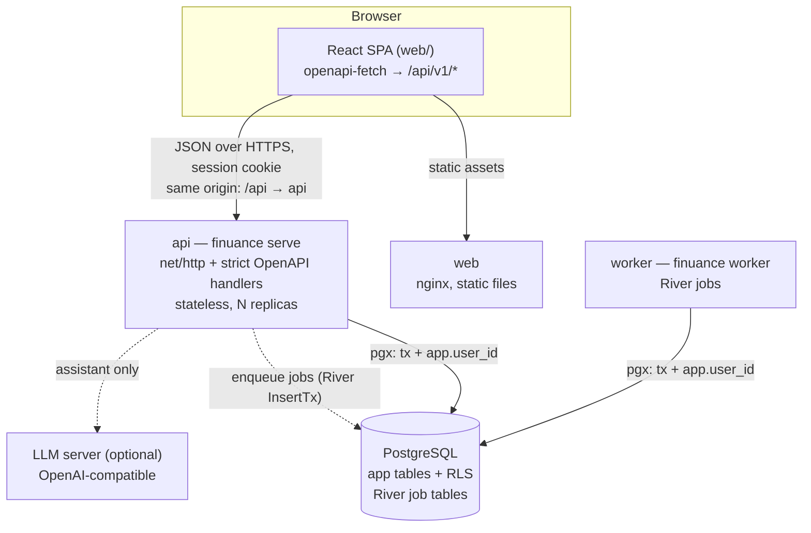
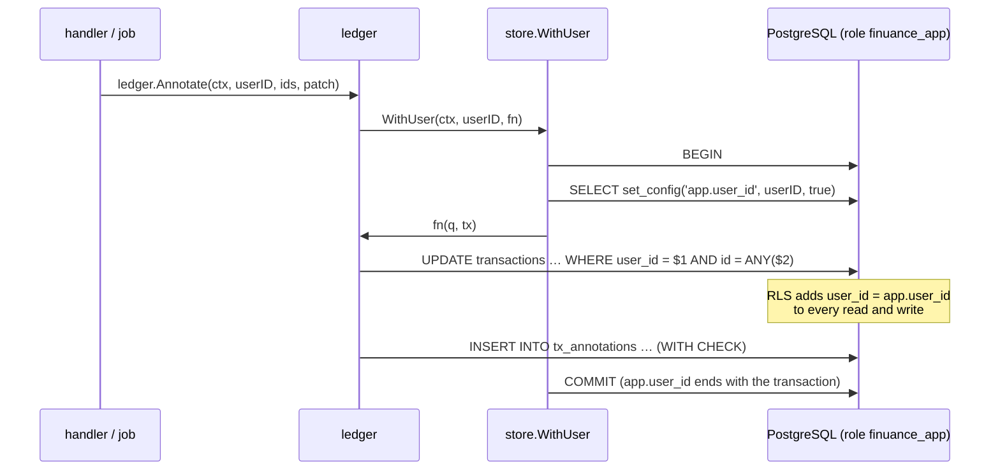

# Architecture

How Finuance is put together, for someone reading the code for the first time. The plan (`docs/PLAN.md`) is the specification. This document explains what is built and why it is shaped that way. It grows phase by phase. Phase 4 adds the data model and tenant isolation.

## Components



- **One Go binary, one image.** The subcommands are `serve`, `worker`, `migrate`, `seed-demo`, `admin`, `healthcheck` and `version`.
- **api** serves HTTP and never runs jobs. Slow work, such as committing an import, is enqueued in the same database transaction as the state change, so a job exists exactly when its change was committed.
- **worker** runs the River workers on the same domain packages as api.
- **web** serves static files. Everything is same-origin (ingress or nginx path routing), so there is no CORS and cookies stay `SameSite=Lax`.

### Backend packages

```
cmd → app → {httpapi, jobs} → {ledger, query, insights, rules, auth} → {store, ingest, money, platform}
```

| Package | Role |
|---|---|
| `ingest`, `money` | Pure parsing and normalisation (Phase 3): bytes in, staged rows out. No database, no clock. |
| `store` | The database: the pool, migrations, sqlc queries (`store/queries/*.sql` → `store/db`), and the only entry points to user data (`WithUser`, `WithUserReadOnly`, `WithoutUser`). |
| `ledger` | Accounts, categories, groups, imports, transactions, annotations, budgets and profiles. Every method runs through `WithUser` and returns domain types, never sqlc rows. |
| `httpapi`, `jobs` | Map HTTP requests and River jobs onto the domain packages. They contain no SQL. |

A guard test (`store/guard_test.go`) parses every non-test file outside `internal/store`. It fails on direct `Query`/`Exec`/`Begin` calls, and on building a sqlc querier (`db.New`) that would bypass `WithUser`.

## Data model

All ids are UUIDv7 generated in Go (`platform.NewID`), so they are time-ordered and index-friendly. Money is `bigint` minor units with an ISO currency code (ADR 0004). Booking dates are `date` (ADR 0005). The `*_n` columns hold `ingest.Collapse(ingest.Norm(x))`, computed in Go, so search and filters use the same normalisation as the importer.

The `pl_natural` ICU collation (`pl-u-kn-true`) sorts names by the Polish alphabet (`ł` after `l`, `ż` after `z`) and numbers by value (`Konto 2` before `Konto 10`). It is applied in queries (`ORDER BY name COLLATE pl_natural`), not on columns. Equality and indexes therefore stay byte-based.


Every table except `users` and `sessions` also has `user_id uuid NOT NULL REFERENCES users ON DELETE CASCADE`. It is omitted from the diagram for readability. `budgets`, `import_profiles`, `investment_profile` and `investment_positions` are left out of the attribute lists. The full DDL is `backend/internal/store/migrations/00002_core.sql` (PLAN §5.2).

### De-duplication in the schema

- **Identity.** A transaction's identity within an account is `(fingerprint, occurrence, split_scope)`, and `UNIQUE (account_id, fingerprint, occurrence, split_scope)` enforces it.
  - The fingerprint is the SHA-256 of the legacy merge key (`ingest.FingerprintKey`).
  - `occurrence` numbers identical rows within one import, so two genuine identical coffees in one export stay two.
- **Committing** inserts staged rows with `ON CONFLICT DO NOTHING`. A row the account already has is a duplicate, linked rather than inserted. A transaction is therefore kept `max(count in any single import)` times.
- **`import_rows`** is both the staging area and the provenance record. Every committed row points at its transaction. Deleting an import deletes its rows, then the import-origin transactions that no row points at any more. A transaction that an overlapping export also contains survives.
- **`tx_annotations`** stores user edits (group, manual category, note) under the same identity, not the transaction id. Deleting and re-importing a file creates new transaction rows, and the commit re-applies the annotations to them (`ledger.CommitImport`, step 1b).

## Tenant isolation

Two independent layers keep users apart.

1. **Explicit filters.** Every query on user data has `WHERE user_id = @user_id`. Every `ledger` method takes the user id.
2. **Row-level security** (ADR 0007, migration `00003_rls.sql`). Every user-owned table has RLS **enabled and forced**, with one policy:

   ```sql
   USING      (user_id = nullif(current_setting('app.user_id', true), '')::uuid)
   WITH CHECK (user_id = nullif(current_setting('app.user_id', true), '')::uuid)
   ```

### How a request reaches the database



- **`WithUser`** opens a transaction and sets `app.user_id` with `set_config(…, true)`, the function form of `SET LOCAL`. The setting ends with the transaction, so it can't leak to the next user of a pooled connection (`TestWithUserScopesTheSettingToOneTransaction`).
- **`WithUserReadOnly`** is the same in a `READ ONLY` transaction. The assistant's tools run there, so a tool can't write even if its SQL is wrong.
- **`WithoutUser`** is for the auth tables (`users`, `sessions`), which have no RLS because a session is resolved before the user is known. In it, every user-owned table looks empty, and writes fail.
- **Roles.** The api and worker connect as `finuance_app`, which owns no tables and can't run DDL. Migrations run as `finuance_owner`. Because RLS is *forced*, even the owner sees no user rows without `app.user_id`, so a migration or a debugging session can't read user data by accident. A future data migration that must touch every user's rows switches `NO FORCE` inside its own transaction and restores `FORCE` before committing.

### What RLS does not cover

- **Foreign keys are checked without row security.** PostgreSQL would accept a transaction of user A that points at user B's group, because the group row exists. Every `ledger` write that stores a reference to a user-owned row therefore checks, in the same transaction, that the row is the caller's (`ledger/owned.go`). Under `WithUser` another user's row is invisible, so the check fails as *not found*. This covers:
  - an account on an import;
  - a group or category on an annotation;
  - a category on a budget.

  Composite foreign keys on `(user_id, id)` would enforce this in the schema itself. That would be a schema change for a later ADR.
- **Referential actions** (`ON DELETE CASCADE` / `SET NULL`) also run without row security. That is what makes deleting a user or an account remove all of its rows even under `FORCE` (`TestRLSCascadesStillWork`).
- **Bulk loads can't use `COPY FROM`.** PostgreSQL refuses it on tables with RLS. Staged rows are inserted with `INSERT … SELECT FROM unnest(…)`, 5,000 rows per statement (`store.InsertImportRows`).

### How it is tested

`backend/internal/store/rls_test.go` runs as `finuance_app` on every table the catalog lists as user-owned. A new table is covered automatically, and fails until it has a policy and seed data. Every query in the suite deliberately omits the `user_id` predicate.

| Test | Proves |
|---|---|
| `TestRLSReadsOnlyOwnRows` | With `app.user_id = A`, only A's rows are visible. |
| `TestRLSCannotWriteOtherUsersRows` | `UPDATE`/`DELETE` of B's rows affect 0 rows. |
| `TestRLSWithCheckRejectsOtherUserID` | Moving a row to B, or inserting with B's id, fails `WITH CHECK` (SQLSTATE 42501). |
| `TestRLSWithoutUserSeesNothing` | Without `app.user_id`, and as the owner role, tables are empty and writes fail. |
| `TestRLSCascadesStillWork` | Deleting a user removes their rows everywhere and leaves the other user intact. |
| `TestEveryUserTableHasForcedRLS` | The catalog: every table with `user_id` (except `sessions`) has RLS enabled, forced, and exactly its `_tenant` policy. |

Removing one table's policy makes all of them fail. This was checked by hand while the suite was written.
