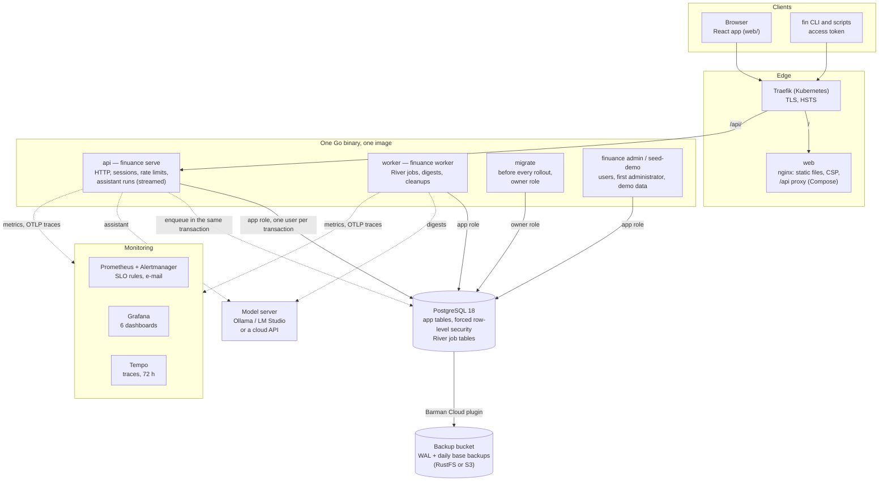
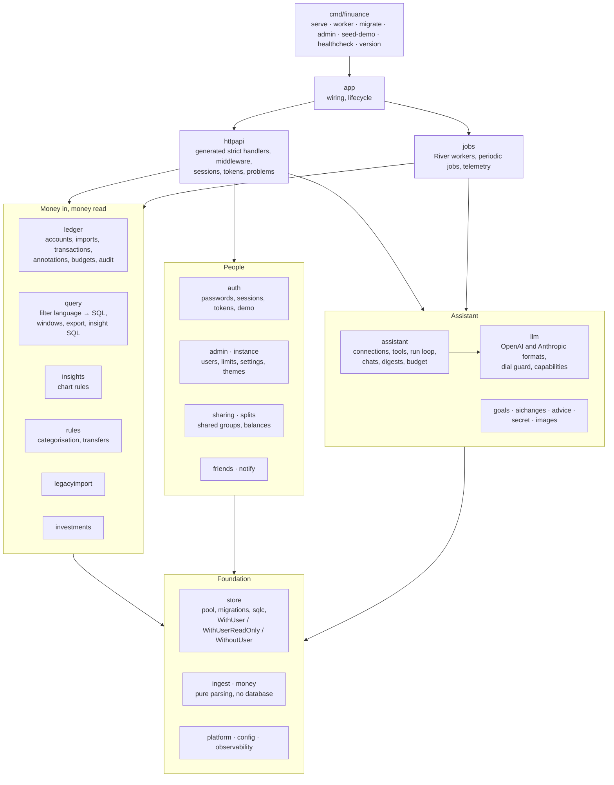
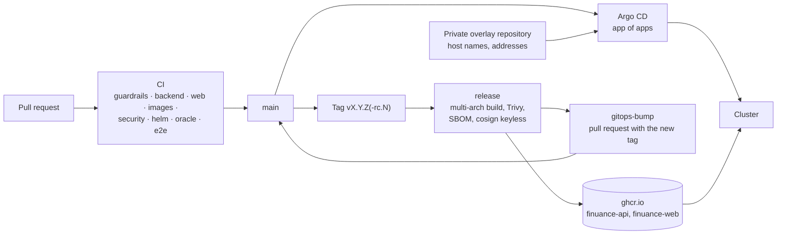

# Component map

Every part of Finuance as it is built at `v0.4.1` (written 2026-11-16), where its code lives and what it talks to. Parts that are planned and not built yet are marked **planned** with their phase (`docs/PLAN.md` §9). [ARCHITECTURE.md](ARCHITECTURE.md) explains the data model, tenant isolation and the query engine in depth; this page is the overview.

## 1. What runs

| Component | What it does | Code | Runs as | Talks to |
|---|---|---|---|---|
| **React app** | The whole interface; typed API client; no HTML built from strings | `web/src/` | Static files in the browser | `/api/v1/*` on the same origin, session cookie |
| **`fin`** | Command line for people and agents (JSON, CSV, table output) | `backend/cmd/fin`, `internal/fincli`, `internal/client/gen` | A local binary | The API with an access token (ADR 0036) |
| **web** | Serves the app with a strict CSP; proxies `/api/` under Compose | `deploy/docker/Dockerfile.web`, `nginx.conf` | Deployment ×2, unprivileged nginx | The api |
| **api** | Every HTTP endpoint (113 paths, 155 operations), sessions and CSRF, rate limits, the assistant's run loop | `backend/cmd/finuance`, `internal/app`, `internal/httpapi` | Deployment ×2–4 (HPA), `finuance serve` | PostgreSQL, the model server, the OTLP endpoint |
| **worker** | Background jobs: committing imports, reclassifying, legacy imports, digests, cleanups | `internal/jobs` | Deployment ×1, `finuance worker` | PostgreSQL, the model server |
| **migrate** | Schema migrations (goose, 24 files) | `internal/store/migrations` | Job before each rollout, owner role | PostgreSQL |
| **admin CLI** | `create-user`, `set-password`, `grant-admin`, `revoke-admin`, `llm-probe`; `seed-demo` | `internal/app/admin.go` | Run by hand in a pod or locally | PostgreSQL |
| **PostgreSQL** | All data and the job queue; forced row-level security; roles `finuance_owner` and `finuance_app` | `deploy/db/bootstrap.sql`, `deploy/k8s/db` | CloudNativePG cluster ×2, or one Compose container | The backup bucket |
| **Model server** | Answers the assistant; optional | `internal/llm` (client side), `deploy/assistant/` | Outside the cluster (ADR 0020) | — |
| **`llmmock`** | A scripted model server for tests, CI and the rehearsal; never in a release | `backend/testutil/llmmock`, `cmd/llmmock` | Compose profile, kind namespace | — |
| **Monitoring** | Metrics, SLO rules, alerts by e-mail, dashboards, traces | `deploy/k8s/observability`, `deploy/k8s/tempo` | kube-prometheus-stack, Tempo | Scrapes api, worker, database, Traefik |

Not there yet:

| Planned component | Phase |
|---|---|
| Signature check at admission (Sigstore policy-controller), images by digest | 23 |
| Loki and Grafana Alloy: collected logs, traces routed through Alloy | 24 |
| `finuance-sim`: the traffic simulator with its tuning page; a lab instance; `llmmock` as a lab image | 25 |
| A Vertex AI connection (token source in `internal/llm`) | 26 |
| A lab on GKE Autopilot built by Terraform (`deploy/terraform/`), Gateway API in the chart | 27 |
| The public demo host | 29 |

## 2. Inside the Go binary

Rules that hold the shape (each is a test or a lint):

- Only `store` and `query` run SQL (`store/guard_test.go`). All user data goes through `store.WithUser`, which sets `app.user_id` for one transaction; the assistant's tools use `WithUserReadOnly`.
- `admin` can't import the financial packages; it reads user tables only for counts.
- `ingest` and `money` have no database and no clock.
- Generated code is never edited: `httpapi/gen`, `client/gen`, `store/db`, `web/src/api/schema.d.ts` (`make gen`).

### The request path

`Recover → AssignRequestID → RealIP → Logging → Metrics → Tracing → SecurityHeaders → MaxBytes → Route`, then the session and token layer (CSRF header and `Origin` check, access-token scopes, feature switches, the one-time-password gate), the handler, a domain package, `store.WithUser`, PostgreSQL.

### Background jobs (River, in PostgreSQL)

| Kind | Started by | Does |
|---|---|---|
| `commit_import` | `POST /imports/{id}/commit`, reprocess | Inserts new transactions, links rows, re-applies annotations, records statistics |
| `reclassify` | Most structural writes (rules, categories, manual transactions, duplicates, import delete) | Rules from scratch, then transfer detection |
| `rematerialize_fingerprint` | Duplicate decisions | Recomputes one fingerprint from its imports |
| `legacy_import` | `POST /legacy-imports` | Replays a backup of the single-file app |
| `assistant_digest`, `assistant_digest_scan` | A request, or the hourly scan | A read-only assistant run whose result is a notification |
| `cleanup_*` (sessions, demo users, audit log, notifications, assistant chats, friend codes) | Periodic | Retention |

A job is inserted in the same transaction as the change that needs it, and carries the request's trace context.

## 3. The web app

| Folder (`web/src/`) | What is in it |
|---|---|
| `api/` | The typed client (`openapi-fetch`), TanStack Query hooks, problem handling |
| `stores/` | Zustand stores and the preferences sync |
| `shell/`, `ui/`, `styles/` | Title bar, sidebar, keyboard manager; primitives (popover, modal, toast); the theme tokens |
| `auth/`, `settings/`, `admin/` | Sign-in, the user's settings, the administration panel (`/admin/:section`) |
| `import/`, `table/`, `groups/`, `duplicates/`, `rules/`, `cash/` | The import window and queue, the transaction table, labels, duplicate review, rules, hand-typed transactions |
| `insights/`, `charts/`, `overview/` | The insight pane and window, chart components, the monthly overview |
| `assistant/` | The chat panel, proposals, consent |
| `shared/` | Shared groups and the Shared tab |
| `legacy/` | Migrating a backup of the single-file app (decrypted in the browser) |

Tests: Vitest beside the code; Playwright in `web/e2e/` (23 spec files, with axe checks, screenshots and the parity run against the legacy app).

## 4. Data

One PostgreSQL database. Tables by area (migrations `00001`–`00024`):

| Area | Tables (examples) | Isolation |
|---|---|---|
| Identity | `users`, `sessions`, access tokens, friend codes | No RLS (resolved before the user is known); every query by `user_id` |
| Ledger | `accounts`, `imports`, `import_files`, `import_rows`, `transactions`, `tx_annotations`, `dedupe_overrides`, `categories`, `groups`, `budgets`, `import_profiles`, rules, goals, investments | Forced RLS, one tenant policy |
| Sharing | `shared_groups`, members, expenses, splits, settlements, links; `friendships`; `notifications` | Forced RLS by membership (`shared_member_role()`), or by either side |
| Assistant | chats, attachments, `ai_changes`, usage, digests | Forced RLS |
| Activity | `audit_log` | Forced RLS, append-only for the app role, 365 days |
| Instance | settings, themes, the advice library, assistant connections and tuning | No user data |
| Queue | River's tables | Job arguments carry ids, never content |

## 5. How a change reaches a cluster

| Workflow | When | What |
|---|---|---|
| `ci.yml` | Pushes and pull requests | gitleaks and the private-data guards; Go lint, tests, fuzz smoke, `govulncheck`; integration tests with PostgreSQL; both images built and scanned; Trivy on the tree; `npm audit`; Helm lint, kubeconform, rules tests, sealing round trip; the legacy oracle is fresh; web lint, types, Vitest, build; Playwright on Compose |
| `nightly.yml` | Daily | Fuzzing, 60 s per target |
| `weekly.yml` | Mondays | ZAP baseline and API scan, k6 smoke against the SLO thresholds, the demo-mode E2E |
| `k8s-rehearsal.yml` | Mondays, deploy pushes | The whole deployment on kind: operators, secrets, database with backup, the app, NetworkPolicy probes, streaming through the ingress, pod kills under load, restore |
| `release.yml` | Version tags | Build, scan, SBOM, sign, the bump pull request |

Argo CD applications, in sync order: projects → admission policy → Tempo → CloudNativePG operator, Sealed Secrets → Barman Cloud plugin, kube-prometheus-stack → RustFS → the secrets → the database (synced by hand) → Finuance → its dashboards and rules.

Namespaces on the reference cluster: `finuance` (web, api, worker, database), `finuance-restore` (restore drills), `s3` (RustFS), `monitoring`, `cnpg-system`, `kube-system` (Traefik, the admission policy), `argocd`. Pod Security `restricted`, default-deny NetworkPolicies, images admitted by registry.

## 6. What the system tells you

| Signal | Emitted by | Where it ends up today | Gap (phase) |
|---|---|---|---|
| Access log, one JSON line per request | api (`middleware/logging.go`) | The container's standard output only | Not collected; no trace id on other lines (24) |
| Job and assistant log lines | worker, api | Standard output | No job id, kind or trace id (24) |
| Metrics | api and worker on the admin port | Prometheus; 6 dashboards; SLO and burn-rate alerts | Model latency missing; panics not counted (24) |
| Traces: request → job → SQL, assistant run and tools | api, worker (OTLP) | Tempo, 72 hours | No span for the model request; client trace context trusted (23, 24) |
| Activity log | Handlers, after a successful change | `audit_log`, shown in Settings → Activity | — |
| Health | `/healthz`, `/readyz` | Probes | Logged and traced like real requests (24) |
| Browser errors | — | Nowhere | Planned (24) |
| Synthetic traffic | — | Indistinguishable | A server-side marker (24) |

## 7. Guard scripts and tools

| Tool | Purpose |
|---|---|
| `tools/check-private.sh`, `check-env-details.sh`, gitleaks | No private data, no environment details, no secrets |
| `tools/check-toolchain.sh`, `check-no-float.sh`, `check-compose-prod.sh`, `check-db-bootstrap.sh`, `check-sealed.sh`, `check-port-forwards.sh`, `check-helm.sh`, `check-observability.sh` | One Go version; no floats for money; the copies of the bootstrap SQL agree; sealed secrets hold no plain values; ports, charts, dashboards and rules are consistent |
| `tools/legacy-oracle/` | Drives the single-file app in a headless browser to produce expectations and the synthetic fixtures |
| `tools/rehearsal.sh`, `homelab-drill.sh` | The deployment rehearsal on kind; backup and restore drills |
| `tools/observe.sh` | The administration tools' port-forwards in one command |
| `tools/zap-scan.sh`, `openvas-scan.sh` | Dynamic scans |
| `tools/seal-secrets.sh`, `bump-homelab-tag.sh`, `publish-public.sh` | Secrets, the deploy bump, the alternative way to publish |
| `loadtest/` (k6), `evals/assistant/` | Load tests against the SLO thresholds; assistant quality per model |
