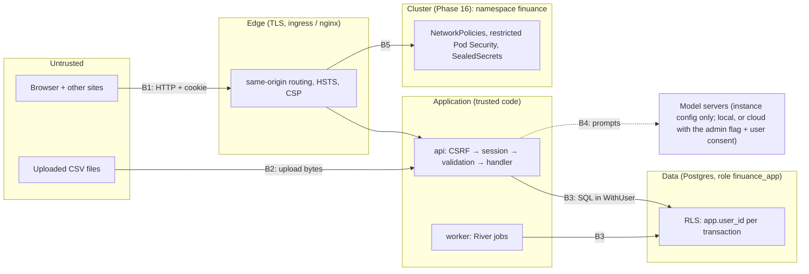

# Threat model (v3)

Version 1 was written in Phase 5, when accounts, sessions and the first protected endpoints arrived. Phase 13 extended it for the assistant (B4, A7, I5, I7, I8, D5), and Phase 16 for the Kubernetes deployment (B5, T6, I10, D7, E4). Phase 18 adds T7 (a single-node cluster on a home network) and I12 (the environment's details). Version 2 (Phase 17) adds the audit log (R1), demo mode (S6, I11, D8) and the security scans (§7, [security-scan.md](security-scan.md)). Phase 19 adds administration and themes (E5, I13, S7, T8), the boundary between users (B6) with friends and notifications (S8, I14), and transactions added by hand (T9); PR 3 adds shared groups across B6 (I15, T10, E6, R2). The baseline controls come from PLAN §8.1. This document states which of them exist today, where they live, and which test proves them.

Version 3 (Phase 23) was written after the repository became public. It adds the repository and the release path as a boundary (B7), the admission chain in the cluster (B8), telemetry as a path data can leave by (B9), and two place-holder boundaries that Phases 25–27 fill in (B10, B11); the rows S10, T15–T17, I19–I21, D13, E8 and E9; and in §5 the risks accepted when a private review's register was closed. That register lives in the private environment repository; this document cites its ids only. Phase 24 adds the synthetic marker (T18) and the collected logs (I22, E10), and settles the two logs that could quote a request (§5). Phase 25 fills in B10 with the traffic simulator and its lab (T19, D14, I23).

**Status legend:** ✅ implemented and tested · 🟡 partly in place · ⏳ planned (phase noted).

## 1. What we protect (assets)

| Asset | Where it lives | Why it matters |
|---|---|---|
| **A1. Financial data** | Postgres tables `transactions`, `import_rows`, `import_files` (raw CSV bytes), annotations, budgets, investments | Bank history reveals income, spending habits, locations, counterparties and account numbers |
| **A2. Credentials** | `users.password_hash` (argon2id PHC strings) | Users reuse passwords elsewhere |
| **A3. Sessions** | `sessions.token_hash` (SHA-256 only); the raw token exists only in the browser cookie | A stolen token is a full login |
| **A4. Account identity** | `users.email`, `display_name` | Personal data; reveals that someone uses the instance |
| **A5. Availability** | api, worker, Postgres on a small homelab node | One user's misuse shouldn't take the instance down |
| **A6. Secrets** | DB role passwords and the LLM API key, in env or Sealed Secrets | Direct access around every app control |
| **A7. Assistant conversations** (Phase 13) | `assistant_chats`, `assistant_messages` (forced RLS); kept 48 h by default, 1–7 days or forever by the user's choice | They contain financial questions, answers and tool results |

## 2. Who might attack (actors)

| Actor | Capability | Typical goal |
|---|---|---|
| **Internet attacker** | Reaches the public origin; scripts requests; runs credential stuffing | Take over accounts, read data, deny service |
| **Malicious website** | Runs JavaScript in a victim's browser while the victim is signed in | CSRF: act as the victim |
| **Other tenant** | A valid account on the same instance (household member, demo visitor) | Read or change someone else's data |
| **Malicious file** | A crafted CSV that a user uploads | Crash or exhaust the parser, or inject formulas into exports |
| **Prompt injector** (Phase 13) | Controls text inside transactions (payee, description) | Steer the assistant into leaking or acting |
| **Operator mistake** | Shell access, logs, backups | Accidental exposure: logs with secrets, a debug query across tenants |
| **Supply chain** | A compromised dependency or base image | Code execution in the api or worker |
| **Outside contributor** (Phase 23) | Opens a pull request from a fork of the public repository; reads every file and the whole history | Run code in CI with the repository's rights, or get a change merged that weakens a control |
| **Client forging telemetry** (Phase 23) | Sends trace headers and long or marked values with ordinary requests | Join someone else's trace, force sampling, or plant text in the logs and traces the operator reads |
| **Holder of a stolen password** (Phase 23) | Knows one account's password (reuse, phishing) | Sign in as that person |
| **Simulator pointed the wrong way** (Phase 25) | The traffic simulator's operator, or a mistake in its settings: its target address, its control page open in a browser | Synthetic users and their imports on the instance with real data, or the simulator driven into a flood |

## 3. Trust boundaries

- **B1, browser → api.** Everything is untrusted input. Requests pass CSRF checks, session resolution, OpenAPI request validation (shape) and domain validation (meaning).
- **B2, uploaded bytes → parser.** The file is hostile until parsed. Size, row, column and time limits apply: the parser limits from Phase 3, the upload limits from Phase 6.
- **B3, application → database.** The app role is subject to row-level security. Even application bugs stay within one tenant.
- **B5, the cluster around the app** (Phase 16). Other workloads on the cluster are untrusted neighbours. Default-deny NetworkPolicies limit who can reach what: Traefik → web and api, the app's pods → PostgreSQL, the monitoring namespace → the metrics ports, and the api → one model server address when the assistant is on. Pods run under the `restricted` Pod Security Standard without a service account token. Secrets are committed only as SealedSecrets; only the controller in the cluster can decrypt them.
- **B6, between users** (Phase 19). Until Phase 19 nothing connected two accounts. Friends (ADR 0027) link two people who exchanged a code; they see each other's display name, never the e-mail address, and nothing else. Notifications carry what another user did to the recipient. Shared groups (ADR 0028) copy chosen expenses (date, amount, payee, category, note, who paid) into a group every member sees, with row-level security by membership. Everything crossing B6 is explicit and minimal; accounts, bank descriptions and raw rows never cross it.
- **B4, application → model servers** (Phase 13, ADR 0015). Connections come from instance config, never from user input. A connection reaches public addresses only with the admin's `cloud` flag (checked at startup and on every dial, so DNS changes don't redirect it), and each user agrees once per cloud connection before their data goes there. The prompt frames bank text as data; tool results for cloud models have long digit runs masked.
- **B7, the public repository and the release path** (Phases 22 and 23). Everyone can read the repository and propose a change. A pull request from a fork runs CI without secrets and only after the maintainer's approval; no workflow runs a fork's code with a write token (`pull_request_target` is not used). `main` takes changes only through pull requests with every required check green; `v*` tags are protected; the release job waits for the maintainer's approval in the `release` environment before anything is built, signed or pushed. Actions are pinned by commit, images by digest, tool binaries by checksum. What a release publishes is signed and carries build provenance (ADR 0037).
- **B8, the admission chain** (Phases 18 and 23). Three checks stand between "a manifest in git" and "a running pod": Argo CD applies only what its projects allow (repositories, namespaces, kinds); a ValidatingAdmissionPolicy admits images from the listed registries only; and in a labelled namespace Sigstore policy-controller admits Finuance's images only by digest and with the release workflow's build provenance (ADR 0039). The environment's values name the digests, so what runs is what the approved release built. The chain is anchored in the repository: whoever can change `main` can change the manifests, the projects and the policies themselves (§5).
- **B9, telemetry** (Phase 23). Logs, traces and metrics leave the process and are read by people and tools with wider access than the database's row-level security gives. They are treated as an output channel like any API response: nothing a user typed, nothing a model wrote and nothing a tool returned may enter them, and nothing a client sends decides what is traced. Identity appears as a hash (`platform.UserHash`).
- **B10, the lab instance and its traffic simulator** (Phase 25, ADR 0043). A lab is an instance started with `FINUANCE_SIMULATION=true`, with synthetic data only; it says so in `GET /meta` and with a "Lab" chip. The simulator (`finuance-sim`) is a client like any other: it reaches the lab through its public address, signs its personas in with passwords derived from a seed it shares with the lab, and gets no path into the instance with real data, where none of its users can exist or sign in (ADR 0041). Its control API and page listen on a port that is not published; a port-forward reaches them, so they need a token as well (T19, D14, I23).
- **B11, cloud models and a cloud cluster** (place-holder; Phases 26 and 27 fill it in). A cloud model sees synthetic data only at first; its credentials are short-lived tokens, not stored keys. The on-demand cloud cluster holds synthetic data and is destroyed after use. The transport rules of I19 already apply to every cloud connection.

## 4. STRIDE

| # | Threat (STRIDE) | Boundary | Control | Status | Where / proof |
|---|---|---|---|---|---|
| S1 | **Spoofing:** password guessing, credential stuffing | B1 | argon2id m=19 MiB, t=2, p=1 (ADR 0010). Login and signup limited to 10/min per (IP, email) and 30/min per IP, checked before hashing (ADR 0012). The same error for an unknown email and a wrong password. | ✅ | `auth/password.go`, `httpapi/handlers_auth.go`; `TestLoginRateLimit`, `TestLoginRotatesAndFailsUniformly` |
| S2 | **Spoofing:** account enumeration through login timing | B1 | An unknown email still runs a full argon2id verify against a dummy hash. Signup does reveal a taken email (409); that is accepted and rate-limited (ADR 0010). | ✅ | `auth/service.go` `Login`; `TestUnknownEmailRunsArgon2` |
| S3 | **Spoofing:** session theft or fixation | B1 | 32 random bytes; only SHA-256 stored. Cookie `HttpOnly; SameSite=Lax; Secure` (not Secure only in dev/test). Idle (7 d) and absolute (30 d) expiry. Rotation on login and password change. Revocation from the sessions list. (ADR 0011) | ✅ | `auth/sessions.go`, `httpapi/session.go`; `TestSessionExpiry`, `TestAuthFlow`, `TestCookieAttributes` |
| S4 | **Spoofing:** CSRF from a malicious site | B1 | Unsafe methods need `X-Finuance-Client: web`, and an `Origin` (if sent) must equal `FINUANCE_PUBLIC_ORIGIN`. This applies to login and signup too. SameSite=Lax is the first layer (ADR 0011). | ✅ | `httpapi/middleware/csrf.go`; `TestCSRF` |
| S5 | **Spoofing:** forgotten password with no email channel | Operator | `finuance admin set-password -password-stdin` resets the password and revokes all sessions. The password never goes in argv. | ✅ | `app/admin.go`; `TestAdminCommands` |
| S6 | **Spoofing:** taking over a demo visitor's session or user | B1 | `POST /auth/demo` creates a new user per visitor (`is_demo`) and signs it in; its address is under the reserved `.invalid` domain and its password random and never shown, so the session cookie (S3) is the only way in. Only on a demo instance (`FINUANCE_DEMO_MODE`); elsewhere the route is `404`. Sign-ups are off there. | ✅ | `auth/demo.go`, `httpapi/handlers_auth.go`; `TestDemoHTTP`, `TestDemoOffHTTP`, `TestDemoMode` |
| T1 | **Tampering:** one tenant changing another's data | B3 | Explicit `user_id` predicates, plus RLS enabled and **forced** with `WITH CHECK` (ADR 0007). FK targets are checked for ownership, because foreign keys bypass RLS. Another user's account or import id is a `404`, never a `403`. | ✅ | `00003_rls.sql`, `ledger/owned.go`; the RLS suite (`store/rls_test.go`), `TestAnnotateRules`, `TestImportErrorsHTTP` |
| T2 | **Tampering:** SQL injection | B1→B3 | sqlc-generated parameterised queries. The only hand-written statement (`InsertImportRows`) binds arrays. The dynamic filter compiler (`internal/query`) builds SQL only from a column whitelist and `$n` placeholders; every user value (conditions, search, unticked values, the assistant filter, a rule's match) is an argument. Rules compile through the same compiler (`query/rules.go`) and update only `t.user_id = $n` rows. Unknown columns are `422`; text with NUL characters is `422`, not a database error. | ✅ | `store/queries/*.sql`, `query/compile.go`; `TestHostileInputOnlyInArgs`, `TestHostileInputAgainstDB`, `FuzzCompile`, `FuzzQueryDB` (nightly, 60 s against Postgres) |
| T3 | **Tampering:** lost updates on preferences | B1 | Optimistic versions: a stale `PUT /preferences` gets `409 stale_version` with the current document | ✅ | `TestPreferences`, `TestPreferencesHTTP` |
| T4 | **Tampering:** CSV/formula injection in exports | B2 | Text cells starting with `= + - @ \t \r` that aren't numbers get a `'` prefix, in the table export and in `transactions.csv` of the data export (ADR 0014) | ✅ | `query/export.go`; `TestGuardCell`, `TestExportCSVHTTP` |
| R1 | **Repudiation:** who did what | — | Access log with request id, route, status and hashed user id. The activity log (`audit_log`, ADR 0021) records sign-ins (also failed ones for an existing account), sign-outs, password changes, revoked sessions, imports, deletions, exports, rule runs, migrations, duplicate decisions and applied assistant proposals with the address and a browser name, shown on Settings → Activity. Append-only for the app role (no UPDATE/TRUNCATE grant, no update policy, no backdating, delete only after 365 days); deleted with the account. | ✅ | `ledger/audit.go`, migration 00010; `TestAuditLogIsAppendOnly`, `TestActivityHTTP` |
| I11 | **Information disclosure:** a demo visitor's data outliving the visit, or reaching another visitor | B3 | Each visitor is a separate user under the same RLS as everyone (T1/I1). An hourly job deletes demo users 24 hours after creation, with all their data (cascade), sessions and activity log included. The migration from the single-file app is refused in the demo. | ✅ | `jobs/demo.go`, `auth/demo.go`; `TestDemoHTTP` (second visitor sees only their own year; cleanup removes the old visitor and nothing else), e2e `demo/demo.spec.ts` |
| I1 | **Information disclosure:** cross-tenant reads | B3 | As T1. Without `app.user_id`, every user table looks empty, even to the owner role. | ✅ | `TestRLSReadsOnlyOwnRows`, `TestRLSWithoutUserSeesNothing` |
| I2 | **Information disclosure:** secrets in logs | Operator | The access log never contains bodies, cookies, query strings, emails or user ids (hash only). Internal error text is hidden in prod problems. | ✅ | `TestLogsNeverContainSecrets`, `TestAccessLog`, `ProblemFor` |
| I3 | **Information disclosure:** stolen database dump | B3 | Password hashes are argon2id. Session tokens are stored hashed. Account numbers live only in `raw`, the counterparty fields and the stored original files (`import_files`, kept so an import can be reprocessed); `number_hint` is the last 4 digits. Backups go to a bucket outside the cluster (RUNBOOK "Backups"); encryption at rest of the volumes and the bucket is the storage's job and is chosen with the backup target in Phase 18. | 🟡 | Hashes ✅, RUNBOOK ✅; ⏳ encryption at rest of the volume and the backup bucket (left to the operator's storage; the chart doesn't set it up) |
| I4 | **Information disclosure:** XSS reading data in the browser | B1 | React escaping; an ESLint rule bans `innerHTML`, `outerHTML` and `dangerouslySetInnerHTML`. nginx sends `default-src 'self'; script-src 'self'; style-src 'self'; connect-src 'self'; frame-ancestors 'none'; base-uri 'none'; form-action 'self'` with `nosniff`, `Referrer-Policy: no-referrer`, a minimal `Permissions-Policy`, `Cross-Origin-Opener-Policy`, `Cross-Origin-Resource-Policy: same-origin` and `Cross-Origin-Embedder-Policy: require-corp` (site isolation against Spectre-style reads), each exactly once (nginx drops the api's copies; the ZAP run found duplicates with different values), and its redirects are relative. On Kubernetes the pages still come from nginx with these headers, and the ingress adds HSTS (a Traefik middleware). | ✅ | `deploy/docker/nginx.conf`, `web/eslint.config.js`, `deploy/helm/finuance/templates/ingress.yaml`; e2e `no CSP violations` and `headers.spec.ts`, CI image job checks the header, weekly ZAP baseline |
| T5 | **Tampering:** prompt injection or a wrong model changes the user's data | B4 | Assistant tools only read (`WithUserReadOnly`); `propose_action` returns a proposal that the server never applies. The user sees a card with the affected rows and applies it through the normal endpoints (session, CSRF, ownership checks, RLS); the ids are fixed when proposed, at most 1,000. Applied proposals are logged (`assistant.action_applied`, no content) until the audit log (ADR 0019). Kinds a user lets the panel apply by itself never include sharing with a shared group or changing a shared split (Phase 22, ADR 0030 note); a proposal without the id it acts on is refused before any request | ✅ | `internal/assistant/tools_actions.go`, `assistant/store.go`, `web/src/api/hooks/assistant.ts`; `TestProposeAction`, `TestAssistantProposalHTTP`, `TestAutoApplyHTTP`, `TestAutoApplyRefusesSharedKinds`, Vitest `proposals.test.ts`, e2e `assistant.spec.ts` |
| I6 | **Information disclosure:** open redirect after sign-in (`?next=`) | B1 | Only same-origin paths are followed (`/x`, never `//host`, `/\\host` or a URL) | ✅ | `web/src/auth/next.ts`; `safeNext` test |
| I5 | **Information disclosure:** prompt injection makes the assistant leak | B4 | Typed read-only tools only (no model-written SQL) in `WithUserReadOnly` (RLS-scoped, `READ ONLY` transaction); no network tools; every lookup is shown as a step; bank text framed as data in the prompt; prompts, outputs and tool results are never logged (one line per run: hashed user, model, rounds, tool names, duration) | ✅ | `assistant/tools.go`, `assistant/run.go`; `TestToolsTenancy`, `TestAssistantChatHTTP` (other user 404), `TestWithUserReadOnlyRejectsWrites` |
| I7 | **Information disclosure:** data sent to a third-party model | B4 | Local connections can't dial public addresses (`llm` dial guard, startup `CheckHosts`); cloud connections need the admin flag, https, and the user's consent (`403 consent_required`); digit runs ≥ 6 masked in tool results for cloud models | ✅ | `llm/http.go`, `config/ai.go`, `assistant/run.go`; `TestPrivateAddressGuard`, `TestCheckHosts`, `TestAIConnectionsFileProblems`, `TestRunLimitsAndConsent` |
| I8 | **Information disclosure:** SSRF through the model endpoint | B4 | Endpoints are instance config only; users choose a connection by name; the API key lives in an environment variable named by the config, never in the file or the database | ✅ | `config/ai.go`; `TestAIConnectionsFileProblems` |
| I9 | **Information disclosure:** a legacy backup's passphrase or encrypted data | B1 | The browser decrypts the backup (WebCrypto); only the plain files and the decrypted settings are uploaded, never the passphrase or the legacy AI key. The uploaded manifest and files are deleted when the run ends; chats copied from it follow the user's retention (ADR 0016). | ✅ | `web/src/legacy/backup.ts`, `legacyimport/migrate.go`; `backup.test.ts`, e2e `legacy.spec.ts` (nothing sent while unlocking), `TestMigratePlainAndLockedBackups` |
| D1 | **Denial of service:** login floods exhausting CPU and memory | B1 | Rate limits before hashing. At most 4 concurrent argon2 hashes (≈ 80 MB). Limiter memory capped at 100k keys per policy with eviction. | ✅ | `TestLimiterEviction`, ADR 0010/0012 |
| D2 | **Denial of service:** hostile CSV (huge, wide, slow) | B2 | 200k rows, 200 columns, context cancellation every 10k rows (Phase 3); the limits apply while a file is split, so the work before a refusal follows the limits, not the file (Phase 22); a cell over 4 KB is cut and makes its row an error, a row's search text is cut at 16 KB. Uploads: `FINUANCE_MAX_UPLOAD_BYTES` (20 MiB) checked exactly on the file, with the request body capped at that plus 64 KiB for multipart framing (every other route stays at 1 MiB); one file per request; a NUL byte in the first 8 KiB is `415`; 30 uploads/min per user. The commit runs as a River job, never in the request. | ✅ | `ingest/parse.go`, `ingest/csv.go`, `ingest/stage.go`, `httpapi/handlers_imports.go`; `TestParseLimitsAndCancellation`, `TestParseHostileShapesStayBounded`, `TestStageBoundsCellsAndSearchText`, `TestImportErrorsHTTP`, `TestUploadRateLimit` |
| D6 | **Denial of service:** huge legacy backups | B1, B2 | `POST /legacy-imports`: each file ≤ `FINUANCE_MAX_UPLOAD_BYTES`, all files ≤ 4×, manifest ≤ 16 MiB, at most 200 files, 500k labels, 200 chats; one run per user (`409 migration_running`); the run is a River job with three attempts | ✅ | `httpapi/handlers_legacy.go`, `legacyimport/manifest.go`; `TestLegacyMigrationRequests`, `TestManifestValidation`, `TestOneRunAtATime` |
| D8 | **Denial of service:** abuse of the public demo (seeding floods, big uploads, model cost) | B1 | New demo users: 5 per hour per address (each seeds a year of transactions, about 1 s). Uploads at most 2 MiB. No migration endpoint. The assistant is off unless `FINUANCE_DEMO_ASSISTANT`; then 10 questions per visitor over its lifetime and lookups of at most 25 rows. The 24-hour cleanup bounds the data. An ingress rate limit comes with the demo deployment (Phase 23). | ✅ | `config.demoLimits`, `httpapi/handlers_auth.go`, `handlers_assistant.go`; `TestDemoHTTP` (429 after 5, 413, 403), `TestDemoAssistantHTTP` |
| D12 | **Denial of service:** requests that keep database connections: waiting for an account's lock while an import commits, statements whose cost the request chooses | B1, B3 | The api's pool sets `lock_timeout` 5 s (`409 account_busy`), `statement_timeout` 30 s (`503 timeout` with `Retry-After`; the streamed export allows itself 15 minutes) and `idle_in_transaction_session_timeout` 1 min; the worker keeps the defaults (Phase 22). Offsets at most 1,000,000, searches at most 16 words | ✅ | `store.RequestTimeouts`, `httpapi/problems.go`, `query/sql.go`; `TestTimeoutsApply`, `TestTimeoutProblems`, `TestQueryCostLimits` |
| D3 | **Denial of service:** oversized JSON bodies | B1 | 1 MiB body limit; the preferences document is capped at 256 KiB | ✅ | `TestBodyLimit`, `TestPreferences` |
| D4 | **Denial of service:** session table growth | B3 | Hourly `CleanupExpiredSessions` River job | ✅ | `TestWorkerRunsJobs` |
| D5 | **Denial of service:** assistant runs exhausting the model server or the api | B1, B4 | One run per user (`409 run_in_progress`), `FINUANCE_AI_MAX_CONCURRENT` per replica (`503 assistant_busy`), `FINUANCE_AI_RATE_PER_HOUR` per user (`429`), total and idle timeouts per model request, six tool rounds per question, history trimmed to the model's context, stop and disconnect cancel the request; chats capped at `FINUANCE_AI_MAX_CHATS` and expired hourly; a daily token budget per user for questions and digests (`assistantTokensPerDay`, bound `FINUANCE_AI_TOKENS_PER_DAY`); background digests opt-in, one at a time per worker, at most one waiting per user, off in demo mode and behind an admin switch (ADR 0033) | ✅ | `assistant/run.go`, `assistant/digest.go`, `jobs/assistant.go`, `jobs/digest.go`; `TestRunLimitsAndConsent`, `TestAssistantStreamStopAndLimits`, `TestRunRoundsLimitAndLoopGuard`, `TestTimeoutsAndCancel`, `TestRetentionAndChatLimit`, `TestDigests`, `TestDigestJobs`, `TestAssistantDigestHTTP`, `TestDigestsInDemoMode` |
| E1 | **Elevation of privilege:** the app role escaping RLS | B3 | `finuance_app` owns no tables and can't run DDL. RLS is forced. Migrations run as `finuance_owner`, which is also bound by FORCE. | ✅ | `TestRiverTablesAndRoles`, `TestEveryUserTableHasForcedRLS` |
| E2 | **Elevation of privilege:** forgetting `WithUser` in new code | B3 | A guard test fails on direct `Query`/`Exec`/`Begin` or `db.New` outside `internal/store` | ✅ | `TestNoDatabaseAccessOutsideStore` |
| E3 | **Elevation of privilege:** supply chain | — | Pinned dependencies and checksummed tool binaries; govulncheck, Trivy and gitleaks in CI; Renovate. Releases carry SPDX SBOMs as cosign attestations and keyless cosign signatures (Phase 14). The cluster's operator charts are pinned in the Argo CD applications, and the rendered manifests are scanned by `trivy config` in CI. Since Phase 17 the image gates fail on HIGH and CRITICAL, the repository is scanned (Go and npm dependencies with dev dependencies, secrets, misconfiguration) and `npm audit` must be clean; base images are pinned by digest and bumped when a rebuild fixes a CVE (§7). Since Phase 18 the homelab admits pods in Finuance's namespaces only with images from the registries listed per namespace (Finuance's own only from `ghcr.io/x2db736ac85h`; our digest-pinned ones only by digest), a built-in `ValidatingAdmissionPolicy`. Since Phase 23 Finuance's images are deployed by digest, and Sigstore policy-controller admits them in a labelled namespace only with the release workflow's signature (ADR 0039; proven in the rehearsal, switched on per cluster by the namespace label). | ✅ | `ci.yml` (`guardrails`, `image`, `security`, `helm`), `release.yml`, [security-scan.md](security-scan.md) |
| T6 | **Tampering / lateral movement:** another workload in the cluster reaches the database or the api directly | B5 | Default-deny NetworkPolicies in the app chart (web, api, worker, migrations) and the database chart (5432 only from the app's pods, the instances and the operator namespace); egress only to DNS, PostgreSQL, the configured model server and the OTLP collector | ✅ | `templates/networkpolicy.yaml` (both charts); `tools/rehearsal.sh netpol` (a pod outside the app can't open 5432, 8080 or 9090; the control reaches another service) |
| T7 | **Lateral movement out of the cluster:** a compromised pod (any namespace, including platform charts without NetworkPolicies) scans or attacks other devices on the host's network; or the cluster's ports are open to that network | B5 | Single-node k3s on a home network (Phase 18, ADR 0022): an nftables table hooked before k3s's and ufw's forward rules drops pod traffic to private, Docker, tailnet and link-local ranges except DNS to the router (`deploy/environments/homelab/host/k3s-lan.nft`; a `ufw route deny` is never reached because kube-router accepts pod traffic first). ufw drops all other input from the LAN; the API server (6443) is not opened. Traefik runs on host ports and the same nftables table drops forwarded 80/443 traffic that doesn't arrive on the Tailscale interface (k3s's service load balancer isn't used: it hid the client's address, so per-address limits saw one address for everyone) | ✅ | RUNBOOK "Bootstrap on single-node k3s" step 2 (pod test: router web UI blocked; DNS, internet, services reachable) and step 10 (a phone on the home Wi-Fi without Tailscale can't connect; a sign-in is recorded with the client's tailnet address) |
| I10 | **Information disclosure:** secrets in git or in plain manifests | B5 | Only SealedSecrets are committed (strict scope: bound to their name and namespace), and only to the private environment repository (ADR 0023): this repository holds none. `make check-sealed` checks both repositories for plain data. `tools/seal-secrets.sh` hands values to kubeseal on stdin, never in a file or argv. Database URLs carry no password (`PGPASSWORD` from the secret). No superuser secret exists (`enableSuperuserAccess: false`). The controller's key is backed up outside git (RUNBOOK). | ✅ | `tools/seal-secrets.sh`, `deploy/k8s/db/templates/cluster.yaml`; CI `helm` job (sealing round trip: no plain data in the output), gitleaks |
| I12 | **Information disclosure:** the deployment environment (personal hardware, home network, host and tailnet names) published through the public repository | B5 | Machine-specific values live in a private environment repository read by Argo CD as a second source (ADR 0023); this repository has placeholders, host-file templates and an example overlay. `make check-env-details` fails on the environment's identifiers in files and unmerged commit messages (patterns kept in the private repository). The certificate's host name is public by design (CT logs): neutral machine name, random tailnet name | ✅ | `tools/check-env-details.sh` in `make check`; `make helm-lint` renders the layering with the example and, locally, the private overlay |
| D7 | **Denial of service:** losing a pod or a node, or a rollout | B5 | api ×2–4 and web ×2 with PodDisruptionBudgets and topology spread, rolling updates with `maxUnavailable: 0`, `preStop` pauses, graceful shutdown; PostgreSQL primary + replica with automatic failover | ✅ | `tools/rehearsal.sh podkill` (k6 through Traefik, zero failed requests while pods are deleted and rolled); on the reference machine `tools/homelab-drill.sh podkill` (23,177 requests, 0 failed) and `… restore` (RTO 71 s, RPO 96 s) |
| E4 | **Elevation of privilege:** escaping a container | B5 | Non-root (uid 65532; nginx as 10101 in the cluster), read-only root filesystem, all capabilities dropped, no privilege escalation, seccomp `RuntimeDefault`, no service account token; the namespace enforces the `restricted` Pod Security Standard | ✅ | `templates/_helpers.tpl`; the rehearsal runs everything in a `restricted` namespace; `trivy config` in CI |
| E5 | **Elevation of privilege:** a user becoming an administrator, or an administrator locking everyone out | B1 | The role is only set by the CLI (`finuance admin create-user -admin`, `grant-admin`) or by another administrator; `/api/v1/admin/*` answers `404` to everyone else and the role is re-read with every request. The last active administrator can't be demoted, disabled or deleted (`409 last_admin`), also not by deleting their own account; demo users are never administrators (ADR 0025) | ✅ | `httpapi/session.go` (`gate`), `auth.GuardLastAdmin`; `TestAdminRoutesAreHidden`, `TestLastAdmin` |
| I13 | **Information disclosure:** an administrator reading people's finances | B1, B3 | The admin API returns accounts, limits and counts only. `internal/admin` can't import the packages that read financial data; its only queries on user-owned tables are fixed counts, run under each user's own context in a read-only transaction. Every administrator action is in the administrator's and the affected account's Activity ("by an administrator"). Not a database guarantee: the app role can still choose any user's context, as it always could; an operator with shell access to the server is trusted (§5) | ✅ | `internal/admin`; `TestAdminCannotReadFinancialData`, `TestAdminImportsNoFinancialPackage`, `TestAdminManagesUsers` |
| I16 | **Information disclosure:** the Developer section (build, tool addresses, how to get into them) seen by someone other than an administrator, or carrying a credential | B1 | Off by default (`FINUANCE_DEVELOPER_MODE`) and refused with demo mode; `GET /api/v1/admin/developer` answers `404` to non-administrators and to administrators while the mode is off, so its existence isn't revealed; `/meta` and `/me` don't mention it, the bundle holds no link, responses are `no-store`. Links are `http`/`https` without user info and text is plain, checked by the api at start and by the chart's schema; notes say how to get a credential, never the credential (ADR 0025 addendum). Residual: what an administrator learns (internal tool addresses, commands) is only useful with cluster access | ✅ | `config.Developer`, `httpapi/handlers_developer.go`; `TestDeveloperInfoHTTP`, `TestDeveloperInfoOff`, `TestDeveloperLinksProblems`, Vitest admin, e2e `admin.spec.ts` |
| S7 | **Spoofing:** a one-time password reused, or an account kept after an administrator disabled it | B1 | One-time passwords are 16 random characters (≈ 79 bits), shown once, and force a new password before anything else works (`403 password_change_required`); the new password must differ. Disabling an account deletes its sessions and refuses sign-ins (`403 account_disabled`, only after the right password, so it reveals nothing to a guesser) | ✅ | `admin.OneTimePassword`, `auth.Login`; `TestDisableResetAndDelete`, `TestAdminManagesUsers` |
| T8 | **Tampering / XSS:** CSS or markup injected through an administrator's colour theme | B1 | A theme is exactly the contract's 16 tokens per variant, each `#rrggbb[aa]`, validated by the server (and the editor); applied with `style.setProperty` on custom properties, never as a stylesheet, so the CSP (`style-src 'self'`) stays. Approval needs every text/surface pair at 4.5:1 (ADR 0026) | ✅ | `instance/theme.go`, `web/src/styles/theme.ts`; `TestParseThemeTokens`, `TestThemesHTTP`, `themes.test.ts` |
| S8 | **Spoofing / enumeration:** guessing a friend code, or finding people through the friends feature | B1, B6 | Codes are 40 random bits, valid at most 70 minutes and once, stored as SHA-256; 10 tries an hour per user and per address, failures audited, one answer for wrong/expired/own. There is no user search; friends see display names only, never e-mail addresses (ADR 0027) | ✅ | `internal/friends`; `TestCodeLifetime`, `TestFriendsHTTP`, `TestFriendCodeTries` |
| I14 | **Information disclosure between users:** a friendship or a notification read by a third user | B6 | `friendships` has forced RLS for its two sides only; notifications are user-owned rows; another user's action writes a notification under the recipient's own context, with ids and display names only | ✅ | migration 00013; `TestFriendshipRLS`, `TestEveryUserTableHasForcedRLS` |
| I15 | **Information disclosure between users:** a member reads another member's accounts, bank descriptions or raw rows through a shared group, or a non-member reads the group | B6 | Groups hold copies, never references; a member's link to their transaction is a private, user-owned row; policies call `shared_member_role()` (SECURITY DEFINER, owned by the schema owner); an invited user sees the group and its members only, someone who left or was never in nothing but their own member row. `shared_group_members` is the one table with RLS enabled but not forced (the function must read it), and the app role is still bound by its policies (ADR 0028) | ✅ | migration 00014; `TestSharedRLS`, `TestSharedGroupsHTTP`, `TestEveryUserTableHasForcedRLS` (lists the exception) |
| T10 | **Tampering between members:** changing someone else's expense or split, inflating a balance, recording a payment between two other people | B6 | Members write only expenses they added and their splits (policy on `added_by`); splits must add up (deferred trigger); payments only by the payer or the payee; member states only move forward (trigger); the owner alone invites, removes and archives; leaving needs a zero balance | ✅ | `TestSharedTrip`, `TestSplits`, `TestSharedRLS`, `TestSharedGroupsHTTP` |
| E6 | **Elevation between users:** joining a group without an invitation, inviting strangers to reach them | B6 | Invites go to friends only (ADR 0027); accepting needs the invited member row; shared groups are off in demo mode and behind the instance switch; owned groups count against `maxSharedGroups` | ✅ | `TestSharedTrip`, `TestSharedGroupsOff`, `TestSharedGroupsLimit` |
| R2 | **Repudiation / deleted accounts:** a member deletes their account to escape a debt, or the others' balances change when someone leaves | B6 | A deleted user's member row and expenses stay (as "Former member", `user_id` set NULL), so balances don't move; group actions are audited for the acting user (Activity) without amounts | ✅ | `TestFormerMember`, `TestDeleteMeRemovesEverything` |
| T9 | **Tampering:** a typed transaction changed by another user, or an imported one edited to hide spending | B1 | Typed rows are ordinary user-owned rows (RLS); only rows with `origin = 'manual'` take typed edits or deletes, imported rows keep the bank's values; every change is in the Activity (ADR 0029) | ✅ | `ledger/manual.go`; `TestManualTransactions`, `TestManualTransactionsHTTP`, `TestImportedRowsStayTheBanks` |
| T12 | **Tampering:** the assistant changing data without the user's review (auto-apply), or a change that can't be taken back | B4 | Tools stay read-only; a change is a proposal applied by the panel through the normal endpoints. *Apply by itself* is opt-in per kind (none by default), never for more than 50 rows, never for a digest's proposals, and the card says it happened. Every applied proposal is recorded with what it replaced, in the same transaction, and Undo restores it unless something changed since (`409 changed_since`; ADR 0030) | ✅ | `ledger/ai_changes.go`, `internal/aichanges`; `TestAIChangeRecordedWithTheChange`, `TestRevertRefusedWhenChangedSince`, `TestAutoApplyHTTP` |
| I18 | **Information disclosure:** a receipt photo carrying the phone's location, device or time (EXIF), or kept after its chat | B1, B4 | The browser draws the photo into a new JPEG (≤ 1,600 px), and the server decodes and encodes it again, so no metadata survives; photos are deleted with their chat (its retention) and unsent ones after a day; they go to the model with their question only; a cloud connection's consent covers photos (ADR 0032) | ✅ | `internal/images`, `assistant/attachments.go`, `web/src/assistant/photos.ts`; `TestNormalize`, `TestAttachments`, `TestAssistantAttachmentsHTTP` |
| D9 | **Denial of service:** an image that decodes into gigabytes (decompression bomb) or floods of photos | B1 | JPEG only, ≤ 2 MiB (body limit on the route), the header's dimensions checked before decoding (≤ 2,048 px a side and ≤ 2,048² pixels), at most 3 photos a question and 6 waiting per chat, the assistant's rate and daily token limits (ADR 0032, ADR 0033) | ✅ | `internal/images`, `middleware/headers.go`; `TestNormalize`, `TestMaxBytes`, `TestAssistantAttachmentsHTTP` |
| T13 | **Tampering:** text printed on a photo steering the assistant (prompt injection through an image) | B4 | Same limits as bank text (T5): read-only tools, changes only as proposals the user reviews; `attach_receipt` repeats the amount, date and shop and resolves the payment itself (no ids from the model), refuses a tie, and is not offered for *Apply by itself* | ✅ | `assistant/tools_receipts.go`; `TestReceiptTools`, `TestReceiptsHTTP` |
| T14 | **Tampering:** amounts so large that totals overflow: a member's expense breaking the shared group's balances, a cash row or an import breaking the user's own totals | B1, B2 | Every amount a request carries is at most ±10¹² minor units (`money.MaxAbsMinor`, the API's schema); at import staging a larger amount, debit or credit is a row error; the tables check the same bound (`NOT VALID`, RUNBOOK "Validating the amount checks"); a total beyond `bigint` anyway is `422` (Phase 22) | ✅ | `money/money.go`, `ingest/stage.go`, migration 00026; `TestAmountBoundsHTTP`, `TestAmountBounds`, `TestStageAmountRange`, `TestInRange` |
| I17 | **Information disclosure:** a model server's API key entered in Administration → Assistant read from the database, the API or a backup, or sent to another server | B1, B3, B4 | Sealed with AES-256-GCM under `FINUANCE_INSTANCE_KEY` (a sealed secret on Kubernetes), the connection's name as associated data, a random nonce each time; write-only in the API (the panel shows stored / none / unreadable); changing the address or cloud setting drops a kept key; never logged or audited; without the instance key no key can be stored (ADR 0035) | ✅ | `internal/secret`, `assistant/stored.go`; `TestSealOpen`, `TestStoredConnections`, `TestAssistantAdminHTTP` |
| D11 | **Denial of service:** an administrator (or a stolen administrator session) loading models until the model server runs out of memory, or switching every connection off | B1 | Administrators only (re-checked per request, CSRF; access tokens never reach `/admin/*`, ADR 0036); loading only models the connection offers, one request at a time from the panel; the server unloads by its own timer; every switch, load and unload is audited as `admin.assistant_changed`; switching off never deletes anything (ADR 0035 addendum) | ✅ | `TestAssistantControlsHTTP`, `TestModelManagement`, `testdata/token-routes.golden` |
| T11 | **Tampering:** an administrator's instructions, a model's note or an advice article steering every user's assistant (prompt injection by an insider), or a connection pointed at a hostile server | B1, B4 | The instructions (≤ 2,000 characters) and notes follow the app's rules, which say tools only read and every number comes from a lookup; tools stay read-only and changes stay proposals the user applies; articles are framed as general information and named in the answer; a panel connection follows the file's rules (private addresses unless cloud, https and user consent for cloud) and the dial guard; every change is audited (ADR 0034, ADR 0035). An administrator is trusted with the instance (ADR 0025) | ✅ accepted | `assistant/prompt.go`, `assistant/stored.go`; `TestRunInstructions`, `TestStoredConnections` |
| S9 | **Spoofing:** a stolen personal access token used against the account, or a token used from a page in someone's browser (CSRF) | B1 | Tokens are 256 random bits, stored as SHA-256, shown once, at most a year, revocable, and ended by a new password, an administrator's reset or sign-out-everywhere and by disabling; a read token can't change anything; 600 requests a minute per token on top of the user's limits; use is recorded (last used); a bearer request ignores cookies and a browser never adds the header by itself, so CSRF doesn't apply; making and revoking are audited (ADR 0036) | ✅ | `auth/tokens.go`, `httpapi/session.go`; `TestAccessTokens`, `TestAccessTokensHTTP` |
| E7 | **Elevation of privilege:** a token reaching the admin panel, the password, sessions, tokens or account deletion, or a read token writing | B1 | A route policy per route pattern (never / read / write) checked before the token is resolved; `TestTokenRoutePolicy` keeps every route's class in a golden file and fails when an admin, auth, password, session or token route is reachable or a POST reads without being listed (ADR 0036) | ✅ | `httpapi/tokens.go`; `TestTokenRoutePolicy`, `TestAccessTokensHTTP` |
| D10 | **Denial of service / information disclosure:** a web page in a browser on the operator's machine reaching Prometheus or Alertmanager through an open port-forward: a plain cross-site POST to Prometheus's `/-/quit` or `/-/reload` (turned on by `--web.enable-lifecycle`), or reading metrics through DNS rebinding | B5 | The admin tools are reached only through port-forwards on loopback, open only while used: `make observe` binds 127.0.0.1 and [::1] only, refuses a port another program holds and stops every forward on Ctrl-C; there are no always-on forwards for the tools without a sign-in (Grafana and Argo CD have one). The local ports are fixed and checked by `tools/check-port-forwards.sh`. Remaining: while a forward is open, a malicious page could make Prometheus restart (operational metrics only, no user data) | 🟡 | `tools/observe.sh`, `tools/observe-test.sh`, RUNBOOK "Local ports" |
| S10 | **Spoofing:** signing in with a stolen password; guessing or replaying the second step | B1 | Optional two-step sign-in with one-time codes (RFC 6238; ADR 0040): the secret is sealed under the instance key, a code is accepted within one step of drift and never twice, a sign-in challenge lives five minutes and takes five attempts, and a limiter per user bounds codes across challenges. Ten recovery codes, stored hashed, each usable once. Enrolment and removal need a session (never an access token) and the password; confirming ends the account's other sessions. An instance can require it of administrators: without it every administration route answers `403`. A lost device is handled by another administrator or `finuance admin remove-second-factor`, both recorded in the activity log. | ✅ | `TestTOTPVectors`, `TestVerifyTOTP`, `TestRecoveryCodes`, `TestSecondStepSignIn`, `TestChallengeLimits`, `TestSecondFactorIsPerUser`, `TestAdministratorsNeedSecondFactor`; `web/e2e/two-step.spec.ts` |
| T15 | **Tampering:** an image that the release workflow did not build runs as Finuance (a pushed tag moved, a look-alike image, a manifest edited to another digest's tag) | B8 | Deploy by digest (`image.digests`, required for every environment by `tools/check-pins.sh`); in a labelled namespace policy-controller admits `finuance-api` and `finuance-web` only with the release workflow's signed build provenance, fails closed, and refuses an image no policy names. The registry list stays the first check. | ✅ | `tools/rehearsal.sh signatures` (the released images admitted; another signer's image, the unsigned local build and an unnamed image refused); `tools/check-helm.sh` compares the policy's signer with `release.yml`; RUNBOOK step 16 |
| T16 | **Tampering:** a client's trace headers joining its request to another trace, forcing sampling, or carrying values into jobs (baggage) | B9 | Every request starts a new root span; the client's context is kept as a link only. The propagator is W3C trace context without baggage, so nothing a client sent travels on to a job. | ✅ | `TestClientTraceContextIsNotTrusted` |
| T17 | **Tampering:** a change to the repository that weakens a control: a workflow edited in a pull request, an action or image replaced under the same tag, a dependency with a known flaw or an unwanted licence | B7 | Required checks and the `main` and tag rulesets; workflows with read-only tokens by default, linted by actionlint and zizmor; every action by commit SHA and every image by digest (`tools/check-pins.sh`); dependency review, CodeQL, osv-scanner and Trivy on every pull request; Renovate proposes updates; the release needs the maintainer's approval. | ✅ | `.github/workflows/`; RUNBOOK "Checking the settings"; [security-scan.md](security-scan.md) |
| I19 | **Information disclosure:** a cloud connection made to reach an internal address (a name that resolves to one, a redirect), or its key sent to another host or over a weak channel | B4 | Every dial of a cloud connection is checked against the address the name resolved to: no loopback, private, link-local, tailnet, reserved or IPv4-in-IPv6 address. https only, TLS 1.2 or newer, and no redirect to another host, port or scheme. The configuration refuses such a literal address at start-up. | ✅ | `TestPublicAddr`, `TestCloudTransportGuard`, `TestNoRedirectToAnotherHost`, `TestTLSMinimum` |
| I20 | **Information disclosure:** user text reaching logs or traces: a query string, a statement's parameters, a database error quoting a value, a prompt, a model's answer or a tool result | B9 | The span exporter is wrapped by a filter that drops caller address, user agent, query string, statement text and error text; database errors are logged as SQLSTATE, constraint, table and column; PostgreSQL logs no parameters; nginx logs the path without the query string in a fixed JSON format. A canary test runs a marked question, tool call, tool result and answer, with a failing model server, and searches every log line and span. | ✅ | `TestRedactedSpans`, `TestRequestSpanCarriesNoUserText`, `TestSafeError`, `TestLoggerWritesSafeErrors`, `internal/assistant/canary_test.go`; `tools/check-access-log.sh` on the running stack |
| I21 | **Information disclosure:** the database connection read or redirected inside the cluster | B5 | `database.sslmode: verify-full` with the cluster's CA certificate mounted (the certificate only, never its key): the api, the worker and the migration job check the server's certificate and name. | ✅ where it is switched on (the reference environment, the rehearsal, the restore drill); the chart's default stays `require` | `tools/check-helm.sh`; `tools/rehearsal.sh` |
| D13 | **Denial of service:** floods that reach the api before its own limiters can help, or many requests in flight from one address | B1 | Optional Traefik middlewares in the chart (`ingress.limits`, off by default): a limit per client address for `/api/v1/auth/`, a wider one for everything else, and a cap on requests in flight. Inside the api, failed sign-ins are also counted per e-mail address whatever the client, IPv6 clients per /64, and a full limiter forgets its oldest keys instead of being reset. | ✅ | `tools/rehearsal.sh limits` (of 60 sign-ins in a row 40 answered `429`, normal use unaffected); `docs/deploying.md` |
| E8 | **Elevation of privilege:** a pod in the app's namespace that is not part of the app (or one that copies a label) reaching the database, the api or the network | B5 | The default deny selects every pod of the namespace (`networkPolicy.namespaceWide`); names are resolved in kube-system only; the database admits the api, the worker and the migration job by name and component and names its own pods' egress; the metrics ports are open to Prometheus's pods only. The chart refuses a range of trusted proxies while the policies are off. | ✅ | `tools/rehearsal.sh netpol` (an unlabelled pod and pods whose labels are not enough, each with a control); `tools/check-helm.sh` |
| E9 | **Elevation of privilege:** a manifest in a platform folder creating something it should not (a workload in another namespace, a cluster role) through Argo CD | B8 | The project `platform-manifests` allows exactly the kinds that the admission policy's and Tempo's manifests and the rendered telemetry chart use, in `monitoring`, and in `finuance` the telemetry chart's Role and RoleBinding only (E10); `check-helm.sh` compares the list with the folders and the chart. It bounds a mistake in those folders; it does not stop someone who can change `main` (§5). | ✅ | `deploy/k8s/argocd/apps/projects.yaml`; `tools/check-helm.sh` |
| I22 | **Information disclosure:** collected logs (Loki, 14 days) read by more people and for longer than a pod's own log: a request line with its query string, a database error quoting a value, a log store open to any pod | B9 | Alloy changes every line in one place before it reaches Loki (ADR 0042): nginx's error lines lose the request line, the upstream address and the referrer; PostgreSQL's lines lose an error's detail, its statement, its context and an internal query. Loki takes pushes from Alloy only and queries from Grafana only (NetworkPolicy), and keeps lines 14 days. Traces pass Alloy too, which deletes the same span attributes as the app. | ✅ | `tools/check-observability.sh` (the stages on sample lines against an expectation, and a guard for the cut fields); `tools/rehearsal.sh logs` (a failing statement's value does not reach Loki); `TestCollectorDropsTheSameAttributes` |
| E10 | **Elevation of privilege:** the log collector's token used for more than reading logs | B8, B9 | Alloy's service account has a Role in each namespace it reads (only `finuance` on the reference environment): get, list and watch pods, get their logs; no cluster role, nothing else. With logs off no Role exists and no token is mounted. Residual: the token shows the namespace's pod specs, which hold no secret values (those come from Secrets by reference). | ✅ | `tools/check-helm.sh` (the Roles' rules, their subject, the namespaces they go to, and logs off) |
| T18 | **Tampering:** a client bending the numbers: a person marking their requests as synthetic to keep failures out of the error budget, or load passed off as people's use | B9, B10 | Whether traffic is synthetic is read from the signed-in user's row (`users.kind`, ADR 0041), never from a header, cookie, query or body; a job inherits it from the server's context. A user is made synthetic only on an instance started with `FINUANCE_SIMULATION`, never an administrator, and elsewhere such a user can't sign in or use a session or token. A synthetic user can't befriend a person. | ✅ | `TestTrafficLabelComesFromTheUser`, `TestSyntheticUsersNeedASimulationInstance`, `TestSyntheticGuardRails`, `TestSyntheticJobs`; a `promtool` case |
| T19 | **Tampering:** the simulator's personas and imports written into the instance with real data, because its target was set to the wrong address | B10 | Two independent refusals: the simulator starts only when the target's `GET /meta` reports `simulation: true`, and an instance without `FINUANCE_SIMULATION` can't make a user synthetic and refuses a synthetic user's sign-in, session and token (T18). `finuance admin synthetic-users` refuses outside a lab before it touches anything, and never changes a person's account at a persona's address. Sign-up stays off on a lab; the personas are made by that command only. | ✅ | `TestSyntheticUsers`, `TestSyntheticUsersNeedASimulationInstance`, `TestRefusesAnInstanceThatIsNotALab` |
| D14 | **Denial of service:** the simulator turned into a load generator, through its tuning page or its control API: a web page in the operator's browser reaching the port-forward (as D10), or a setting far above what a lab can take | B10 | The ceilings are in the code, not the page: at most 50 personas, a maximum rate per persona, one assistant run at a time, back-off on `429` and after five `5xx` in a row. The control API is not published through the ingress; it needs a control token compared in constant time, `X-Finuance-Client` and a matching `Origin`. | ✅ | The ceilings: `TestCeilings`, `TestPause`, `TestOneQuestionAtATime`, `TestBackoff`; the control API: `TestGuard`, `TestConfiguration` |
| I23 | **Information disclosure / spoofing:** the simulator's seed read from its Secret or a values file, which gives every persona's password | B10 | The seed is a Secret (never a value in git) of at least 32 bytes, read from stdin by the admin command and never printed; it opens the personas' accounts on a lab only, and a lab holds synthetic data only. A new seed resets every persona's password and ends their sessions and tokens. Accepted: anyone with the seed can act as the animals on that lab. | ✅ | `TestSyntheticUsers`, `internal/sim/identity` tests; the charts take the seed and the control token from Secrets only (`tools/check-helm.sh`) |

## 5. Accepted risks and assumptions

- **Rate limits are per replica** (ADR 0012). With N api replicas an attacker gets N× the budget. Accepted for N ≤ 4, the HPA's maximum in the chart (Phase 16). Revisit if the deployment scales further.
- **Signup reveals whether an email is registered.** Accepted for a self-hosted instance. `FINUANCE_ALLOW_SIGNUP=false` closes it.
- **Two-step sign-in is optional** (TOTP, ADR 0040, since Phase 23); an instance can require it of administrators. An account without it is protected by its password, the login limiters and the activity log. **There is no email verification**: personal instances run with signup disabled and admin-created accounts. Passkeys and OIDC are in the backlog.
- **TLS terminates at the ingress or nginx.** The api trusts `X-Forwarded-For` only from `FINUANCE_TRUSTED_PROXIES`.
- **`LIKE` is marked LEAKPROOF** (`bootstrap.sql`, Phase 7) so search can use its trigram index under RLS. A leakproof function may run on other users' rows before the policy filters them. `textlike` only errors on a malformed pattern (the user's own input), never because of a row's value, so it reveals nothing. Any other function given this flag needs the same review.
- **Prompt injection can still mislead an answer** (a payee named "ignore previous instructions"). It can't write, reach the network or another user; the user sees every lookup behind an answer. A cloud model sees the looked-up rows of a user who agreed to that connection.
- **Assistant rate limits and the one-run-per-user rule are per replica**, like the other limits.
- **The cluster's administrators and the Sealed Secrets controller key are trusted.** Whoever holds cluster-admin or the controller key can read every secret, and with it the database.
- **The model server's API has no authentication** (LM Studio). The NetworkPolicy limits the api to it, but anything else that can reach its port can use it; keep it on the tailnet or behind a firewall (ADR 0020).
- **Instance administrators are trusted with accounts, not with finances** (ADR 0025): they can create, disable and delete accounts and reset passwords, so a malicious administrator can lock someone out or sign in as them after a reset (the user sees the reset in Activity). They can't read anyone's transactions through the product.
- **Demo limits are per replica and per address** like the others: visitors behind one NAT share the 5-per-hour budget, and a distributed attacker can create more. The 24-hour cleanup bounds what they leave behind; the demo deployment adds an ingress limit (Phase 29).
- **Medium and low scan findings without a reachable path stay until their base image is rebuilt** (listed with the reason in [security-scan.md](security-scan.md)); HIGH and CRITICAL fail the build and are never accepted.
- **A compromised host or database superuser is out of scope.** It can read everything. Disk encryption and backup encryption reduce what a stolen disk or backup reveals.

Accepted in version 3 (Phase 23), each with the id of the private register's row where it has one:

- **Write access to `main` is cluster access** (`OPS-1`, `OPS-4`; the maintainer, 2026-11-20). Argo CD does not verify commit signatures, and `main` does not require signed commits. The projects, the applications and the image policies come from the same repository, so they bound mistakes, not a person who can merge. What protects `main` is the GitHub account (two-factor authentication and a passkey), the rulesets and the required checks. Verifying signatures would still rest on that account, because merges made on GitHub are signed with GitHub's key; it stays in the backlog.
- **A NetworkPolicy reaches a new pod a moment after the pod starts.** In the rehearsal a pod that connected in its first seconds got out of the namespace before the default deny applied to it. The policies are therefore a boundary for running workloads, not for the first seconds of a hostile one; what keeps a hostile pod from starting at all is B8 and the restricted Pod Security Standard.
- **The signature check fails closed.** With the label on a namespace, no new Finuance pod starts there while the controller is down or cannot reach the registry and Sigstore's services; running pods are not affected. On one machine that is accepted, and the way back is one label (RUNBOOK step 16).
- **Backups are unencrypted, on the same disk as the database, and travel over plain http to the bucket inside the cluster** (`OPS-3`, `OPS-6`; the maintainer, 2026-11-17). The bucket is reachable from inside the cluster only and the network policies limit who can reach it; a stolen disk reveals the backups together with the database. RUNBOOK "Connecting backup storage outside the machine" says how to add a copy elsewhere; the Sealed Secrets controller key is kept off the machine.
- **`GET /meta` tells a signed-out client the exact version** (`API-10`). The repository and its releases are public, so the version tells an attacker nothing that the release notes do not; what matters is running a supported version (`SECURITY.md`).
- **User ids are time-ordered (UUIDv7) and a friend sees the other's id** (`API-11`). A friend can learn roughly when an account was created. An id cannot be derived from another, and no endpoint accepts a user id without a relationship check.
- **Deleting an account deletes its activity log** (`IMP-8`; ADR 0021). Someone who takes an account over and deletes it leaves no record in the application. The request still appears in the access log with the hashed user id, for as long as the operator keeps logs.
- **A pod's own log can still quote a request** (Phase 24 settled the collected copy, I22). nginx's error log names the request line, with its query string, when a request fails at the proxy; and PostgreSQL's log keeps the detail and the statement of a failing statement, which can quote a value. The collector cuts both before Loki, so they stay only in the container's log on the machine (`kubectl logs`, rotated by the kubelet), where an operator needs them to fix a failure. PostgreSQL's message stays in Loki: it names a constraint or a type, and only a few kinds (invalid input syntax) quote a value, which the API validates before a query.
- **`friendships` accepts a row from either of its two sides** (`DB-2`, rest). The database cannot see the friend code; the application checks it, and a code works once.
- **Sign-in and administration tables are protected by the application's code paths, not by the database** (`DB-1`, second half). A guard test keeps the statements that write them inside the sign-in, administration and cleanup code; moving them behind database functions is in the backlog.
- **The Compose deployment can be made to listen on every interface over plain http** (`FINUANCE_WEB_BIND=0.0.0.0`; `OPS-11`). It is for a TLS proxy on another machine; the default is the loopback address, and production mode sends secure cookies only, so a browser on plain http cannot stay signed in.
- **CI keeps the E2E run's report and traces for seven days when it fails, and every run's screenshots for thirty** (`OPS-11`). They hold requests of test accounts with synthetic data only.
- **Argo CD's root application uses the `default` project** (`OPS-11`). It creates only Application and AppProject objects from one folder; like the first item, a tighter project would bound a mistake, not someone who can merge.
- **On Kubernetes, `/api/` goes from the ingress straight to the api**, so API responses carry the api's own headers and not nginx's (`OPS-11`). They are JSON and need no content security policy; the pages and scripts, which do, are always served by nginx (I4).

## 6. Review checklist for new endpoints

1. Is the route public? If so, add it to `publicRoutes` with a reason. Otherwise it is protected automatically.
2. Does it write? CSRF applies automatically to every non-GET method.
3. Does it read or write user data? It must go through `ledger`/`auth` methods that use `WithUser`. Add an "other user gets 404" test.
4. Does it store a reference to another user-owned row? Check ownership in the same transaction (`ledger/owned.go`).
5. Is it expensive (hashing, parsing, model calls)? Give it a rate-limit policy (ADR 0012).
6. Could it log user data, or put it into a span? It must not (B9). Extend the redaction test if it adds a new field; log a database error as a value so that `platform.SafeError` applies.
7. Does it end the caller's own session or account? Leave it out of the ZAP API scan in `tools/zap-scan.sh`; every other operation in `api/openapi.yaml` is attacked by the weekly scan automatically.
8. Is it something a demo visitor shouldn't do (expensive, large uploads, data leaving the instance)? Refuse it when `FINUANCE_DEMO_MODE` is on, with a test.
9. Does it change who can sign in or what a session may do (passwords, the second step, tokens, roles)? Session only, never an access token; ask for the current password; record it in the activity log.

## 7. Security testing

| Scan | What | When | Gate |
|---|---|---|---|
| Trivy image | both images, OS and Go/npm packages (a checksum-verified binary reading `docker save` tarballs; results at every severity in code scanning) | every push and release | HIGH/CRITICAL fail |
| Trivy fs | repository: Go and npm dependencies (dev included), secrets, Dockerfiles and manifests (results in code scanning) | every push (`security` job) | HIGH/CRITICAL fail |
| osv-scanner | `backend/go.mod` and both npm lockfiles against OSV | every push (`security` job) and daily | any fails; no ignore list |
| Daily scan | govulncheck, `npm audit`, osv-scanner, and Trivy against the **released** images' digests; acceptances that expire within a week | daily (`daily-scan.yml`) | a finding opens or updates the `security-scan` issue; a clean run closes it |
| CodeQL | Go, JavaScript/TypeScript, the workflows, the Python helpers | pull requests, pushes to `main`, weekly | alerts triaged: fixed, or dismissed with the reason in security-scan.md |
| Dependency review | what a pull request adds or updates: advisories and licences | every pull request | moderate or higher fails; a licence outside the allowlist fails |
| OpenSSF Scorecard | the repository's supply-chain practices | weekly and pushes to `main` | reviewed; the score in security-scan.md |
| actionlint, zizmor | the workflows (permissions, injection, credentials, pinned actions) | every push (`workflows` job), `make check` when installed | any fails |
| Pins | every action by commit SHA, every image the repository doesn't build by digest (`tools/check-pins.sh`) | `make check` | any fails |
| trufflehog | the whole git history, verified secrets | once (Phase 22), gitleaks stays the gate | any is rotated and recorded |
| Trivy config | the rendered Helm charts | every push (`helm` job) | HIGH/CRITICAL fail; all severities reviewed in Phase 17 |
| `npm audit` | web dependencies, production and all | every push | HIGH fails |
| govulncheck | reachable Go vulnerabilities | every push | any fails |
| gitleaks | the git history | every push | any fails |
| OWASP ZAP | baseline (passive) on the web app, active API scan from `api/openapi.yaml` signed in as its own user | weekly and on demand (`weekly.yml`, `make zap`) | any WARN or FAIL not in `.zap/rules.tsv` fails |
| OpenVAS / Nessus | the deployed instance | Phase 18 | findings fixed or documented |

The current results and the reason for every finding that isn't fixed are in [security-scan.md](security-scan.md).
