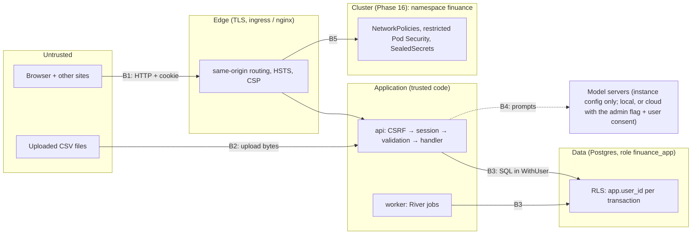

# Threat model (v2)

Version 1 was written in Phase 5, when accounts, sessions and the first protected endpoints arrived. Phase 13 extended it for the assistant (B4, A7, I5, I7, I8, D5), and Phase 16 for the Kubernetes deployment (B5, T6, I10, D7, E4). Phase 18 adds T7 (a single-node cluster on a home network) and I12 (the environment's details). Version 2 (Phase 17) adds the audit log (R1), demo mode (S6, I11, D8) and the security scans (§7, [security-scan.md](security-scan.md)). The baseline controls come from PLAN §8.1. This document states which of them exist today, where they live, and which test proves them.

**Status legend:** ✅ implemented and tested · 🟡 partly in place · ⏳ planned (phase noted).

## 1. What we protect (assets)

| Asset | Where it lives | Why it matters |
|---|---|---|
| **A1. Financial data** | Postgres tables `transactions`, `import_rows`, `import_files` (raw CSV bytes), annotations, budgets, investments | Bank history reveals income, spending habits, locations, counterparties and account numbers |
| **A2. Credentials** | `users.password_hash` (argon2id PHC strings) | Users reuse passwords elsewhere |
| **A3. Sessions** | `sessions.token_hash` (SHA-256 only); the raw token exists only in the browser cookie | A stolen token is a full login |
| **A4. Account identity** | `users.email`, `display_name` | Personal data; reveals that someone uses the instance |
| **A5. Availability** | api, worker, Postgres on a small homelab node | One user's misuse shouldn't take the instance down |
| **A6. Secrets** | DB role passwords and the LLM API key, in env or Sealed Secrets | Direct access around every app control |
| **A7. Assistant conversations** (Phase 13) | `assistant_chats`, `assistant_messages` (forced RLS); kept 48 h by default, 1–7 days or forever by the user's choice | They contain financial questions, answers and tool results |

## 2. Who might attack (actors)

| Actor | Capability | Typical goal |
|---|---|---|
| **Internet attacker** | Reaches the public origin; scripts requests; runs credential stuffing | Take over accounts, read data, deny service |
| **Malicious website** | Runs JavaScript in a victim's browser while the victim is signed in | CSRF: act as the victim |
| **Other tenant** | A valid account on the same instance (household member, demo visitor) | Read or change someone else's data |
| **Malicious file** | A crafted CSV that a user uploads | Crash or exhaust the parser, or inject formulas into exports |
| **Prompt injector** (Phase 13) | Controls text inside transactions (payee, description) | Steer the assistant into leaking or acting |
| **Operator mistake** | Shell access, logs, backups | Accidental exposure: logs with secrets, a debug query across tenants |
| **Supply chain** | A compromised dependency or base image | Code execution in the api or worker |

## 3. Trust boundaries

- **B1, browser → api.** Everything is untrusted input. Requests pass CSRF checks, session resolution, OpenAPI request validation (shape) and domain validation (meaning).
- **B2, uploaded bytes → parser.** The file is hostile until parsed. Size, row, column and time limits apply: the parser limits from Phase 3, the upload limits from Phase 6.
- **B3, application → database.** The app role is subject to row-level security. Even application bugs stay within one tenant.
- **B5, the cluster around the app** (Phase 16). Other workloads on the cluster are untrusted neighbours. Default-deny NetworkPolicies limit who can reach what: Traefik → web and api, the app's pods → PostgreSQL, the monitoring namespace → the metrics ports, and the api → one model server address when the assistant is on. Pods run under the `restricted` Pod Security Standard without a service account token. Secrets are committed only as SealedSecrets; only the controller in the cluster can decrypt them.
- **B4, application → model servers** (Phase 13, ADR 0015). Connections come from instance config, never from user input. A connection reaches public addresses only with the admin's `cloud` flag (checked at startup and on every dial, so DNS changes don't redirect it), and each user agrees once per cloud connection before their data goes there. The prompt frames bank text as data; tool results for cloud models have long digit runs masked.

## 4. STRIDE

| # | Threat (STRIDE) | Boundary | Control | Status | Where / proof |
|---|---|---|---|---|---|
| S1 | **Spoofing:** password guessing, credential stuffing | B1 | argon2id m=19 MiB, t=2, p=1 (ADR 0010). Login and signup limited to 10/min per (IP, email) and 30/min per IP, checked before hashing (ADR 0012). The same error for an unknown email and a wrong password. | ✅ | `auth/password.go`, `httpapi/handlers_auth.go`; `TestLoginRateLimit`, `TestLoginRotatesAndFailsUniformly` |
| S2 | **Spoofing:** account enumeration through login timing | B1 | An unknown email still runs a full argon2id verify against a dummy hash. Signup does reveal a taken email (409); that is accepted and rate-limited (ADR 0010). | ✅ | `auth/service.go` `Login`; `TestUnknownEmailRunsArgon2` |
| S3 | **Spoofing:** session theft or fixation | B1 | 32 random bytes; only SHA-256 stored. Cookie `HttpOnly; SameSite=Lax; Secure` (not Secure only in dev/test). Idle (7 d) and absolute (30 d) expiry. Rotation on login and password change. Revocation from the sessions list. (ADR 0011) | ✅ | `auth/sessions.go`, `httpapi/session.go`; `TestSessionExpiry`, `TestAuthFlow`, `TestCookieAttributes` |
| S4 | **Spoofing:** CSRF from a malicious site | B1 | Unsafe methods need `X-Finuance-Client: web`, and an `Origin` (if sent) must equal `FINUANCE_PUBLIC_ORIGIN`. This applies to login and signup too. SameSite=Lax is the first layer (ADR 0011). | ✅ | `httpapi/middleware/csrf.go`; `TestCSRF` |
| S5 | **Spoofing:** forgotten password with no email channel | Operator | `finuance admin set-password -password-stdin` resets the password and revokes all sessions. The password never goes in argv. | ✅ | `app/admin.go`; `TestAdminCommands` |
| S6 | **Spoofing:** taking over a demo visitor's session or user | B1 | `POST /auth/demo` creates a new user per visitor (`is_demo`) and signs it in; its address is under the reserved `.invalid` domain and its password random and never shown, so the session cookie (S3) is the only way in. Only on a demo instance (`FINUANCE_DEMO_MODE`); elsewhere the route is `404`. Sign-ups are off there. | ✅ | `auth/demo.go`, `httpapi/handlers_auth.go`; `TestDemoHTTP`, `TestDemoOffHTTP`, `TestDemoMode` |
| T1 | **Tampering:** one tenant changing another's data | B3 | Explicit `user_id` predicates, plus RLS enabled and **forced** with `WITH CHECK` (ADR 0007). FK targets are checked for ownership, because foreign keys bypass RLS. Another user's account or import id is a `404`, never a `403`. | ✅ | `00003_rls.sql`, `ledger/owned.go`; the RLS suite (`store/rls_test.go`), `TestAnnotateRules`, `TestImportErrorsHTTP` |
| T2 | **Tampering:** SQL injection | B1→B3 | sqlc-generated parameterised queries. The only hand-written statement (`InsertImportRows`) binds arrays. The dynamic filter compiler (`internal/query`) builds SQL only from a column whitelist and `$n` placeholders; every user value (conditions, search, unticked values, the assistant filter, a rule's match) is an argument. Rules compile through the same compiler (`query/rules.go`) and update only `t.user_id = $n` rows. Unknown columns are `422`; text with NUL characters is `422`, not a database error. | ✅ | `store/queries/*.sql`, `query/compile.go`; `TestHostileInputOnlyInArgs`, `TestHostileInputAgainstDB`, `FuzzCompile`, `FuzzQueryDB` (nightly, 60 s against Postgres) |
| T3 | **Tampering:** lost updates on preferences | B1 | Optimistic versions: a stale `PUT /preferences` gets `409 stale_version` with the current document | ✅ | `TestPreferences`, `TestPreferencesHTTP` |
| T4 | **Tampering:** CSV/formula injection in exports | B2 | Text cells starting with `= + - @ \t \r` that aren't numbers get a `'` prefix, in the table export and in `transactions.csv` of the data export (ADR 0014) | ✅ | `query/export.go`; `TestGuardCell`, `TestExportCSVHTTP` |
| R1 | **Repudiation:** who did what | — | Access log with request id, route, status and hashed user id. The activity log (`audit_log`, ADR 0021) records sign-ins (also failed ones for an existing account), sign-outs, password changes, revoked sessions, imports, deletions, exports, rule runs, migrations, duplicate decisions and applied assistant proposals with the address and a browser name, shown on Settings → Activity. Append-only for the app role (no UPDATE/TRUNCATE grant, no update policy, no backdating, delete only after 365 days); deleted with the account. | ✅ | `ledger/audit.go`, migration 00010; `TestAuditLogIsAppendOnly`, `TestActivityHTTP` |
| I11 | **Information disclosure:** a demo visitor's data outliving the visit, or reaching another visitor | B3 | Each visitor is a separate user under the same RLS as everyone (T1/I1). An hourly job deletes demo users 24 hours after creation, with all their data (cascade), sessions and activity log included. The migration from the single-file app is refused in the demo. | ✅ | `jobs/demo.go`, `auth/demo.go`; `TestDemoHTTP` (second visitor sees only their own year; cleanup removes the old visitor and nothing else), e2e `demo/demo.spec.ts` |
| I1 | **Information disclosure:** cross-tenant reads | B3 | As T1. Without `app.user_id`, every user table looks empty, even to the owner role. | ✅ | `TestRLSReadsOnlyOwnRows`, `TestRLSWithoutUserSeesNothing` |
| I2 | **Information disclosure:** secrets in logs | Operator | The access log never contains bodies, cookies, query strings, emails or user ids (hash only). Internal error text is hidden in prod problems. | ✅ | `TestLogsNeverContainSecrets`, `TestAccessLog`, `ProblemFor` |
| I3 | **Information disclosure:** stolen database dump | B3 | Password hashes are argon2id. Session tokens are stored hashed. Account numbers live only in `raw`, the counterparty fields and the stored original files (`import_files`, kept so an import can be reprocessed); `number_hint` is the last 4 digits. Backups go to a bucket outside the cluster (RUNBOOK "Backups"); encryption at rest of the volumes and the bucket is the storage's job and is chosen with the backup target in Phase 18. | 🟡 | Hashes ✅, RUNBOOK ✅; ⏳ Phase 18 volume and bucket encryption |
| I4 | **Information disclosure:** XSS reading data in the browser | B1 | React escaping; an ESLint rule bans `innerHTML`, `outerHTML` and `dangerouslySetInnerHTML`. nginx sends `default-src 'self'; script-src 'self'; style-src 'self'; connect-src 'self'; frame-ancestors 'none'; base-uri 'none'; form-action 'self'` with `nosniff`, `Referrer-Policy: no-referrer`, a minimal `Permissions-Policy`, `Cross-Origin-Opener-Policy`, `Cross-Origin-Resource-Policy: same-origin` and `Cross-Origin-Embedder-Policy: require-corp` (site isolation against Spectre-style reads), each exactly once (nginx drops the api's copies; the ZAP run found duplicates with different values), and its redirects are relative. On Kubernetes the pages still come from nginx with these headers, and the ingress adds HSTS (a Traefik middleware). | ✅ | `deploy/docker/nginx.conf`, `web/eslint.config.js`, `deploy/helm/finuance/templates/ingress.yaml`; e2e `no CSP violations` and `headers.spec.ts`, CI image job checks the header, weekly ZAP baseline |
| T5 | **Tampering:** prompt injection or a wrong model changes the user's data | B4 | Assistant tools only read (`WithUserReadOnly`); `propose_action` returns a proposal that the server never applies. The user sees a card with the affected rows and applies it through the normal endpoints (session, CSRF, ownership checks, RLS); the ids are fixed when proposed, at most 1,000. Applied proposals are logged (`assistant.action_applied`, no content) until the audit log (ADR 0019) | ✅ | `internal/assistant/tools_actions.go`; `TestProposeAction`, `TestAssistantProposalHTTP`, e2e `assistant.spec.ts` |
| I6 | **Information disclosure:** open redirect after sign-in (`?next=`) | B1 | Only same-origin paths are followed (`/x`, never `//host`, `/\\host` or a URL) | ✅ | `web/src/auth/next.ts`; `safeNext` test |
| I5 | **Information disclosure:** prompt injection makes the assistant leak | B4 | Typed read-only tools only (no model-written SQL) in `WithUserReadOnly` (RLS-scoped, `READ ONLY` transaction); no network tools; every lookup is shown as a step; bank text framed as data in the prompt; prompts, outputs and tool results are never logged (one line per run: hashed user, model, rounds, tool names, duration) | ✅ | `assistant/tools.go`, `assistant/run.go`; `TestToolsTenancy`, `TestAssistantChatHTTP` (other user 404), `TestWithUserReadOnlyRejectsWrites` |
| I7 | **Information disclosure:** data sent to a third-party model | B4 | Local connections can't dial public addresses (`llm` dial guard, startup `CheckHosts`); cloud connections need the admin flag, https, and the user's consent (`403 consent_required`); digit runs ≥ 6 masked in tool results for cloud models | ✅ | `llm/http.go`, `config/ai.go`, `assistant/run.go`; `TestPrivateAddressGuard`, `TestCheckHosts`, `TestAIConnectionsFileProblems`, `TestRunLimitsAndConsent` |
| I8 | **Information disclosure:** SSRF through the model endpoint | B4 | Endpoints are instance config only; users choose a connection by name; the API key lives in an environment variable named by the config, never in the file or the database | ✅ | `config/ai.go`; `TestAIConnectionsFileProblems` |
| I9 | **Information disclosure:** a legacy backup's passphrase or encrypted data | B1 | The browser decrypts the backup (WebCrypto); only the plain files and the decrypted settings are uploaded, never the passphrase or the legacy AI key. The uploaded manifest and files are deleted when the run ends; chats copied from it follow the user's retention (ADR 0016). | ✅ | `web/src/legacy/backup.ts`, `legacyimport/migrate.go`; `backup.test.ts`, e2e `legacy.spec.ts` (nothing sent while unlocking), `TestMigratePlainAndLockedBackups` |
| D1 | **Denial of service:** login floods exhausting CPU and memory | B1 | Rate limits before hashing. At most 4 concurrent argon2 hashes (≈ 80 MB). Limiter memory capped at 100k keys per policy with eviction. | ✅ | `TestLimiterEviction`, ADR 0010/0012 |
| D2 | **Denial of service:** hostile CSV (huge, wide, slow) | B2 | 200k rows, 200 columns, context cancellation every 10k rows (Phase 3). Uploads: `FINUANCE_MAX_UPLOAD_BYTES` (20 MiB) checked exactly on the file, with the request body capped at that plus 64 KiB for multipart framing (every other route stays at 1 MiB); one file per request; a NUL byte in the first 8 KiB is `415`; 30 uploads/min per user. The commit runs as a River job, never in the request. | ✅ | `ingest/parse.go`, `httpapi/handlers_imports.go`; `TestParseLimitsAndCancellation`, `TestImportErrorsHTTP`, `TestUploadRateLimit` |
| D6 | **Denial of service:** huge legacy backups | B1, B2 | `POST /legacy-imports`: each file ≤ `FINUANCE_MAX_UPLOAD_BYTES`, all files ≤ 4×, manifest ≤ 16 MiB, at most 200 files, 500k labels, 200 chats; one run per user (`409 migration_running`); the run is a River job with three attempts | ✅ | `httpapi/handlers_legacy.go`, `legacyimport/manifest.go`; `TestLegacyMigrationRequests`, `TestManifestValidation`, `TestOneRunAtATime` |
| D8 | **Denial of service:** abuse of the public demo (seeding floods, big uploads, model cost) | B1 | New demo users: 5 per hour per address (each seeds a year of transactions, about 1 s). Uploads at most 2 MiB. No migration endpoint. The assistant is off unless `FINUANCE_DEMO_ASSISTANT`; then 10 questions per visitor over its lifetime and lookups of at most 25 rows. The 24-hour cleanup bounds the data. An ingress rate limit comes with the demo deployment (Phase 19). | ✅ | `config.demoLimits`, `httpapi/handlers_auth.go`, `handlers_assistant.go`; `TestDemoHTTP` (429 after 5, 413, 403), `TestDemoAssistantHTTP` |
| D3 | **Denial of service:** oversized JSON bodies | B1 | 1 MiB body limit; the preferences document is capped at 256 KiB | ✅ | `TestBodyLimit`, `TestPreferences` |
| D4 | **Denial of service:** session table growth | B3 | Hourly `CleanupExpiredSessions` River job | ✅ | `TestWorkerRunsJobs` |
| D5 | **Denial of service:** assistant runs exhausting the model server or the api | B1, B4 | One run per user (`409 run_in_progress`), `FINUANCE_AI_MAX_CONCURRENT` per replica (`503 assistant_busy`), `FINUANCE_AI_RATE_PER_HOUR` per user (`429`), total and idle timeouts per model request, six tool rounds per question, history trimmed to the model's context, stop and disconnect cancel the request; chats capped at `FINUANCE_AI_MAX_CHATS` and expired hourly | ✅ | `assistant/run.go`, `jobs/assistant.go`; `TestRunLimitsAndConsent`, `TestAssistantStreamStopAndLimits`, `TestRunRoundsLimitAndLoopGuard`, `TestTimeoutsAndCancel`, `TestRetentionAndChatLimit` |
| E1 | **Elevation of privilege:** the app role escaping RLS | B3 | `finuance_app` owns no tables and can't run DDL. RLS is forced. Migrations run as `finuance_owner`, which is also bound by FORCE. | ✅ | `TestRiverTablesAndRoles`, `TestEveryUserTableHasForcedRLS` |
| E2 | **Elevation of privilege:** forgetting `WithUser` in new code | B3 | A guard test fails on direct `Query`/`Exec`/`Begin` or `db.New` outside `internal/store` | ✅ | `TestNoDatabaseAccessOutsideStore` |
| E3 | **Elevation of privilege:** supply chain | — | Pinned dependencies and checksummed tool binaries; govulncheck, Trivy and gitleaks in CI; Renovate. Releases carry SPDX SBOMs as cosign attestations and keyless cosign signatures (Phase 14). The cluster's operator charts are pinned in the Argo CD applications, and the rendered manifests are scanned by `trivy config` in CI. Since Phase 17 the image gates fail on HIGH and CRITICAL, the repository is scanned (Go and npm dependencies with dev dependencies, secrets, misconfiguration) and `npm audit` must be clean; base images are pinned by digest and bumped when a rebuild fixes a CVE (§7). | ✅ | `ci.yml` (`guardrails`, `image`, `security`, `helm`), `release.yml`, [security-scan.md](security-scan.md) |
| T6 | **Tampering / lateral movement:** another workload in the cluster reaches the database or the api directly | B5 | Default-deny NetworkPolicies in the app chart (web, api, worker, migrations) and the database chart (5432 only from the app's pods, the instances and the operator namespace); egress only to DNS, PostgreSQL, the configured model server and the OTLP collector | ✅ | `templates/networkpolicy.yaml` (both charts); `tools/rehearsal.sh netpol` (a pod outside the app can't open 5432, 8080 or 9090; the control reaches another service) |
| T7 | **Lateral movement out of the cluster:** a compromised pod (any namespace, including platform charts without NetworkPolicies) scans or attacks other devices on the host's network; or the cluster's ports are open to that network | B5 | Single-node k3s on a home network (Phase 18, ADR 0022): an nftables table hooked before k3s's and ufw's forward rules drops pod traffic to private, Docker, tailnet and link-local ranges except DNS to the router (`deploy/environments/homelab/host/k3s-lan.nft`; a `ufw route deny` is never reached because kube-router accepts pod traffic first). ufw drops all other input from the LAN; the API server (6443) is not opened. Traefik runs on host ports and the same nftables table drops forwarded 80/443 traffic that doesn't arrive on the Tailscale interface (k3s's service load balancer isn't used: it hid the client's address, so per-address limits saw one address for everyone) | ✅ | RUNBOOK "Bootstrap on single-node k3s" step 2 (pod test: router web UI blocked; DNS, internet, services reachable) and step 10 (a phone on the home Wi-Fi without Tailscale can't connect; a sign-in is recorded with the client's tailnet address) |
| I10 | **Information disclosure:** secrets in git or in plain manifests | B5 | Only SealedSecrets are committed (strict scope: bound to their name and namespace). `tools/seal-secrets.sh` hands values to kubeseal on stdin, never in a file or argv. Database URLs carry no password (`PGPASSWORD` from the secret). No superuser secret exists (`enableSuperuserAccess: false`). The controller's key is backed up outside git (RUNBOOK). | ✅ | `tools/seal-secrets.sh`, `deploy/k8s/db/templates/cluster.yaml`; CI `helm` job (sealing round trip: no plain data in the output), gitleaks |
| I12 | **Information disclosure:** the deployment environment (personal hardware, home network, host and tailnet names) published through the public repository | B5 | Machine-specific values live in a private environment repository read by Argo CD as a second source (ADR 0023); this repository has placeholders, host-file templates and an example overlay. `make check-env-details` fails on the environment's identifiers in files and unmerged commit messages (patterns kept in the private repository). The certificate's host name is public by design (CT logs): neutral machine name, random tailnet name | ✅ | `tools/check-env-details.sh` in `make check`; `make helm-lint` renders the layering with the example and, locally, the private overlay |
| D7 | **Denial of service:** losing a pod or a node, or a rollout | B5 | api ×2–4 and web ×2 with PodDisruptionBudgets and topology spread, rolling updates with `maxUnavailable: 0`, `preStop` pauses, graceful shutdown; PostgreSQL primary + replica with automatic failover | ✅ | `tools/rehearsal.sh podkill` (k6 through Traefik, zero failed requests while pods are deleted and rolled) |
| E4 | **Elevation of privilege:** escaping a container | B5 | Non-root (uid 65532; nginx as 10101 in the cluster), read-only root filesystem, all capabilities dropped, no privilege escalation, seccomp `RuntimeDefault`, no service account token; the namespace enforces the `restricted` Pod Security Standard | ✅ | `templates/_helpers.tpl`; the rehearsal runs everything in a `restricted` namespace; `trivy config` in CI |

## 5. Accepted risks and assumptions

- **Rate limits are per replica** (ADR 0012). With N api replicas an attacker gets N× the budget. Accepted for N ≤ 4, the HPA's maximum in the chart (Phase 16). Revisit if the deployment scales further.
- **Signup reveals whether an email is registered.** Accepted for a self-hosted instance. `FINUANCE_ALLOW_SIGNUP=false` closes it.
- **There is no MFA and no email verification** in v1. Personal instances run with signup disabled and admin-created accounts. OIDC is in the backlog.
- **TLS terminates at the ingress or nginx.** The api trusts `X-Forwarded-For` only from `FINUANCE_TRUSTED_PROXIES`.
- **`LIKE` is marked LEAKPROOF** (`bootstrap.sql`, Phase 7) so search can use its trigram index under RLS. A leakproof function may run on other users' rows before the policy filters them. `textlike` only errors on a malformed pattern (the user's own input), never because of a row's value, so it reveals nothing. Any other function given this flag needs the same review.
- **Prompt injection can still mislead an answer** (a payee named "ignore previous instructions"). It can't write, reach the network or another user; the user sees every lookup behind an answer. A cloud model sees the looked-up rows of a user who agreed to that connection.
- **Assistant rate limits and the one-run-per-user rule are per replica**, like the other limits.
- **The cluster's administrators and the Sealed Secrets controller key are trusted.** Whoever holds cluster-admin or the controller key can read every secret, and with it the database.
- **The model server's API has no authentication** (LM Studio). The NetworkPolicy limits the api to it, but anything else that can reach its port can use it; keep it on the tailnet or behind a firewall (ADR 0020).
- **Demo limits are per replica and per address** like the others: visitors behind one NAT share the 5-per-hour budget, and a distributed attacker can create more. The 24-hour cleanup bounds what they leave behind; the demo deployment adds an ingress limit (Phase 19).
- **Medium and low scan findings without a reachable path stay until their base image is rebuilt** (listed with the reason in [security-scan.md](security-scan.md)); HIGH and CRITICAL fail the build and are never accepted.
- **A compromised host or database superuser is out of scope.** It can read everything. Disk encryption and backup encryption reduce what a stolen disk or backup reveals.

## 6. Review checklist for new endpoints

1. Is the route public? If so, add it to `publicRoutes` with a reason. Otherwise it is protected automatically.
2. Does it write? CSRF applies automatically to every non-GET method.
3. Does it read or write user data? It must go through `ledger`/`auth` methods that use `WithUser`. Add an "other user gets 404" test.
4. Does it store a reference to another user-owned row? Check ownership in the same transaction (`ledger/owned.go`).
5. Is it expensive (hashing, parsing, model calls)? Give it a rate-limit policy (ADR 0012).
6. Could it log user data? It must not. Extend the redaction test if it adds a new field.
7. Does it end the caller's own session or account? Leave it out of the ZAP API scan in `tools/zap-scan.sh`; every other operation in `api/openapi.yaml` is attacked by the weekly scan automatically.
8. Is it something a demo visitor shouldn't do (expensive, large uploads, data leaving the instance)? Refuse it when `FINUANCE_DEMO_MODE` is on, with a test.

## 7. Security testing

| Scan | What | When | Gate |
|---|---|---|---|
| Trivy image | both images, OS and Go/npm packages | every push and release | HIGH/CRITICAL fail |
| Trivy fs | repository: Go and npm dependencies (dev included), secrets, Dockerfiles and manifests | every push (`security` job) | HIGH/CRITICAL fail |
| Trivy config | the rendered Helm charts | every push (`helm` job) | HIGH/CRITICAL fail; all severities reviewed in Phase 17 |
| `npm audit` | web dependencies, production and all | every push | HIGH fails |
| govulncheck | reachable Go vulnerabilities | every push | any fails |
| gitleaks | the git history | every push | any fails |
| OWASP ZAP | baseline (passive) on the web app, active API scan from `api/openapi.yaml` signed in as its own user | weekly and on demand (`weekly.yml`, `make zap`) | any WARN or FAIL not in `.zap/rules.tsv` fails |
| OpenVAS / Nessus | the deployed instance | Phase 18 | findings fixed or documented |

The current results and the reason for every finding that isn't fixed are in [security-scan.md](security-scan.md).
