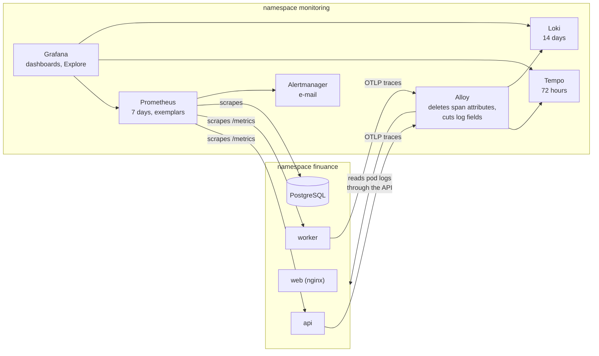

# Observability

What the api and the worker tell an operator, and how the three signals are joined: **logs** (one
JSON object per line on standard error, collected into Loki), **metrics** (Prometheus, on the admin
port) and **traces** (OpenTelemetry, sent over OTLP when an endpoint is configured). The service-level objectives and
their alerts are in [SLO.md](SLO.md); the dashboards, rules and how to reach Grafana are in
[RUNBOOK.md](RUNBOOK.md).

No signal carries what a person typed, what a model wrote or what a tool returned: no bodies, no
query strings, no statement parameters, no prompt or answer text. A user appears as a hash
([THREAT-MODEL.md](THREAT-MODEL.md), boundary B9 and row I20).

## Where the signals go

On Compose, `make up-observability` runs the same dashboards in Grafana's `otel-lgtm` image: the
api and the worker send their traces to it, its Prometheus scrapes their admin ports, and an Alloy
container reads the containers' logs through the Docker socket and applies the same stages as on
Kubernetes. The links between the signals described below (a log line's `trace_id` opens the
trace, a span's "Logs for this span" lists its lines, an exemplar on a latency panel opens one
request's trace) are configured for the Kubernetes install: the Loki data source comes with
`deploy/k8s/telemetry`, the Tempo and Prometheus ones with the monitoring values. `otel-lgtm`
brings its own data sources.

## Log fields

In production every line is one JSON object. The fields below mean the same on every line; the
list is `observability.LogFields` in the code, and a test keeps this table and that list in step.
A line may add fields of its own (`count`, `import`, `error`, `connection`, …) but never uses one
of these names for something else.

| Field | On which lines | Meaning |
|---|---|---|
| `time` | all | when the line was written (RFC 3339, with nanoseconds) |
| `level` | all | `DEBUG`, `INFO`, `WARN` or `ERROR` |
| `msg` | all | a fixed sentence per call site, never built from data; `request` is the access line |
| `request_id` | everything written while a request is served, and every line of a job it queued (and of the jobs that job queued) | the id the response carries in `X-Request-ID` and a problem response in `requestId`; a failed import or migration shows it as its reference |
| `trace_id` | everything written inside a span: a request, a job, an assistant run | the OpenTelemetry trace id; the same id finds the trace in Tempo |
| `span_id` | as `trace_id` | the span that was current when the line was written |
| `user` | the access line of a signed-in request, the assistant's run line | the first 8 bytes of SHA-256 of the user id, in hex; never the id or the e-mail address |
| `route` | the access line | the route pattern (`GET /api/v1/imports/{id}`), never the path with its values; `unmatched` for a 404 |
| `method` | the access line | the HTTP method |
| `status` | the access line | the status sent; 500 when the handler panicked before sending anything |
| `bytes` | the access line | the size of the response body |
| `duration_ms` | the access line, the assistant's run line | how long it took |
| `client_ip` | the access line | the client's address as the trusted proxies report it |
| `job_id` | every line a job writes | River's id of the job |
| `kind` | every line a job writes | the job's kind (`commit_import`, `reclassify`, …) |
| `attempt` | every line a job writes | which attempt this is, from 1 |
| `traffic` | the access line, every line a job writes | `real`, or `synthetic` for the traffic simulator's users and the jobs they queue; decided by the server from the user's row, never by the request |

A line gets `trace_id` and `span_id` from the context it is logged with, so code logs with its
context (`InfoContext` and friends; the linter requires it where a context is in scope). Errors
logged as values are written as their class only: for a database error the SQLSTATE, constraint,
table and column, never its message.

## Following one request

1. **From what the user saw.** The response header `X-Request-ID` (and `requestId` in a problem
   response) is the `request_id` of every line the request wrote.
2. **To its lines.** The access line (`msg` = `request`) has the route, status and duration; a
   `request failed` or `panic` line with the same `request_id` says what went wrong.
3. **To its trace.** Any of those lines has the `trace_id`. The trace shows the request, its
   database statements and, when the request queued a job, the job as a child span.
4. **To the job's lines.** The job's lines carry the same `request_id` and `trace_id`, and their
   own `job_id`, `kind` and `attempt`.

**A failed import.** When an import's commit fails for the last time, the toast and the import
window say "The import could not be committed. … (Reference: <id>)". The reference is the
`request_id` of the request that queued the commit (the upload, or *Commit* in the import
window): `{namespace="finuance"} | request_id="<id>"` lists that request's access line and the
worker's `commit_import failed` line after the last attempt, with the error's class; the
`trace_id` on either opens the trace, where the request's span has the job's three attempts below
it, each with an error status and its SQL. A failed migration from the single-file app works the same way. The
reference names a request, not a user: anyone who can read the logs can follow it, nobody else
learns anything from it.

In Grafana: Explore → Loki, `{namespace="finuance"} | request_id="<id>"` finds the request's lines;
a line's `trace_id` opens the trace in Tempo; in the trace, a span's "Logs for this span" goes back
to Loki with `| trace_id="<id>"`, which also finds the job's lines.

The kubelet's probes (`/healthz`, `/readyz`) are not traced, and their access lines are written at
debug level only; a failing probe is an error line like any other failing request. A handler that
panics is one access line with status 500, one `panic` line with the stack, one 5xx in
`http_server_requests_total`, one in `finuance_panics_total`, and the alert `FinuancePanic`.

## Collected logs

On Kubernetes, Grafana Alloy reads the logs of every pod in the app's namespace through the
Kubernetes API and writes them to Loki, which keeps them 14 days ([ADR 0042](adr/0042-log-and-trace-pipeline.md);
the chart is `deploy/k8s/telemetry`). The Compose profile `make up-observability` does the same
for the project's containers, into the Loki inside its `otel-lgtm` container.

| In Loki | What |
|---|---|
| labels | `namespace`, `pod`, `container` (`api`, `worker`, `migrate`, `web`, `postgres`; `db` in Compose) and, on the lines that carry it, `traffic` |
| structured metadata | `trace_id` and `request_id` from the app's lines, `request_id` from nginx's access log; Loki adds `detected_level` |
| the line | as written, except what the stages cut |

What the stages cut before a line reaches Loki (`deploy/k8s/telemetry/files/stages.alloy`; a test
runs them on sample lines): from nginx's error log the request line, the upstream address and the
referrer; from PostgreSQL an error's detail, its statement, its context and an internal query. The
container's own log on the machine keeps them (THREAT-MODEL §5).

Queries that come up often:

- a request and the jobs it queued: `{namespace="finuance"} | request_id="<id>"`
- a trace's lines, a job's included: `{namespace="finuance"} | trace_id="<id>"`
- the api's warnings and errors: `{namespace="finuance", container="api"} | detected_level=~"warn|error"`
- one job: `{namespace="finuance", container="worker"} | json | job_id="<id>"`
- synthetic users' requests only: `{namespace="finuance", traffic="synthetic"}`

The API and jobs dashboards end with log panels (their **Logs** variable picks the Loki data
source). `logs.enabled: false` in the chart's values switches the logs off; Alloy then still
carries the traces.

## Traces

A request is one trace: the server span named after the route pattern, its database statements
(without their text), and below it whatever the request started.

| Span | Kind | What it covers | Its own attributes |
|---|---|---|---|
| the route pattern, e.g. `POST /api/v1/imports/{id}/commit` | server | one request; always a new trace, a client's `traceparent` is only kept as a link | the HTTP method, route and status |
| `job <kind>` | consumer | one attempt of a job, as a child of the request that queued it | `river.kind`, `river.job_id`, `river.attempt`, `river.queue` |
| `assistant.run` | internal | one question to the assistant | `assistant.mode`, `assistant.result`, `assistant.rounds` |
| `llm.request` | client | one request to a model server | `gen_ai.operation.name`, `gen_ai.provider.name`, `gen_ai.request.model`, `gen_ai.response.time_to_first_chunk`, `gen_ai.usage.input_tokens` and `gen_ai.usage.output_tokens` when the server reports them, `error.type`, `assistant.connection`, `assistant.round` |
| `assistant.tool` | internal | one tool call | `assistant.tool` (the tool's name, or `unknown`) |

The `gen_ai.*` names follow the OpenTelemetry GenAI conventions, which were still in development
when they were last checked (2026-11-20); they may be renamed. No span carries a prompt, an answer,
a tool's arguments or its result, and no trace context is sent to a model server.

Every span's resource names the service (`service.name`: `finuance-api` or `finuance-worker`), its
version, the environment (`deployment.environment.name`) and the instance (`service.instance.id`).
On Kubernetes the chart adds `k8s.pod.name` and `k8s.namespace.name` from the pod's own fields, and
`otel.resourceAttributes` in the values adds more.

On Kubernetes the traces go to Alloy, which deletes the same attributes as the app (a second line
of defence) and sends them on to Tempo (ADR 0042).

`FINUANCE_OTEL_SAMPLE_RATIO` (the chart's `otel.sampleRatio`; default 1) is the share of requests
that are traced. The decision is made once, at the request: a trace is kept whole or not at all,
and a job follows the request that queued it.

## Metrics

The api and the worker serve Prometheus metrics on their admin port (`/metrics`, never through the
ingress). The full list is `deploy/k8s/observability/metrics.txt`, kept in step with the code by a
test. Labels are bounded: a route is its pattern, a job its kind, and no label carries a user.

| Metric | Labels | What it says |
|---|---|---|
| `http_server_requests_total` | `route`, `method`, `status_class` | every request, a panicking one included |
| `http_server_request_duration_seconds` | `route` | how long requests take; each bucket carries one request's trace id as an exemplar |
| `finuance_panics_total` | | handlers that panicked; any increase raises `FinuancePanic` |
| `finuance_rate_limited_total` | `limiter` | requests the api's own limiters refused, by limiter (`login_ip`, `login_failed`, `upload`, `assistant`, …) |
| `finuance_auth_failures_total` | `reason` | failed sign-ins: `password` or `second_step` |
| `finuance_jobs_total`, `finuance_job_duration_seconds` | `kind`, `result` | the worker's jobs |
| `finuance_imports_total`, `finuance_import_rows_total` | `result`; `kind` | committed imports and their rows |
| `finuance_assistant_runs_total`, `…_run_duration_seconds` | `mode`, `result` | questions to the assistant |
| `finuance_assistant_model_requests_total` | `connection`, `result` | requests to model servers and how they ended |
| `finuance_llm_request_duration_seconds` | `connection` | one request to a model server, to the end of its answer |
| `finuance_llm_time_to_first_token_seconds` | `connection` | until the first piece of the answer arrives |
| `finuance_llm_tokens_total` | `connection`, `direction` | tokens as the model servers report them (`input`, `output`) |

The assistant's metrics come from both processes: the api answers chats and the worker writes the
digests, so their dashboard and the alert `FinuanceAssistantModelErrors` read both jobs.

**Exemplars.** A scraper that asks for the OpenMetrics format gets, with each latency bucket, the
trace id of one request that fell into it. With `exemplar-storage` switched on in Prometheus and the
Tempo link on Grafana's Prometheus data source (both set in the reference environment's monitoring
values), the dots on "p95 by route" open that request's trace.

## Errors in the browser

A person who meets a failure on the server's side sees its request id with the message
("… (Reference: cf0ff0a8…)"), which is the `request_id` to search the logs for.

Errors that happen in the browser itself are counted in `finuance_client_errors_total{kind}` and
written as one `client error` line each:

| `kind` | Sent by | When |
|---|---|---|
| `error` | the web app, `POST /api/v1/client-events` | an uncaught error |
| `unhandled_rejection` | the web app | a promise nobody handled |
| `render` | the web app | a screen failed to draw; the person sees "This screen couldn't be shown" |
| `csp` | the browser, `POST /api/v1/csp-reports` | the content security policy blocked something |

The web app sends the kind, the error's class name (`TypeError`) and the screen's route pattern
(`/imports/:id`), and the API's contract refuses anything else: no message, no stack, no address
with its values or query. At most five reports per page load, and thirty a minute per client
address at the server. A browser's policy report is counted and thrown away unread, because it
quotes addresses. Both routes work without a session; the report route is the one route that takes
a request without the client header, since the browser sends it by itself, and it changes nothing.

## Synthetic traffic

A lab instance can run a traffic simulator whose users are marked as synthetic in the database
([ADR 0041](adr/0041-synthetic-users.md)). The server labels what they cause, and nothing a client
sends can set or clear the label:

- **Logs:** `traffic` is `synthetic` on the access line and on every line of a job such a user
  queued. In Loki, `traffic="synthetic"` shows only the simulator and `traffic!="synthetic"` hides it.
- **Metrics:** the label `traffic` (`real`, `synthetic`) on `http_server_requests_total`,
  `http_server_request_duration_seconds`, `finuance_jobs_total`, `finuance_assistant_runs_total`,
  `finuance_assistant_tool_calls_total` and `finuance_assistant_model_requests_total`. Every
  dashboard has a **Traffic** selector (all, real, synthetic).
- **Traces:** the request's and the job's span carry `finuance.synthetic=true`; in Tempo, search
  for that attribute.
- **Objectives:** the service-level rules leave synthetic traffic out, so the error budget
  describes what people experience. A lab, where the simulator is the traffic, sets
  `slo.includeSynthetic: true` in the observability chart.

Synthetic users exist only on an instance started with `FINUANCE_SIMULATION=true`; elsewhere they
can't be made and can't sign in.

### The simulator

The traffic simulator (`finuance-sim`, [simulator.md](simulator.md), ADR 0043) is that traffic. Four
things to know when reading it:

- **Requests without a user count as real:** signing in, `GET /meta`, the probes, unknown paths
  and a path parameter in the wrong format (the router refuses it before the session is known). So
  a lab shows some real traffic even when only the animals use it. The rehearsal's `lab` stage
  checks that nothing else of theirs is counted as real.
- **Its own view:** `finuance_sim_actions_total{persona,action,result}`,
  `finuance_sim_action_duration_seconds{action}`, `finuance_sim_active_personas`,
  `finuance_sim_paused` and `finuance_sim_config_generation`, on the dashboard "Finuance ·
  Simulator", next to the latency the lab itself measured.
- **From an action to its trace:** the page's feed shows each action's request id, the id the
  server answered. Search the logs for it, and a line's `trace_id` opens the trace. On Kubernetes
  the ingress passes the simulator's own `sim-<animal>-…` id to the api; on Compose the web server
  gives every request its own (23.4).
- **On Compose, Loki has no `traffic` label:** the containers' logs reach it as text. The feed's
  link therefore searches every service for the id (`{service_name=~".+"} |= "<id>"`), which works
  in both places.
