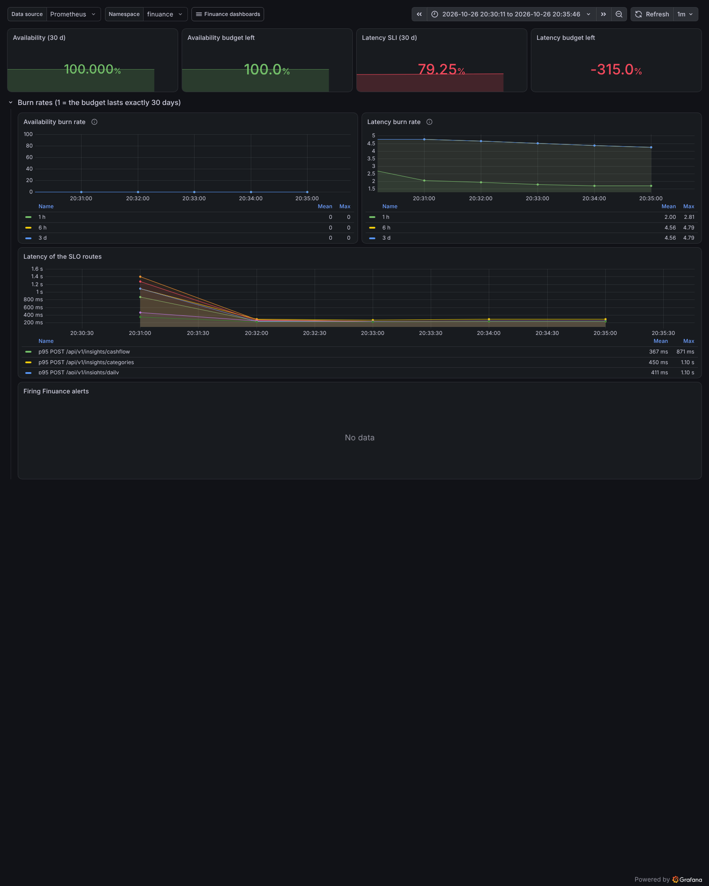
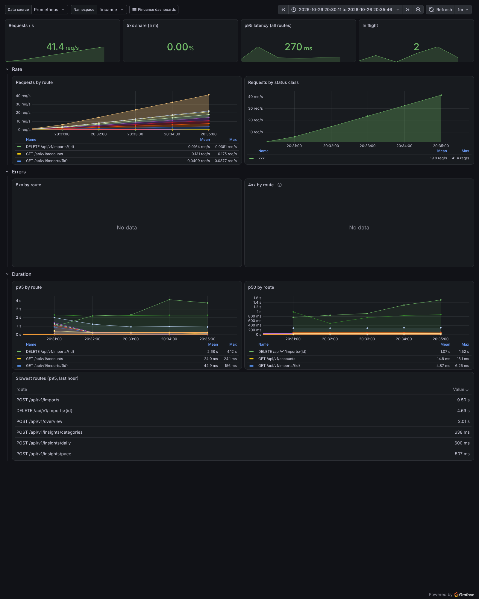
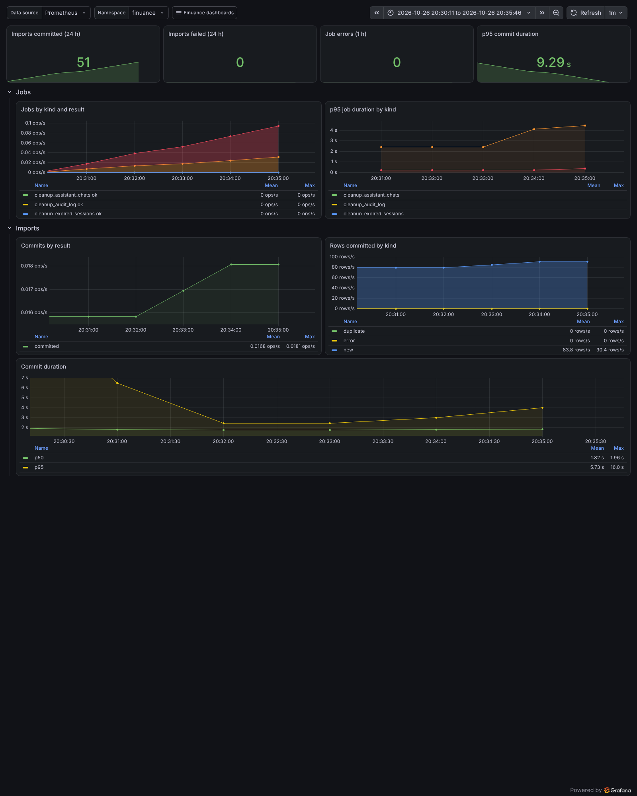
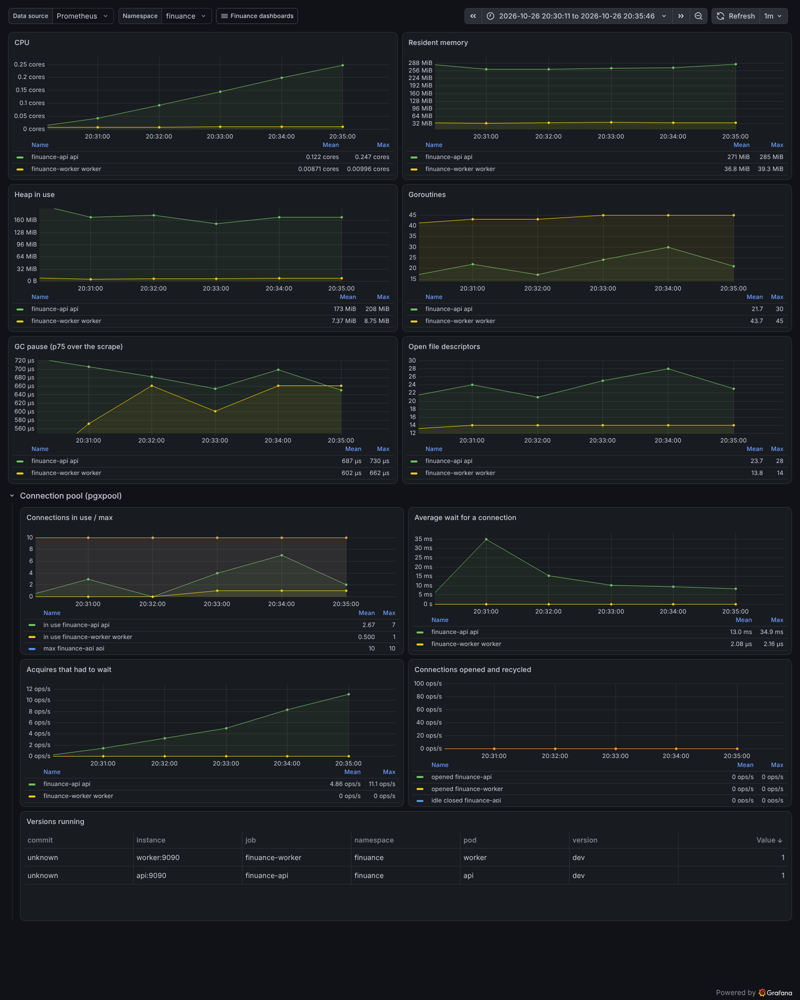

# Performance

Benchmark numbers and how they were reached. Each entry says which machine produced it, because the cloud sandbox is noisy and shares its CPUs.

## Ingest: `BenchmarkParse_100k` (Phase 3, task 3.14)

**What it measures:** the whole import pipeline on 100 000 rows (≈ 16.3 MB, Pekao layout) from the ported legacy demo generator (`internal/demo`):

1. decode;
2. delimiter detection;
3. tokenize;
4. shape;
5. column typing;
6. role detection;
7. `Stage` with fingerprints.

The benchmark is `backend/internal/ingest/bench_test.go`. Run it with:

```sh
cd backend && go test -short -run='^$' -bench='^BenchmarkParse_100k$' -benchmem -count=6 ./internal/ingest/
```

CI runs it with `-count=3` and writes the result to the `backend (Go)` job summary.

**Target (PLAN §3.14):** ≤ 500 ms per run, with allocations reported.

### Results — 2026-10-20, cloud sandbox

The sandbox is an Intel Xeon @ 2.80 GHz with 4 vCPUs (shared), running Go 1.27.3 on linux/amd64.

| Run | ns/op (6 runs) | Median | B/op | allocs/op |
|---|---|---|---|---|
| Before optimisation (`f69844e`) | 7.5–9.7 s | ≈ 8.5 s | — | — |
| After, 4 cores (`-cpu=4`) | 509–669 ms | **≈ 563 ms** | 272.7 MB | 2.49 M |
| After, 1 core (`-cpu=1`, 4 runs) | 1.22–1.41 s | ≈ 1.24 s | 272.7 MB | 2.49 M |

**Status:** the target is **not met on this machine**. The best runs reach 509–511 ms, and the median is ≈ 13 % over. The sandbox shares its CPUs, and the same binary varied by 30 % between runs. A dedicated 4-core machine should come in close to 500 ms, but that has not been measured yet. Compare with the CI job summary for a second data point.

### Where the time goes (one run, 4 cores, after optimisation)

| Step | Time |
|---|---|
| Decode (UTF-8 validation) | 12–24 ms |
| Delimiter detection | < 0.1 ms |
| Tokenize | 34–37 ms |
| Shape (public `Shape`, which copies rows; `Parse` trims in place) | 57–64 ms |
| Column typing (parallel per column) | 92–103 ms |
| Role detection | 10 ms |
| Stage + fingerprints (parallel chunks) | 212–224 ms |
| **Total** | **≈ 440 ms** |

The first run of the breakdown took 985 ms (a cold heap and GC warm-up). The benchmark loop sits between the warm and the cold runs, because it allocates 272 MB per run and the GC runs during the measurement.

### What changed (profile-driven, behaviour-preserving)

Every oracle comparison, golden file and fuzz invariant still holds after each change.

1. **`money.Split` without regexes.** The legacy-shaped currency regex backtracked on every cell. Hand-written checks replaced it:
   - a plausibility pre-check (a digit is present, at most 3 ASCII letters);
   - prefix/suffix currency stripping;
   - number-shape checks;
   - no copy when there is nothing to strip.
2. **`Norm` fast paths.** Pure ASCII is lowercased in one pass. Other text is decomposed per rune with NFD properties. Full NFD + lowercasing remains the fallback, which handles combining marks, Hangul, `Σ` and `İ`. `TestNormFastPathsMatchFull` checks the paths agree on the corpus and the edge cases.
3. **Byte tokenizer.** For ASCII delimiters (all real ones), plain fields are zero-copy substrings, and only quoted fields are assembled in a buffer. The rune state machine stays for other delimiters. `FuzzTokenize` checks the two produce identical output (≈ 3 M inputs in 5 minutes).
4. **Hand-written date scanners.** They mirror the legacy `isoDate`/`dmyDate` regexes, which stay in `values_test.go` as the reference.
5. **Cheap pre-checks.** `ParseDate` rejects cells shorter than 8 or not starting with a digit, and `ParseNumber` rejects text without digits, before any real parsing.
6. **Parallelism.** Columns are typed concurrently, bounded by `GOMAXPROCS`. `Stage` works in chunks of ≥ 2000 rows and merges in order, so the output is deterministic.
7. **Pre-sizing.** Records are counted by newline before tokenizing, row slices are sized from the previous row, and `Raw` is sized from the column count. `Parse` trims rows in place because it owns the tokenizer output.

**Tried and reverted:** normalising each cell before the join in `SearchText`. It saved CPU but raised allocations, and the total got slower.

### Further options (not done; the next phase that touches ingest can pick them up)

- `Stage` dominates. `SearchText` normalises the joined row, so `Norm` runs again over text that typing already looked at. Caching the per-cell lowercase/NFD form during typing would avoid the second pass.
- The 272 MB/op is mostly `Raw` pairs and the staged strings. An arena per import, or streaming staged rows to the database in batches instead of holding all of them, would cut GC time.
- Column typing parses every cell as a number *and* as a date. Stopping once a column can no longer reach the 90 % threshold would skip most of the work for text columns. `Column.Numbers`/`Dates` would then have to be filled lazily for the columns that need them.

## Store: staging insert of 100k rows (Phase 4, task 4.4)

**What it measures:** `ledger.CreateImport` for the 100k-row demo file (Pekao layout, 12 columns), already parsed and staged outside the timer. It covers:

- converting the rows to the `import_rows` form;
- the `imports` and `import_files` rows;
- 20 `INSERT … SELECT FROM unnest(…)` statements of 5,000 rows each, in one transaction under `WithUser`, against the testcontainers Postgres 18.6.

The benchmark is `backend/internal/ledger/bench_test.go`. Run it with:

```sh
cd backend && go test -run '^$' -bench 'CreateImport_100k' -benchtime=3x -count=3 ./internal/ledger/
```

It needs Docker. It isn't part of `make test`.

**Target (PLAN §9 Phase 4):** ≤ 3 s on a dev machine.

### Results — 2026-10-20, cloud sandbox (same machine as above; Postgres in Docker on the same 4 vCPUs)

| Run | ns/op (3 × 3 runs) | B/op | allocs/op |
|---|---|---|---|
| First version | 8.5–10.7 s | 1.30 GB | 4.60 M |
| UUIDs encoded as `[16]byte` | **8.0–9.7 s** | 1.24 GB | 2.80 M |

**Status:** the target is **not met in the sandbox**, by roughly 3×. The time is almost all server-side.

### Where the time goes

Measured with `EXPLAIN (ANALYZE, BUFFERS, WAL)` on one 5,000-row batch of demo rows, and with timers around each step of 100k rows:

| Step | Time |
|---|---|
| Convert `StagedRow` → `store.ImportRow` (raw JSON encoding) | ≈ 0.5 s / 100k |
| pgx encoding of the 27 parameter arrays | ≈ 0.4–0.6 s / 100k |
| Server: execute one 5,000-row batch | 285 ms (≈ 5.7 s / 100k) |
| — of which: parsing the `raw` text into `jsonb` | ≈ 95 ms (same batch with a tiny `raw`: 136 ms) |
| — of which: FK triggers (`import_id`, `user_id`, `transaction_id`), per row | ≈ 90 ms |
| Reference: copy the same 100k rows inside Postgres (temp table: no WAL, no FKs, no RLS) | 2.1 s |

The last row is the floor for this database container on this machine: even a server-side copy with no constraints takes 2.1 s. A dev machine with native Docker or a local Postgres should be faster, but that has not been measured yet.

### Tried and rejected

- **Batch size.** Batches of 1,000, 2,000, 5,000 and 20,000 rows, each on a fresh import in alternating order, were all within the run-to-run noise (±25 %). 5,000 is kept.
- **Pipelining** all 20 statements in one `pgx.Batch`: 11–14 s, slower than the loop (the whole batch is encoded before anything is sent).

### Options (need a decision; both change the §5.2 schema)

1. **Store `raw` as an array of values only** (`["02.01.2025", "-12,50", …]`), with the header names once per import (`imports.headers`). About half the server time goes into parsing the repeated `{"h": …, "v": …}` objects. Transactions would need their header names from the source import. That's a data-model change for an ADR.
2. **Drop the `user_id` foreign key on `import_rows`.** The row's import already belongs to the user, and RLS checks `user_id`. That saves one FK trigger per row (≈ 15 %).

Neither is done. The recommendation is to measure on a dev machine first (`make test-integration` already needs Docker there; the command above runs the benchmark), and to choose an option only if that also misses 3 s.

## Query engine: 100k transactions (Phase 7, task 7.11)

**Setup.** `TestQueryPerf` (`internal/query/perf_test.go`, opt-in with `FINUANCE_PERF=1`) imports 108,098 transactions for one user through the real import path: the demo generator over ten years, in 14 accounts with shifted ranges. It runs `VACUUM ANALYZE`, as autovacuum would after the imports, and then times `Engine.Page` (one window of 200 rows plus totals, stats, data range and `duplicatesSkipped`) 30 times per shape, discarding the first run. The full `EXPLAIN (ANALYZE, BUFFERS)` output of each statement is in [`perf-phase7-plans.md`](perf-phase7-plans.md); `Engine.Explain` produces it for any request.

### Results — 2026-10-21, cloud sandbox (4 vCPU, Postgres 18.6 in Docker, default settings)

| Shape | Rows | First version p50 / p95 | After tuning p50 / p95 | With our Product Engineer's decisions p50 / p95 |
|---|---|---|---|---|
| default sort, no filter | 108,098 | 255 / 296 ms | 77 / 101 ms | **76 / 102 ms** |
| default sort, deep window (offset 90,000) | 108,098 | 496 / 571 ms | 98 / 125 ms | **89 / 130 ms** |
| payee contains "kawiarnia" | 6,030 | 305 / 442 ms | 132 / 290 ms | 133 / 233 ms |
| search "blik warszawa" | 5,049 | 449 / 523 ms | 221 / 273 ms | **90 / 114 ms** |
| category = Transport, last 3 months | 82 | 275 / 341 ms | 98 / 128 ms | **107 / 138 ms** |
| sort by payee (Polish collation) | 108,098 | 369 / 419 ms | 141 / 167 ms | 162 / 181 ms |
| amount < −100, sorted by amount | 18,117 | 328 / 381 ms | 107 / 128 ms | **109 / 139 ms** |
| scrolling: window at 9,000, `includeTotals: false` | — | — | — | **7 / 12 ms** |
| scrolling: search window at 2,000, `includeTotals: false` | — | — | — | **33 / 48 ms** |

Target: p95 ≤ 150 ms on a dev machine. In the sandbox, the first request of six of the seven shapes meets it, and scrolling windows (`includeTotals: false`) are far below it. The exceptions are the payee "contains" filter (no trigram index on `payee_n`) and the full Polish-collation sort. Earlier phases measured this sandbox at roughly 2–3× slower than a dev machine, so both may meet the target on a dev machine; that is not verified.

### What changed (migration `00004_query_indexes.sql` and `internal/query/sql.go`)

1. **Covering index for the default order and the totals.** `tx_user_booked_idx` became `(user_id, booked_on DESC, seq) INCLUDE (id, account_id, amount_minor, balance_after_minor, is_transfer)`. Count, sum/avg/min/max and the date range of an unfiltered or period-only context are index-only scans. `user_id` and `is_transfer` must be in the index because RLS and the transfer filter read them.
2. **Only the joins a statement needs.** The totals and id lookups join accounts, categories and groups only when a filter or the sort column uses them. Always joining them prevented index-only scans.
3. **Late row lookup for windows.** The window finds its 200 ids first (`ORDER BY … OFFSET … LIMIT` on the narrow source, index-only for the default order), then joins the display columns for those rows. A deep window went from 90,200 full-row fetches to an index-only skip (rows statement 30 ms).
4. **`duplicatesSkipped` without the `import_rows` heap.** It was "linked rows − import-origin transactions", two full scans (about 240 ms, mostly reading the wide `import_rows` table). It is now "linked rows − distinct linked transactions", from the partial index `import_rows_linked_idx (user_id, import_id) INCLUDE (transaction_id) WHERE transaction_id IS NOT NULL` (30–65 ms). The two are equal because every import-origin transaction keeps at least one linked row; `TestDuplicatesSkippedFormula` checks that through commits, an override and a delete.
5. Fresh statistics matter: before `ANALYZE` the planner estimated 527 rows instead of 108,098 and chose nested loops (the first version's numbers above are already after `ANALYZE`; without it they were 1.3–2× worse).

### Decisions (our Product Engineer, Phase 7 gate)

- **`LIKE` may use the trigram index under RLS: option (a).** On a table with row-level security, PostgreSQL only uses *leakproof* operators as index conditions, because a non-leakproof one might reveal other users' rows before the policy filters them. `LIKE` (`textlike`) is not leakproof by default, so the `search_text` trigram index was unused. `deploy/db/bootstrap.sql` now runs `ALTER FUNCTION pg_catalog.textlike(text, text) LEAKPROOF` as superuser. `LIKE` errors only on a malformed pattern, never because of a row's value. `TestLikeIsLeakproof` checks the flag, and `TestQueryPerf` checks that search plans use `tx_search_trgm_idx`.
  - **A database bootstrapped before this change** needs it once, as superuser: `ALTER FUNCTION pg_catalog.textlike(text, text) LEAKPROOF;` in the `finuance` database (Compose: `docker compose exec db psql -U postgres -d finuance -c '…'`).
  - **Moving to a new cluster:** the flag lives in the database's catalog, so a dump/restore into a new cluster must repeat it.
- **`includeTotals: false`** on `POST /transactions/query` skips the totals, the stats, the data range and `duplicatesSkipped`. The grid sends it for every window after the first (Phase 8).

### Still open (no decision needed now)

- The payee/description/… "contains" filters scan the user's rows: only `search_text` has a trigram index. Indexes on the most-used `_n` columns are an option if real data needs them.
- **Collation sorts** (any text column) sort all of the user's rows. An expression index per sortable text column would serve them. That is 9 indexes, so it's not worth it at this scale.

## Deleting an import (Phase 10, found by the groups E2E)

Deleting the 917-row demo import took **~27 s** in the E2E stack (about 40k transactions across
all users). With `log_min_duration_statement` the time was all in `DeleteOrphanTransactions`.
`transactions.transfer_peer_id` references `transactions` with `ON DELETE SET NULL`, so PostgreSQL
looks for rows pointing at every deleted transaction, and without an index each look-up scanned the
whole table.

Changes:
- migration `00005_fingerprint_index.sql`: `tx_transfer_peer_idx` (partial, `transfer_peer_id IS
  NOT NULL`) → the same delete takes **164 ms**; and `import_rows_fp_idx` `(user_id, fingerprint)`
  for the per-fingerprint look-ups of re-materialisation and the duplicates window;
- `ledger.DeleteImport` re-materialises only the fingerprints other committed imports still contain
  (`FingerprintsWithRows`): the rest lost their transactions in the orphan clean-up. Deleting the only
  import of an account rebuilds nothing;
- `TestEveryForeignKeyIsIndexed` (store) fails for a new foreign key without an index on its columns,
  unless it is listed with the reason it doesn't need one.

## Table view: 100k rows (Phase 10, task 10.14)

**Setup.** `node tools/perf/grid.mjs` (against `make up`) signs up a user and imports 100,870
transactions: the legacy demo file copied 110 times, each copy a month earlier with its own
references, in 10 files (import ≈ 3 min in the sandbox). Headless Chromium at 1440×900 then scrolls
the grid, jumps around and applies filters; `--trace out.zip` records a Playwright trace (with
screenshots) of the measured part. Frame intervals come from `requestAnimationFrame`; script, layout
and style times from Chrome's `Performance.getMetrics`.

### Results — 2026-10-22, cloud sandbox (4 vCPU, software rendering)

| Measurement | Result |
|---|---|
| first paint of `/t/all` (100,870 rows) | 381 ms |
| idle frames | p50 16.7 ms, none over budget |
| wheel scrolling, 120 × 500 px, top | p50 16.7 / p95 33.4 ms; 114 of 264 frames > 17.5 ms |
| wheel scrolling, middle of the data | p50 16.7 / p95 33.4 ms; 115 of 262 frames > 17.5 ms |
| **same wheel steps over a static 5,000-row HTML table (no script)** | p50 16.7 / p95 66.7 ms; 113 of 319 frames > 17.5 ms |
| main-thread time per wheel step: script / layout / style / total | ≈ 4 / 3 / 3 / 21 ms |
| jump to the bottom / middle / top until no skeleton row | 15 / 79 / 19 ms (windows cached after the first visit; 303 ms cold) |

Filter-to-paint (Enter or the last keystroke → new count and first rows painted; 5 runs after a
warm-up; search includes its 120 ms debounce):

| Filter | p50 | max |
|---|---|---|
| search "blik warszawa" | 167 ms | 175 ms |
| payee contains "kawiarnia" | 100 ms | 140 ms |
| amount < −100 | 101 ms | 128 ms |
| date 2024 | 102 ms | 129 ms |
| category =Transport | 88 ms | 116 ms |

**Reading.** Filter-to-paint is within the §7.12 budget (≤ 300 ms p95) for every shape. For
scrolling, the sandbox can't show 60 fps for any page: a static table with no script at all drops
as many frames as the grid, because headless Chromium paints in software here (~10 ms of the 21 ms
per step). The grid's own work per step is about 4 ms of script plus 6 ms of layout and style.
**The 60 fps check needs a real browser with a GPU** — part of the gate's hands-on session.

Since Phase 11 the insights pane takes half the window above the grid; its own numbers (and the
grid's with the pane open) are in "Insights" below.

**What changed.** Rows are memoised (`DataRow`), so a scroll step renders only the rows that come
into view; that cut script time by ~15 %. The grid scrolls in windows of 200 rows with 10 rows of
overscan, as planned.

## Insights: 100k rows (Phase 11)

**Setup.** Server side, `TestInsightsPerf` (`internal/insights/perf_test.go`, opt-in with
`FINUANCE_PERF=1`) seeds the same 108,098-transaction user as `TestQueryPerf` and times the six
insight calls the pane makes, 20 runs each after a warm-up. In the browser, `tools/perf/grid.mjs`
now also waits, for every filter, until each insight response is in and two frames have been drawn
("filter-to-charts").

### Results — 2026-10-22, cloud sandbox (4 vCPU, Postgres 18.6 in Docker)

Server, p50 / p95 per call:

| Shape | summary | categories | cashflow | pace | payees | daily | all six, one after another |
|---|---|---|---|---|---|---|---|
| all time, no filter | 67 / 98 ms | 85 / 107 ms | 41 / 67 ms | 20 / 25 ms | 43 / 58 ms | 43 / 57 ms | 300 ms |
| last 12 months | 15 / 19 ms | 54 / 64 ms | 46 / 74 ms | 4 / 5 ms | 8 / 10 ms | 5 / 6 ms | 132 ms |
| one month | 2 / 3 ms | 38 / 50 ms | 38 / 59 ms | 2 / 3 ms | 2 / 3 ms | 2 / 4 ms | 84 ms |
| category = Transport, last 3 months | 5 / 6 ms | 43 / 104 ms | 83 / 122 ms | 4 / 7 ms | 2 / 5 ms | 3 / 4 ms | 141 ms |
| search "blik warszawa" | 37 / 55 ms | 66 / 83 ms | 19 / 24 ms | 33 / 41 ms | 19 / 46 ms | 34 / 39 ms | 207 ms |

Browser (100,870 rows, pane open; p50 / max of 5 runs):

| Filter | list painted | charts painted |
|---|---|---|
| search "blik warszawa" | 170 / 173 ms | 202 / 204 ms |
| payee contains "kawiarnia" | 85 / 104 ms | 118 / 137 ms |
| amount < −100 | 93 / 100 ms | 126 / 133 ms |
| date 2024 | 80 / 102 ms | 113 / 136 ms |
| category =Transport | 86 / 95 ms | 119 / 136 ms |

First paint of `/t/all` is 275 ms. The browser sends the six requests in parallel, so a filter
change waits for the slowest one, not their sum.

**Reading.** Every call is within the 150 ms p95 target, and the charts finish within the §7.12
budget (≤ 300 ms) for every filter. The two calls that read every month of the base rows, categories
(its colour ranking is all-time) and cash flow, are the slowest for short periods; both are aggregate
scans that an index can't shortcut, and they stay well within the budget at this size.

**What changed.** The first measurement had a first paint of 1,855 ms: the pane's six requests
started before the list's own and, over HTTP/1.1, the browser allows six requests per host, so the
list waited. The charts now load once the list's first window has arrived (`ChartEnv.ready`); later
filter changes send all seven at once (above). Behind TLS (HTTP/2, Phase 16) the limit goes away.

## Overview: 100k rows (Phase 12)

**Setup.** `TestOverviewPerf` (`internal/insights/perf_test.go`, opt-in with `FINUANCE_PERF=1`)
seeds the same 108,098-transaction user and times `insights.Overview` (everything
`POST /overview` returns, one read-only transaction), 20 runs after a warm-up.

### Results — 2026-10-23, cloud sandbox (4 vCPU, Postgres 18.6 in Docker)

| Shape | p50 / p95 |
|---|---|
| all accounts, latest month, 12 months | 192 / 216 ms |
| all accounts, 36 months | 198 / 218 ms |
| one account | 55 / 68 ms |
| category != Mieszkanie | 296 / 317 ms |
| search "blik warszawa" | 164 / 198 ms |

**Reading.** One call stands in for the twelve cards, so it is compared with the §7.12 budget for a
screen (≤ 300 ms) rather than with the 150 ms per insight call. The service call meets it except with
the negated category filter (317 ms p95); in the browser, through nginx and the Compose database, a
month step takes 428 ms p50, nearly all of it the server (drawing is ~41 ms). Both are above the
budget in this sandbox and need the homelab measurement. Four statements read every base row
(months, colour slots, recurring candidates, balance); in this sandbox the transactions table
(≈ 140 MB) doesn't fit the container's 128 MB of shared buffers, so each of them is a ~65 ms
sequential read. The negated category filter is the slowest shape because nearly every row passes
it. A larger `shared_buffers` on the homelab (Phase 16) is the first lever; the four scans could
also be folded into fewer statements if a real data set needs it.

Browser (`node tools/perf/overview.mjs --email …`, the 100,870-row user of `tools/perf/grid.mjs`,
`make up`, headless Chromium at 1440×900; p50 / p95):

| Step | Time |
|---|---|
| `POST /overview` through nginx (20 runs) | 310 / 366 ms |
| table → overview drawn (title-bar button to the balance card painted) | 463 / 481 ms |
| … of which before the overview request starts | 78 / 81 ms |
| month step (← to the page idle again) | 428 / 446 ms |
| … of which drawing after the response | 41 / 50 ms |

The overview's code is a separate chunk (12 KB gzip, PLAN §7.12) loaded 1.5 s after the app starts;
the overview request starts from the route's small entry component, in parallel with mounting the
page. A first version loaded the page with `React.lazy`: React holds a resolved Suspense boundary
back for ~300 ms, and the request only started after it (table → overview 810–1,120 ms).

**What changed.** The first measurement was 315 ms p95 unfiltered and 417 ms with the category
filter. Recurring detection took 180 ms: it counted months with `count(DISTINCT date_trunc(…))`,
which sorts per payee. It now counts them with two hash aggregates, and every month truncation
(`Months`, the per-month categories, recurring) truncates a `timestamp` instead of a `timestamptz`,
which skips the time-zone conversion per row.

## Phase 14: against the §7.12 budgets (task 14.5)

Re-measured on 2026-10-23 in the cloud sandbox (4 vCPU, Postgres 18.6 in Docker) with the same
108,098-transaction user, after the legacy migration and the assistant had landed. The overview numbers come from a run
alone on the machine; a first run next to an image build was 20–50 % slower and is not used.

**Bundle** (`npm run build`, gzip; budget: initial JS ≤ 250 KB, route-split chunks don't count):

| Chunk | gzip |
|---|---|
| initial JS (`index-*.js`: shell, table, insights, import window, settings, migration wizard) | **200.5 KB** |
| overview page (loaded at idle) | 12.3 KB |
| assistant panel (loaded when it first opens) | 7.8 KB |
| CSS | 12.3 KB |

**API, p95 at 108k rows** (`FINUANCE_PERF=1`):

| Call | Shape | Phase 7/11/12 | Phase 14 |
|---|---|---|---|
| `POST /transactions/query` | default sort, no filter | 102 ms | 61 ms |
| | deep window (offset 90,000) | 130 ms | 74 ms |
| | payee contains "kawiarnia" | 233 ms | 166 ms |
| | search "blik warszawa" | 114 ms | 85 ms |
| | category = Transport, last 3 months | 138 ms | 89 ms |
| | sort by payee (collation) | 181 ms | 116 ms |
| | amount < −100, sorted by amount | 139 ms | 74 ms |
| | scrolling window without totals | 12 / 48 ms | 5 / 27 ms |
| insights (six calls) | slowest call, all time | 107 ms (categories) | 138 ms (categories) |
| | all six one after another, all time | 300 ms | 327 ms |
| `POST /overview` | all accounts, 12 months | 216 ms | 237 ms |
| | one account | 68 ms | 74 ms |
| | category != Mieszkanie | 317 ms | 348 ms |
| | search "blik warszawa" | 198 ms | 208 ms |

**Reading.**
- The bundle is within budget with 50 KB to spare. The migration wizard sits in the initial chunk
  with the other settings pages; it can move to its own chunk if room runs short.
- Every table request except "payee contains" (no trigram index on `payee_n`, see Phase 7) is within
  150 ms p95, so filter-to-paint stays within the 300 ms budget measured in Phase 10.
- The insight calls and the overview are where Phases 11 and 12 left them (run-to-run noise in
  this sandbox is about ±15 %). The overview with a negated category filter is still above 300 ms
  here; the levers are unchanged (a larger `shared_buffers` on the homelab, Phase 16).
- Grid scrolling at 60 fps and filter-to-paint on the homelab remain the gate's hands-on checks
  (software rendering in the sandbox, see "Table view").

**Found by the E2E: a window run once per row.** On a fresh database (as in CI), a filtered
window of a 917-row account took 2.5–5 s. The table statistics dated from before the user's
import, so the planner estimated the user at 1 row and ran the window subquery
(`t.id IN (SELECT … ORDER BY … LIMIT 200)`) once per row of the user: 917 × 917 index reads. The
statistics were just stale until autoanalyze ran, so a real instance would hit this after the
first import of a new user. The window is now a `MATERIALIZED` CTE that runs once
(`query.windowFirst`, also used by the assistant's row lookup). `TestWindowWithStaleStatistics`
recreates the stale statistics (analyze, then a new user imports) and checks that the window
runs once; it fails on the old statement. The query rows above are measured with the CTE.

## Phase 15: recurring cadences (task 15.4)

Weekly and yearly payments need their own candidates (the legacy monthly prefilter drops most of
them). A second scan with its own aggregate made `POST /overview` ~100–400 ms slower at 108k rows,
so `query.RecurringCandidates` now computes both prefilters from one `(group, month, week)` hash
aggregate and returns the rows once, flagged monthly and/or other. The monthly candidates are the
same as before (`TestOverviewParity`).

`TestOverviewPerf`, p50 / p95 of 20 runs, same 108,098-transaction user:

| Shape | without cadences | one scan, both cadences |
|---|---|---|
| all accounts, latest month, 12 months | 202 / 239 ms | 224 / 277 ms |
| one account | 53 / 121 ms | 64 / 75 ms |
| category != Mieszkanie | 311 / 358 ms | 320 / 388 ms |
| search "blik warszawa" | 170 / 208 ms | 161 / 190 ms |

## Phase 17: load test (task 17.5)

Measured on 2026-10-26 in the cloud sandbox (4 vCPU shared by everything below, 16 GB) with
`make up-observability` (api, worker, web, PostgreSQL 18.6 with the Compose defaults —
`shared_buffers` 128 MB — and the local Grafana/Prometheus/Tempo container) and k6 in Docker on the
same machine. Data: `make loadtest-seed`, 50 users × 20,202 transactions (26 years of the demo
generator each) plus a few small users: 1.05 million transactions, a 4 GB database.
`make loadtest` (profile `load`, 5 minutes): 30 virtual users browsing the table (random filters,
search words, sorts, periods, two scrolled windows), 15 loading all six charts, 5 on the overview,
2 imports of a 5,000-row file per minute (upload, commit, poll, delete). The homelab numbers come
in Phase 18.

The load test found two bottlenecks that only show with many users or long histories. Both are
fixed.

### 1. A new user's first large import was quadratic

Seeding the first load-test user took over 2 minutes for 20,000 rows. auto_explain on the Compose
database showed the commit's link step (`LinkImportRows`, 119 s) and the duplicate check
(`FingerprintsSourcedLater`, 99.8 s) running nested loops that scanned all of the user's
transactions once per staged row. The planner's statistics predate the rows the commit has just
inserted in its own transaction, so it estimated the new account at a handful of rows. Running
`ANALYZE` inside the commit would fix the estimates, but it holds a lock until the commit ends and
would serialise imports. Instead, after inserting at least 1,000 transactions the commit turns off
nested loops for the rest of its transaction (`SET LOCAL enable_nestloop = off` through
`set_config(…, true)`, restored afterwards; `ledger.afterBulkInsert`), so steps 2–5 use hash joins,
linear in the import. Smaller imports keep the planner's per-row index lookups, which suit them.

| | before | after |
|---|---|---|
| link step, 20,000 rows | 119 s | 1.1 s |
| whole seed of one 20,202-row user (parse, stage, commit) | > 2 min | ≈ 8 s |
| 50 users × 20,202 rows | — | 6 min 42 s |
| `TestBulkCommitForANewUser` (≈ 10,000 rows after an `ANALYZE` of a small instance) | 27 s | 4.3 s |

### 2. Search cost grew with the instance, not with the user

The first `load` run failed the latency SLO (p95 671 ms). The database was the limit: the api used
a quarter of a core while the pool's waits averaged 33 ms. In the database log most slow
statements were searches (`search_text LIKE '%…%'`). The trigram index `tx_search_trgm_idx`
indexed `search_text` alone, so it returned the matching rows of *every* user. RLS and
`user_id = $1` then discarded all but one user's. That cost grows with the size of the instance.
Phase 7 measured one 108k-row user and could not see it.

`EXPLAIN (ANALYZE)` of the totals statement for one 20,202-row user, warm cache:

| search | index entries read | index scan | statement | after: entries | index scan | statement |
|---|---|---|---|---|---|---|
| `kawiarnia` | 58,661 (user: 1,127) | 69 ms | 85 ms | 1,127 | 4.2 ms | 26 ms |
| `blik` | 223,867 (user: 4,301) | 79 ms | 99 ms | 4,301 | 3.0 ms | 50 ms |
| `apteka` | 17,543 (user: 337) | 10.5 ms | 20 ms | 337 | 0.9 ms | 6.4 ms |

Migration `00011_search_index.sql` replaces it with a GIN index on `(user_id, search_text
gin_trgm_ops)`. `btree_gin`, a trusted contrib extension that ships with PostgreSQL, gives `uuid`
a GIN operator class (our Product Engineer's decision, 2026-10-26). The GIN scan intersects the
user's entries with the trigrams and reads only that user's matches. It is also smaller: 204 MB
instead of 265 MB for 1.05 million rows. Building it blocks writes to `transactions`. At
1 million rows that took 2 min 35 s with the default `maintenance_work_mem` and 24 s with the
256 MB the migration sets for itself. `TestSearchReadsOnlyTheUsersEntries` checks that a search
reads no more index entries than the user's own matches; on the old index it reads 4× as many
(four users).

### Results (`make loadtest`, profile `load`)

| run | requests | failed | median | p95 (SLO routes) | p99 |
|---|---|---|---|---|---|
| before (global trigram index) | 12,112 | 0 | 132 ms | **671 ms** ✗ | 1.32 s |
| after, warm database, run 1 | 12,772 | 0 | 63 ms | **303 ms** ✗ (by 3 ms) | 1.44 s |
| after, warm database, run 2 | 12,906 | 0 | 59 ms | **240 ms** ✓ | 520 ms |

**Breaking point** (`PROFILE=ramp`: table views without think time, 10 → 320 per second; each
view is the first window plus up to two scrolled ones). Rate and p95 of `POST
/transactions/query` per 30 s, from Prometheus:

| | p95 under 300 ms up to | saturated at | p95 when saturated |
|---|---|---|---|
| before | ≈ 18 requests/s (290 ms) | ≈ 31 requests/s | 29 s (k6: 14.2 s) |
| after | ≈ 45 requests/s (140 ms) | ≈ 57 requests/s | 9.8 s (k6: 7.6 s) |

Both times PostgreSQL used 3.2 of the 4 cores and the machine had no idle CPU at saturation, and
no request failed. On this shared 4-vCPU sandbox the table traffic the stack serves within the
SLO went up 2.5 times (18 → 45 requests/s), and its ceiling 1.8 times; the `load` profile sends
about 20 table requests/s besides the charts.

"SLO routes" are `/transactions/query` and `/insights/*` (docs/SLO.md). A run straight after a
database restart (cold cache, 128 MB of shared buffers for a 4 GB database) had a p95 of 1.79 s;
the numbers above are from a warm database. Runs vary by about ±25 % in this sandbox, which also
runs k6, Grafana and the build tools. Imports kept working under load: 100 % committed, a 5,000-row
commit took 4.7 s at the median (p95 15 s), and deleting one took 1.8 s.

Per route (Prometheus, p50 / p95 over the run; the latency histogram's buckets make these
approximate):

| route | before p95 | after p50 / p95 |
|---|---|---|
| `POST /transactions/query` | 804 ms | 68 / 296 ms |
| `POST /insights/*` (six) | 480–890 ms | 26–97 / 222–350 ms |
| `POST /overview` (outside the latency SLO) | 2.07 s | 290 ms / 1.23 s |

The overview is now the slowest request. It aggregates the whole history once per month card, and
the levers are the same as in Phase 14: more `shared_buffers` (the CloudNativePG values also keep
128 MB, to be sized in Phase 18) and caching the month aggregates. It stays outside the SLO.






Also found by the load test and fixed:
- the dashboards' availability, 5xx share, failed imports and job errors read *No data* while
  nothing had failed: the error series didn't exist yet. The recording rule and the panels now
  count a missing error series as 0 (`or vector(0)`), with a promtool test;
- the api's trace spans were named after the HTTP method only (otelhttp renamed them after the
  handler ran); they are named after the route again (`TestSpanNamedAfterRoute`);
- every k6 virtual user's sign-in rotated the previous user's session in a shared cookie jar (a
  test-script bug: each sign-in now has its own jar).
